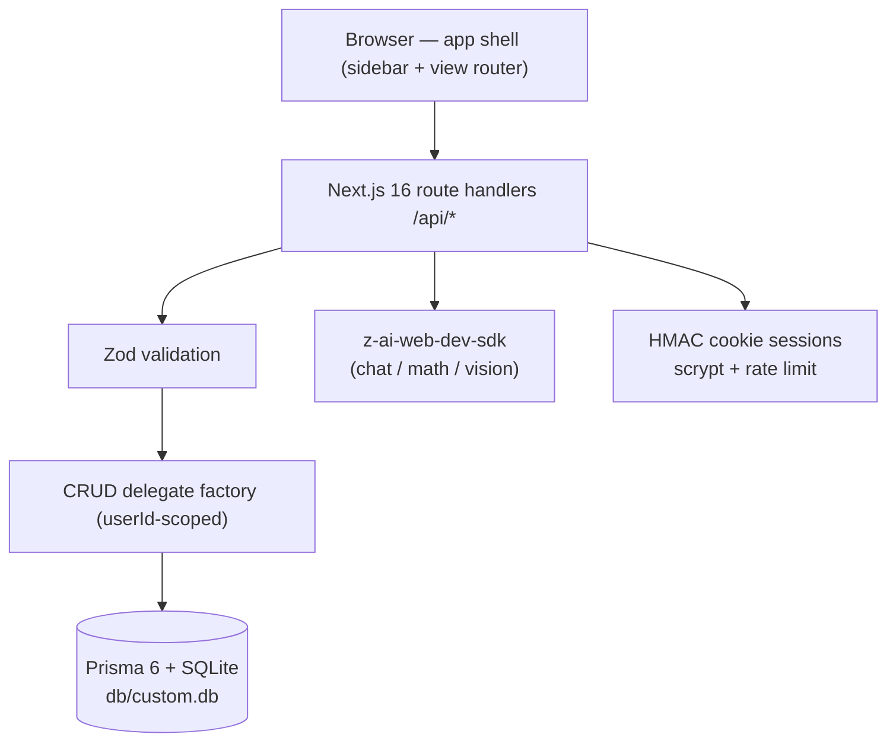

# StudyFlow (Omni-Study)

      

**StudyFlow — your study companion.** A production-ready, self-hosted clone (functional superset) of the [`omni-study1.base44.app`](https://omni-study1.base44.app/) study-planning app, rebuilt as a single Next.js application you fully own: your database, your AI keys, your deployment.

## Overview

The reference app is a study companion that keeps a student's whole life in one place — but it lives behind a hosted platform login with no source access. StudyFlow rebuilds every surface (and fills in the ones the reference left empty) as an open codebase: twenty views from the daily dashboard to a focus timer, all wired to real CRUD persistence through Prisma/SQLite. Visual parity was measured from the live reference (computed styles, not eyeballing), and the places where the framework changed underneath — Tailwind v4's engine differences chief among them — are documented and pinned by tests. Where the reference shows empty states, StudyFlow ships working features: an AI study assistant, a math solver that reads photographed problems, flashcard decks with a study mode, and a grade tracker with trend charts.

| | | |
|---|---|---|
|  |  |  |
|  |  |  |

All 20 views (plus the login card, three mobile captures, seven dark-mode captures, the session-17 fresh-user evidence set — zero-data Analytics/Grade Tracker, the reference-measured empty-state hints, the Settings Profile/Notifications tabs, the mobile StudyGroups copy — the session-11 audit evidence pair, the session-12 accessibility evidence set — forced-colors renders, print pages, the focused skip link — and the session-13 resilience evidence set — the AI-chat failure rollback, the solver's MIME guard toast, the remediated mobile drawer — and the session-14 hardening evidence set — the offline banner with the bounced-back composer, the AI rate-limit toast, the display-name guard) are in [`docs/screenshots/`](docs/screenshots/) — the standard 31 were refreshed after the session-11 theme-system remediation (`node scripts/capture-studyflow.mjs`); the S12 set via `node scripts/capture-s12-evidence.mjs` and the S13 set via `node scripts/capture-s13-evidence.mjs`, and the S14 set via `node scripts/capture-s14-evidence.mjs`, the S15 auth-flow set via `node scripts/capture-s15-evidence.mjs` (the login inline error, the signup form, the verify OTP screen, check-email, the calculator keyboard superset), and the S16 mobile set via `node scripts/capture-s16-evidence.mjs` (the auth sub-screens + the dashboard at 390×844 — the mobile-only responsive fixes; no default-media desktop visual changed in sessions 12–16; the prior pins are the byte-parity guarantee), the S17 fresh-user set via `node scripts/capture-s17-evidence.mjs`, and the S18 RUM set via `node scripts/capture-s18-evidence.mjs` (the beacon-live dashboard + mobile, the GET /api/rum aggregate, the un-instrumented login), and the S19 diagnostics set via `node scripts/capture-s19-evidence.mjs` (the `/rum` panel — desktop light + dark + mobile 390px), and the S20 v3 set via `node scripts/capture-s20-evidence.mjs` (the `/rum` panel with the per-card trend sparklines + the Export CSV action + the exported CSV head), and the S21 portability set via `node scripts/capture-s21-evidence.mjs` (the `/export` page — desktop light + dark + mobile 390px + the downloaded JSON envelope head), and the S22 boot-guard set via `node scripts/capture-s22-evidence.mjs` (the dev-server dashboard + `/export` + mobile 390px screenshots + the boot-guard evidence JSON — the negative spawn's exit + message, the positive-control health, the dev-boot warn line), and the S23 import set via `node scripts/capture-s23-evidence.mjs` (the `/export` page with the Restore card — desktop light + dark + mobile 390px + the completed-import result state + the API round-trip evidence JSON — the first import's summary, the idempotent re-import, the validation-error family, the rollback guard, the probe cleanup), and the S24 change-password set via `node scripts/capture-s24-evidence.mjs` (the Settings Profile tab with the Change password card — desktop light + dark + mobile 390px + the success-note state + the API round-trip evidence JSON — the guard family, the anon gate, the fresh-user rotation with the old-401/new-200 login pair, the session-survives proof, the demo restore), and the S25 account-deletion set via `node scripts/capture-s25-evidence.mjs` (the Settings Profile tab with the Danger zone card — desktop light + dark + mobile 390px + the revealed confirmation-form state + the API round-trip evidence JSON — the guard family, the anon gate, the fresh-user deletion with the DB-level cascade proof, the cleared-session me-401, the demo-intact proof), and the S26 email-change set via `node scripts/capture-s26-evidence.mjs` (the Settings Profile tab with the Email address card — desktop light + dark + mobile 390px + the success-note state with the live identity-block update + the API round-trip evidence JSON — the guard family incl. the same-email 400 + the duplicate 409, the anon gate, the fresh-user rotation with the DB-level emailVerified-stays-true proof + the old-401/new-200 login pair, the demo restore), and the S27 dark-sweep repair set (the before-state — MODE empty, 97 phantom flashbulbs + 7 phantom unreadable measured in LIGHT mode — and the after-state — MODE dark, all 20 views clean in real dark mode — with the guard's negative-control exit, the restore proof, and the refreshed standing 31) in `docs/screenshots/s27-dark-sweep-evidence.json`, and the S28 connectivity-repair set (the before-state — the phantom "Login offline shows no/silent feedback" finding whose own measured bodyText contained the offline message — and the after-state — "Login offline announces the failure through the S15 inline alert (stays on the card, button recovered)" with findings 0 — with the reproduction probe, the negative-control exit, the gates, and the refreshed standing 31) in `docs/screenshots/s28-connectivity-audit-evidence.json` + the login-offline inline-alert capture `s28-login-offline-inline-alert.png`, and the session-29 doc-alignment refresh (the standing 31 re-captured from the remediated codebase — docs-only changes, zero app bytes moved) per `docs/remediation-plan-session29.md`, and the session-30 dependency-security evidence set (the bun-audit classification envelope with the two documented non-production advisories, the negative controls, the gates) in `docs/screenshots/s30-dep-audit-evidence.json` per `docs/remediation-plan-session30.md`

## Key Features

| | Feature | What it does |
|---|---------|--------------|
| 📊 | Dashboard | Time-aware greeting, conditional overdue alert banner, four stat cards, today's tasks, upcoming exams & assignments |
| ☀️ | My Day | Quick-add tasks, amber "Today's Progress" card, Suggestions for overdue/upcoming tasks |
| ✅ | Tasks | Lists (custom lists + Important), search, filters, full CRUD — priority (colored round checkbox), repeat, My Day toggle, subtasks |
| 📅 | Calendar | Sunday-first month grid (dynamic week count) + day detail (border-l-4 colored rows), timeline agenda mode, icon+tab mode switch, legend |
| 🔔 | Events & Reminders | Dark terminal-style panel: 7-day sections, recurring events, multi-reminders, color-coded |
| 🏫 | Timetable | grid-cols-8 week table with full day heads + 60px hour rows, mobile day accordion, Grid Builder, alternating Week A/B, My Classes with today's date |
| 📚 | Assignments / Exams | Subject-tagged, urgency badges, status tracking — type + priority pills, interactive progress sliders; exam cards with subject color strips, durations, topics |
| 🗒️ | Notes | Notebooks, tags, pinned notes, autosaving editor |
| 🃏 | Flashcards | Two-panel view with colored deck swatches, card grid with difficulty badges, 3D-flip study mode, AI card generation |
| 📝 | Practice Tests | Question builder (manual + AI generation), score recording with completion % |
| 👥 | Study Groups | Members, next meeting, subject linking |
| 📈 | Grade Tracker | Gradient summary card + target/chart icons, weighted averages per subject, GPA, SVG trend chart |
| 🧠 | Analytics | Icon-block stat cards (Tasks Completed, Assignments, Focus Time, Upcoming Exams), axis-labeled area charts (7-day activity, focus gradient), grade trend, subject distribution |
| 📁 | Files | Folders, uploads (≤ 2 MiB), links, grid/list views |
| 🧮 | Calculator Suite | Basic, scientific (shunting-yard engine, no `eval`), GPA, unit converter + history |
| ƒ | Math Solver | AI step-by-step solutions — typed or photographed (vision) |
| ✨ | AI Assistant | Chat with six study-tuned quick modes, persisted history |
| ⏲️ | Focus Timer | Pomodoro/Deep Work presets, subject logging, session stats |
| 🎨 | Theme System | Light/Dark/System + seven accent colors + emoji avatars, persisted per user — dark mode fully re-themes every surface (a superset: the reference's own Dark option is a no-op), applies pre-paint (no light flash on load), themes the login route for dark-OS visitors, and System mode tracks OS theme changes live |
| ♿ | Accessibility | Forced-colors (Windows High Contrast) state restoration (system-color outlines on the selected day/today/active tab/active nav, the slider progress gradient), a skip-to-content link (WCAG 2.4.1), print that forces light + keeps essential backgrounds (`print-color-adjust: exact`) + a timetable week table that fits the page, and `prefers-reduced-motion` support — all supersets (the reference has none) |
| 🛡️ | Resilience | Failure-state hardening — every AI call carries a 120 s deadline (`AbortSignal.timeout`) so a hung backend never locks the composer; a failed AI send rolls the message back into the composer instead of orphaning it; the solver guards non-image files client-side; uploads reject nameless files; downloads speak RFC 5987 (`filename*=UTF-8''…`) so unicode filenames save correctly; verified at 300+ rows with zero main-thread blocking |
| 📡 | Connectivity | A global offline banner (amber pill, screen-reader announced) the moment the network drops — renders nothing while online (byte-identical DOM); transport failures toast a human message ("You appear to be offline…") instead of raw browser text; every per-request path recovers (bounced-back composer, dialogs that keep their forms, SPA navigation on cached data) — a superset (the reference has no offline handling) |
| 🔒 | Security hardening | Per-user AI rate limits (20 req/15 min on all four LLM routes — 429 with `Retry-After`), download responses carry `X-Content-Type-Options: nosniff` + `Cache-Control: private, no-store`, whitespace-only display names rejected — alongside the scrypt/HMAC/rate-limited auth baseline and the **AUTH_SECRET boot guard** (session-22): a production boot without a real `AUTH_SECRET` — missing, empty, or the public dev fallback pasted in — REFUSES to start, exiting with the `openssl rand -hex 32` remedy (dev/test keep the documented zero-config fallback with a one-line boot warning); weak-but-present secrets (< 32 chars) draw a boot warning |
| ♿ | AI accessibility | The assistant transcript and the math solver's solution are polite live regions (`aria-live` + `aria-busy`) — replies and solutions land announced for screen readers (WCAG 4.1.3); errors were already announced via the aria-live toast stack |
| 🔐 | Auth | Email & password (scrypt + HMAC cookie sessions), rate-limited — with the reference's full account journey: a real Create-your-account form, email verification (6-digit OTP, 15-minute one-shot codes), an unverified-login gate, a 3-state forgot-password flow (Reset your password → Check your email → the reset link), and inline form errors (the reference's red/green alert pattern). No SMTP in the self-hosted context: the verification code and reset link surface to the actor directly (ADR-013). Session-24 adds the account-security rotation: **a signed-in user changes their own password from Settings → Profile** (current-password proof + the register policy + the must-differ rule, rate-limited — a pure superset; the reference has no password surface) (ADR-022). Session-25 completes the ownership arc with the exit: **a signed-in user permanently deletes their own account from Settings → Profile → Danger zone** (password proof + the typed word DELETE + the ONE cascade write wiping every collection; the session cookie dies with the account — a pure superset; the reference has no deletion surface) (ADR-023). Session-26 adds the account-identity rotation: **a signed-in user changes their own login email from Settings → Profile → Email address** (password proof + the typed-twice confirm guarding the typo lockout + must-differ/uniqueness guards, rate-limited; the session survives — a pure superset; the reference has no email-change surface) (ADR-024) |
| ⌨️ | Calculator keyboard | The calculator accepts physical-keyboard input (digits, operators, Enter to evaluate, Backspace, Escape to clear) — a functional superset; the reference's calculator is click-only. Keystrokes never leak into form fields (GPA rows, converter inputs are guarded) |
| ⚡ | Load stability (CWV) | The authenticated shell pre-warms the active view's data IN PARALLEL with the auth call — the first paint renders with final geometry (dashboard CLS 0.00, was 0.117–0.125; Lighthouse-class mobile preset: login LCP ~640 ms, dashboard LCP ~2.4 s — both CWV-good, vs the reference's own 7.6–8.0 s login / 4.4 s + CLS 0.372 dashboard). Auth sub-screens render the reference's responsive mobile geometry (20px headings, 44px Sign in, the 76px verify rhythm) — measured at 390×844 on both apps |
| 🆕 | Fresh-user journey | A registered user's first run now mirrors the reference's measured zero state: Analytics and Grade Tracker render their stat cards at zero data (no empty-state blocks the reference never renders), every view's empty-state hint carries the reference's exact copy, Settings opens its five tabs with the reference's per-tab headers — and the Profile tab persists School Name, Grade Level (6th Grade → Graduate), a 1–12 hour Daily Study Goal and the Account-created line; the Notifications tab carries the persisted Enable Notifications master toggle (session-17) |
| 📡 | RUM observability | Real-user web-vitals monitoring (a pure superset — the reference has no field telemetry): the authed shell mounts an invisible beacon that reports TTFB/FCP/LCP/CLS/INP to the in-app `POST /api/rum` endpoint (batched, keepalive, failures swallowed); `GET /api/rum` answers p75 per metric + the recent samples for the owner. The beacon renders zero DOM — visual parity is untouched (session-18) |
| 📊 | RUM diagnostics panel | The owner-facing surface for the beacon's field data: the auth-gated `/rum` route renders the five Core Web Vitals at p75 with rating badges derived from the public CWV bounds, a samples line, the ten most recent events, and a Refresh action — themed (dark mode + the seven accents) through the production theme path, responsive to 390px, linked from NOWHERE (the shell's 20-link parity stays byte-intact; the owner navigates directly — see DEPLOYMENT.md §8) (session-19). Session-20 v3: each sampled card carries a SPARKLINE trend line (the metric's 20 most recent samples, oldest → newest — accent-themed SVG, edge cases unit-pinned) and an **Export CSV** action downloads the most recent 2000 events as a spreadsheet-ready RFC-4180 CSV (raw values, the S13/S14 download-header contract) |
| 💾 | Data portability | The "own your data" exit: `GET /api/export/data` downloads the user's COMPLETE content — all 20 collections (tasks, notes, decks, grades, files with payloads, …) in chronological order with ids/foreign keys intact — as a versioned JSON envelope (`format: studyflow-data-export`, `version: 1`; the hashless profile rides `user`; tokens, RUM telemetry, and the password hash are excluded by decision). The auth-gated `/export` page previews it: a per-collection count grid, the **Download JSON** action, and the format documentation — themed through the production path, responsive to 390px, linked from NOWHERE (the owner navigates directly — DEPLOYMENT.md §8.2) (session-21). Session-23 completes the round-trip: **`POST /api/import/data` restores an export into the importing account** — upsert-by-id (existing rows update to the file's values, new ids create with the importer's userId — the envelope is portable across accounts), all-or-nothing in ONE transaction (any failure rolls back completely), never deletes, content only (never identity); dangling optional FKs null (the schema's own SetNull semantics), a dangling required `cards.deckId` is a rejected corrupt envelope, folders sort parents-first with cycle rejection — all pre-validated by the pure seam so Prisma's P2003 never surfaces opaquely. The `/export` page's **Restore from a backup** card drives it (file picker + the created/updated result report; a 10 MiB cap + a 10/15-min rate limit) |
| 🐳 | Docker deployment | A production `Dockerfile` (multi-stage: prod-deps → standalone build → bun runtime) + `docker-compose.yml` with a SQLite volume, an auth-secret guard, an init profile (schema push + seed) and a healthcheck — one command from clone to container (`docker compose --profile init up`); the runtime layout is validated end-to-end outside Docker (session-18) |

## Architecture

| Layer | Technology | Version | Purpose |
|-------|-----------|---------|---------|
| Framework | Next.js (App Router) | 16.4.2 | One page + 20 path rewrites (SPA parity with the reference); the S88 security patch (GHSA-2464-fhr4-w9xw / GHSA-p3m5-59mp-jv5r / GHSA-673q-mjm6-r5xr — all fixed in 16.4.1+, the same-day advisories) |
| UI runtime | React | 19 | Client view switching inside a single app shell |
| Language | TypeScript | 5 (strict) | End-to-end types, no `any` |
| Styling | Tailwind CSS | 4 (CSS-first `@theme`) | v3-pinned palette/shadow tokens for reference parity |
| Components | Radix UI (shadcn-style) | current | Accessible primitives themed via CSS vars |
| Database | SQLite via Prisma ORM | 6.19.3 | Zero-config, single file at repo-root `db/` |
| State | Zustand | 5 | App/theme/data stores; URL is the routing truth |
| Validation | Zod | 4.6.5 | Every API boundary |
| AI | z-ai-web-dev-sdk | 0.0.18 | Server-only: chat, math solve, vision |
| Unit tests | Vitest | 5 | Pure seams (router, date, calculator, auth, schemas, view collections) |
| E2E tests | Playwright | 1.63 | Production standalone build + isolated `db/e2e.db` |
| Runtime | Bun | ≥ 1.3 | `bun run dev`, scripts, seed |



## File Hierarchy

```
📂 src/
├── 📂 app/
│   ├── 📄 page.tsx              ← the whole app: auth gate + shell + view switcher
│   ├── 📄 login/page.tsx        ← reference-parity login card
│   ├── 📄 globals.css           ← Tailwind v4 @theme tokens + trap pins
│   └── 📂 api/                  ← auth, health, 16 entity CRUDs, AI, files, settings
├── 📂 components/
│   ├── 📂 ui/                   ← button, card, dialog, select, tabs, toast, …
│   ├── 📂 layout/               ← sidebar (fixed glass) + mobile drawer chrome
│   └── 📂 views/                ← the 20 view components + shared primitives
├── 📂 lib/
│   ├── 📄 db-path.ts            ← the DATABASE_URL contract (unit-tested)
│   ├── 📄 db.ts                 ← Prisma singleton with env resolution
│   ├── 📄 auth.ts               ← scrypt, HMAC sessions, rate limiter
│   ├── 📄 router.ts             ← 20-view ↔ PascalCase-path map
│   ├── 📄 data.ts               ← client cache + typed mutations
│   ├── 📄 calculator.ts         ← shunting-yard engine, GPA, converter
│   ├── 📄 theme.ts              ← 7 accents, RGB-triplet tokens
│   └── 📂 server/               ← http helpers + entity CRUD delegates
├── 📂 prisma/
│   ├── 📄 schema.prisma         ← 24 models; DATABASE PATH CONTRACT header
│   └── 📄 seed.ts               ← idempotent demo data
├── 📂 tests/
│   ├── 📄 *.test.ts             ← Vitest unit layer (844 tests)
│   └── 📂 e2e/                  ← Playwright specs (310 specs)
└── 📂 docs/
    ├── 📄 Tailwind-V4-Validation-Report.md  ← the five documented v3→v4 traps
    ├── 📄 remediation-plan.md   ← session-2 parity audit: evidence, fixes, non-gaps
    ├── 📄 remediation-plan-session3.md ← session-3 mobile-chrome & token audit
    ├── 📄 remediation-plan-session4.md ← session-4 text-metrics & login audit
    ├── 📄 remediation-plan-session5.md ← session-5 interactive-chrome & view-body audit
    ├── 📄 remediation-plan-session6.md ← session-6 populated-state & row-design audit
    ├── 📄 remediation-plan-session7.md ← session-7 lightly-probed-views & flashcards audit
    ├── 📄 remediation-plan-session8.md ← session-8 deep-chrome/layout audit (16 gap families)
    ├── 📄 remediation-plan-session9.md ← session-9 data-state/chart-axes/icon audit (19 gap families)
    ├── 📄 remediation-plan-session10.md ← session-10 dark-mode consistency audit (the @theme inline token trap + 6 tint families)
    ├── 📄 remediation-plan-session11.md ← session-11 theme-system audit (pre-paint boot script + System tracking + accent-dark re-themes)
    ├── 📄 remediation-plan-session12.md ← session-12 accessibility audit (forced-colors state restoration + print + skip link + reduced-motion)
    ├── 📄 remediation-plan-session13.md ← session-13 resilience audit (AI failure states + upload edge cases; data-volume stress verified green)
    ├── 📄 remediation-plan-session14.md ← session-14 hardening audit (connectivity UX + settings guards + security headers/limits + AI live regions)
    ├── 📄 remediation-plan-session15.md ← session-15 auth-flow audit (inline errors + signup/verify/forgot/reset + calculator keyboard superset)
    ├── 📄 remediation-plan-session16.md ← session-16 CWV/mobile-geometry audit (load-stability pre-warm + responsive auth sub-screens + fresh copy sweep)
    ├── 📂 screenshots/          ← dev-server captures of every view (light + dark)
    └── 📄 DEPLOYMENT.md         ← production notes
```

## Quick Start

Requires **Bun ≥ 1.3** (or npm with Node ≥ 22 — swap `bun` for `npx`/`npm run`).

```bash
git clone https://github.com/nordeim/omni-study.git
cd omni-study
bun install

# Database — .env ships with DATABASE_URL="file:../db/custom.db";
# db/ lives at the repo root (git-ignored, recreated by these two commands):
bun run db:push
bun run db:seed

bun run dev
```

**Verify setup:**

1. `curl http://localhost:3000/api/health` → `{"status":"ok","db":"up","app":"studyflow"}`
2. Open <http://localhost:3000> → redirects to `/login`
3. Sign in with the demo account — **`demo@studyflow.app` / `Demo1234!`** — you land on the dashboard with seeded subjects, tasks, exams, notes, decks and grades.

## Environment Variables

Copy `.env.example` to `.env` (the defaults above already work locally):

| Variable | Required | Purpose |
|----------|----------|---------|
| `DATABASE_URL` | yes | `"file:../db/custom.db"` — resolved by `src/lib/db-path.ts` to `<repo>/db/custom.db` at runtime; the `db:*` scripts set it inline for the Prisma CLI (schema-anchored). Keep the value in sync with `prisma/schema.prisma`'s header note. |
| `AUTH_SECRET` | prod | HMAC key for session cookies. Generate with `openssl rand -hex 32`; a dev-only fallback is used when unset — and **enforced at boot in production** (the server exits with the remedy message instead of silently signing forgeable sessions). |
| `NEXT_PUBLIC_SITE_URL` | no | Canonical origin for metadata/sitemap. Defaults to `http://localhost:3000`. |

## Testing

```bash
bun run test        # Vitest — 844 unit tests (router, theme, date, calculator incl. mapPhysicalKey, auth incl. the AI rate-limit budget + the verification/reset seams, validation incl. verify/forgot/reset schemas + the S24 change-password rotation seam + the S25 deletion seam + the S26 email-rotation seam, db-path, site-url, theme-cache + boot-script contract + content-disposition + api-timeout + the offline transport-error mapping, rum-diagnostics — the CWV thresholds/panel display seam + the S20 sparkline geometry + the CSV builder, data-export — the S21 envelope/manifest/secret-guard seam, env-check — the S22 AUTH_SECRET boot-guard seam, data-import — the S23 envelope-validation/FK-pre-emption/folders-topo-sort seam, dep-audit — the S30 bun-audit parser/classifier seam, dev-preflight — the S31 dev-server boot-stability classifier seam, suite-verdict — the S32 standing-suite verdict seam [the anti-phantom shape-error guard + the three documented non-gap signatures] + the S33 mobile-sweep classifier [the light-mode 390×844 drawer-navigation sweep] + the S34 midband-sweep classifier [the light-mode 768×1024 drawer-navigation sweep — the md breakpoint, the 391–1023px band's representative width, with the chrome vehicle-contract class] + the S35 landscape-sweep classifier [the light-mode 844×390 phone-landscape drawer-navigation sweep — the HEIGHT axis the standing surface never varied, with the per-view heading-clearance key + the drawerNavScrollable short-viewport contract class] + the S36 dark-mobile-sweep classifier [the dark-mode 390×844 drawer-navigation sweep — the MODE axis at the mobile viewport the standing surface never varied, with the per-view flashbulbs/unreadable detector keys + the drawer dark record + the INDEPENDENT dark-detection counting] + the S37 accent-light-sweep classifier [the accent × light 390×844 sweep — the ACCENT axis in LIGHT mode the standing surface never varied, with the ALL-ACCENTS guard + the per-accent applied self-verification + the three signature-strict non-gap exemptions (the CTA-face, the calendar adjacent-month slate-300 days re-verified live on the reference, the yellow-500 priority-pill vocabulary)] + the S38 accent-dark-sweep classifier rebuild [the accent × dark MOBILE 20-view matrix — the pre-S38 mobile pass swept only 6 views; the ALL-ACCENTS + ALL-VIEWS + drawer-present anti-phantom guards, every view recorded explicitly on both surfaces, the per-accent applied self-verification, the mode/mobileViewport contracts, and the mobile scrollWidth overflow class] + the S39 accent-midband-sweep classifier [the accent × mid-band 768×1024 drawer-navigation sweep — the mid-band × accent cell never probed + the navigation-interaction gap: the accent sweeps navigate by direct goto, so the drawer's active-link tint was only ever read on the Dashboard link; with the ALL-ACCENTS + ALL-VIEWS + drawer-present guards, the vehicle-contract class, and the TWO interaction finding classes (the tint rot — activeTint "none", the S8 no-var class; the active-state mismatch — activeLabel ≠ the view)] + the S40 accent-landscape-sweep classifier [the accent × landscape 844×390 drawer-navigation sweep — the landscape × accent cell never probed (landscape-sweep is light+violet only) and the S39 interaction proof extended to the SHORT viewport, with the S35 short-viewport contracts (headingClearance + drawerNavScrollable) folded into the S39 accent shape] + the S41 accent-desktop-sweep classifier [the desktop light-accent sidebar-navigation sweep at 1280×800 — the documented S37 bracketed non-gap: accent-dark covers 1280 dark only, and the SIDEBAR-vehicle active-link tint was verified at ZERO views, ZERO accents, in either mode; with the INVERTED vehicle contract (sidebarVisible true + hamburgerVisible false), the sidebar-own scroll contract (sidebarNavScrollable at 800 height), the per-view headingOffset key, and the interaction finding classes on the DESKTOP vehicle]) + the S42 accent-volume-sweep classifier [the data-volume × dark × accent stress — the S13 volume profile (300/200/250) swept through the theme space's dark-accent half: the volume counts EXACT at the seam (a seed-volume envelope is its own rot class), the ALL-ACCENTS + ALL-VIEWS guards (the 7 volume-affected views — the S13 set), the per-view S13 measurement family (nodes/mainNodes/longTaskTotal ≤ 1500ms/clickLatencyMs ≤ 1500ms), the S38 dark detector family (flashbulbs always findings; the CTA-face exemption ONLY — the light-mode calendar-day + yellow-pill exemptions do NOT apply in dark), the interaction evidence in DARK (the never-read sidebar-tint cell), and the /api/tasks ≤ 500KB B1 bound]
bun run build       # REQUIRED before e2e — the suite boots the standalone server
bun run test:e2e    # Playwright — 310 specs against the production build on :3100
```

E2E notes: the suite pushes and seeds an isolated `db/e2e.db` (never touches `custom.db`), signs the demo user in **once** via a setup project (the login endpoints are rate-limited — 10 attempts/IP/15 min), and asserts the reference-measured design pins (sidebar geometry, v3 `shadow-sm`, canvas gradient, view-title model, stat-card text metrics, empty-state design, brand-gradient stops, login chrome, the session-5 interactive-chrome pins, the session-6 populated-row pins, the session-7 flashcards/timetable/analytics/dialog pins, the session-8 deep-chrome/layout pins, the session-9 data-state/chart-axes pins, the session-10 dark-mode consistency pins — the shadcn token utilities, banner/amber/clock/today/chart dark re-themes, the dark mobile drawer, and a light-mode byte-parity regression guard — the session-11 theme-system pins — pre-paint dark application, the dark-OS login, runtime System tracking, the theme-color meta, the accent-surface dark re-themes, print emulation, and a light regression guard — the session-12 accessibility pins — forced-colors state outlines + the bold active nav + the slider gradient, the skip link's Tab order/focus/Enter landing, the beforeprint/afterprint light-forcing, `print-color-adjust: exact` on the essential surfaces, the timetable print width reset, reduced-motion collapse, and a light regression guard — the session-13 resilience pins — the AI-chat failure rollback + recovery, the solver's client-side MIME guard with zero outbound requests, the nameless-upload rejection, and the RFC 5987 download header — and the session-14 hardening pins — the offline banner's appear/disappear + online absence (byte-parity guard), the human offline toast, the whitespace display-name 400 + trim-on-save, the AI-route per-user rate limit (20 then 429 with Retry-After), the download nosniff + private no-store headers, and the AI transcript/solver aria-live regions — and the session-15 auth-flow pins — the inline login-error alert with its measured chrome, the signup form's reference shape, the register→verify→signed-in journey via the surfaced code, the unverified-login gate, the forgot→check-email→reset-link→new-password journey, and the calculator's physical-keyboard superset including the form-field guard — and the session-22 boot-guard pins — the standalone production server spawned WITHOUT AUTH_SECRET exits non-zero with the actionable message (the `openssl rand -hex 32` remedy), and the positive control: the suite's own properly-configured boot answering `/api/health` — and the session-24 change-password pins — the anon 401 gate, the wrong-current/same-password/short-new 400 family (pre-write: the demo hash untouched), and the fresh-user rotation round-trip: register → sign in → the panel rotates → the old password login 401 → the new password login 200 → the session survives — and the session-25 account-deletion pins — the anon 401 gate, the wrong-password/wrong-confirmation/short-password 400 family (pre-write: the demo account untouched, still signing in), and the fresh-user terminal journey: register → sign in through the UI → the panel reveals the Danger zone form → the wrong-word early inline error → the deletion → the redirect to /login → the old-credentials login 401 → the cleared session's me 401 — and the session-26 email-change pins — the anon 401 gate, the wrong-password/mismatched-confirm/short-password/same-email 400 family + the duplicate-email 409 (pre-write: the demo account untouched, still signing in), and the fresh-user identity rotation: register → sign in through the UI → the panel's Email address card → the mismatched-confirm early inline error → the change → the success note + the identity block showing the NEW email (the live store update, both surfaces) → the session survives me 200 with the new email → the old-email login 401 → the new-email login 200). Full gate order: `lint → typecheck → test → build → test:e2e`.

## API Reference

All endpoints are same-origin JSON; sessions ride the `sf_session` cookie. 🔒 = requires authentication.

| Endpoint | Methods | Description |
|----------|---------|-------------|
| `/api/health` | GET | Liveness + DB probe (used by the e2e webServer gate + the Docker healthcheck) |
| `/api/rum` | POST/GET 🔒 | The RUM hook (session-18): POST a batched web-vitals report (upsert on sessionId+metric — final value wins, 1000/15-min per-user budget); GET answers p75 per metric + recent samples + the per-metric `trends` series (session-20) — the data behind the `/rum` diagnostics panel (session-19) |
| `/api/rum/export` | GET 🔒 | The CSV export (session-20): the user's most recent 2000 RUM events as a spreadsheet-ready `text/csv` download (RFC-4180 escaping, raw values, the attachment + nosniff + private/no-store header contract) |
| `/api/export/data` | GET 🔒 | The full-data export (session-21): the user's complete content across the 20 collections as a versioned JSON envelope download (chronological, ids/FKs intact, the hashless profile, the attachment + nosniff + private/no-store header contract) — the data behind the `/export` page |
| `/api/import/data` | POST 🔒 | The data import / restore (session-23): POST a `studyflow-data-export` envelope to restore it into the importing account — upsert-by-id in ONE all-or-nothing transaction (never deletes; content only, never identity; the importer's userId re-attached to every row), the seam's envelope validation (dangling optional FKs nulled, required `cards.deckId` rejected, folders sorted parents-first with cycle rejection), a 10 MiB body cap (413), a 10/15-min per-user rate limit (429), and the per-collection created/updated report as the response |
| `/api/auth/login` / `register` / `logout` / `me` | POST/GET | Rate-limited auth; no user enumeration. `register` creates an UNVERIFIED account + a 6-digit code (no auto-login — S15/ADR-013); `login` gates unverified accounts behind the reference's inline copy |
| `/api/auth/verify-email` / `resend-verification` | POST | The OTP flow: match the latest unexpired 15-min code → mark verified + sign in; resend re-issues for unverified accounts (uniform 200 otherwise) |
| `/api/auth/forgot-password` / `reset-password` | POST | The 3-state reset flow: always-200 request (reset URL in the response — the no-SMTP delivery), 30-min one-shot token consumption |
| `/api/auth/change-password` | POST 🔒 | The account-security rotation (session-24/ADR-022): `{ currentPassword, newPassword }` — the current password verified against the stored scrypt hash FIRST (a wrong current → 400, pre-write), the register family's min-8/max-200 policy on both fields, the must-differ rule (the schema's refine), a 10/15-min per-user rate limit (429 + Retry-After); the stateless session SURVIVES the owner's own rotation (documented — revoking other sessions is ADR-022's rejected alternative) |
| `/api/auth/delete-account` | POST 🔒 | The ownership exit (session-25/ADR-023): `{ password, confirmation: "DELETE" }` — the password verified against the stored scrypt hash FIRST (a wrong password → 400, pre-write), the typed-confirmation rule (the schema's refine — case-exact), a 10/15-min per-user rate limit (429 + Retry-After), then the ONE cascade write: `user.delete` wipes every collection (all 22 user relations carry `onDelete: Cascade` — subjects, tasks, notes, decks, grades, files, chat, RUM events, tokens); the session cookie is cleared with the account (maxAge 0 — the logout mechanism) |
| `/api/auth/change-email` | POST 🔒 | The account-identity rotation (session-26/ADR-024): `{ password, newEmail, confirmEmail }` — the password verified against the stored scrypt hash FIRST (a wrong password → 400, pre-write), the confirm-match rule (the schema's refine), then the route-side guards: must-differ (posting the current address → 400) + uniqueness (an address owned by ANY account, verified or not → 409), a 10/15-min per-user rate limit (429 + Retry-After), then the ONE write: `user.update` moves the login identifier (lowercased; `emailVerified` stays true — the password proof IS the verification); the session SURVIVES (stateless HMAC over the user id — the S24 contract) |
| `/api/tasks` (+ `/[id]`) | GET POST PATCH DELETE 🔒 | Tasks — lists, importance, due dates |
| `/api/task-lists`, `/api/subjects`, `/api/assignments`, `/api/exams`, `/api/events`, `/api/timetable`, `/api/notebooks`, `/api/notes`, `/api/flashcards/decks`, `/api/flashcards/cards`, `/api/practice-tests`, `/api/study-groups`, `/api/grades`, `/api/focus-sessions`, `/api/holidays` | GET POST PATCH DELETE 🔒 | Ownership-scoped CRUD via the delegate factory |
| `/api/files` (+ `/[id]`, `/folders`, `/link`) | GET POST DELETE 🔒 | Multipart upload ≤ 2 MiB (nameless files rejected), link-files, download with RFC 5987 filenames |
| `/api/settings/preferences` | PATCH 🔒 | Theme mode, accent, avatar, display name + the S17 study-profile fields (school, grade level, 1–12h study goal, notifications master) |
| `/api/calculator/history` | GET POST DELETE 🔒 | Persisted calculations |
| `/api/ai/chat`, `/api/ai/messages` | POST GET DELETE 🔒 | Study assistant (server-side SDK only; 20 req/user/15 min) |
| `/api/ai/generate-cards` | POST 🔒 | AI flashcard generation for a deck |
| `/api/ai/generate-questions` | POST 🔒 | AI practice-test question generation |
| `/api/math/solve` | POST 🔒 | Text or photographed problems (vision; 20 req/user/15 min) |

## Design System

Measured from the live reference (see `docs/Tailwind-V4-Validation-Report.md` for the full trap log):

| Token | Value | Usage |
|-------|-------|-------|
| Primary | `#8b5cf6` (violet-500) via `--sf-primary` RGB triplet | Active states, accents |
| Primary CTAs | `linear-gradient(to right, violet-500, indigo-600)` + v3 `shadow` — accent-aware via `.sf-gradient` (session-5 pin) | Every primary action button |
| Task rows | standalone `rounded-xl` cards, slate-200 border, 24px round priority-colored checkbox, slate-700 titles, due/repeat pills, hover-revealed actions (session-6 pin) | Tasks + My Day |
| Dashboard rows | bare `p-4 gap-4` rows, 20px round checkbox, title-only (session-6 pin) | Today's Tasks |
| Assignment rows | 24px round checkbox, blue due-in pill, priority/type pills, gradient progress slider + violet % label (session-6 pin) | Assignments |
| Exam cards | 3-col grid, `h-2` subject color strip, amber urgency badge, icon detail rows, type footer (session-6 pin) | Exams |
| Calendar cells | Sunday-first `aspect-square` centered cells (dynamic week count — 35 for five-week months), 4-color dots, SELECTED = solid accent fill + TODAY = 100-level tint (both hover-stripped), simple p-6 month card, legend + border-l-4 day-detail rows (session-6/S8-C/S9-E pins) | Calendar |
| Flashcards | two-panel layout: `w-80 border-r` deck sidebar with colored 40px icon blocks, deck color swatches, `lg:grid-cols-3` card grid with difficulty pills, 3D-flip study mode (session-7 pin) | Flashcards |
| Timetable grid | `grid-cols-8` week table, full day-name heads + `text-lg` dates, 60px hour rows with "7 AM" labels, mobile day accordion (session-7 pin) | Timetable |
| Analytics stats | r12 border-0 cards, 48px tinted icon blocks (violet/blue/green/orange-100), fraction values (session-7 pin) | Analytics |
| View titles | `h1 text-2xl font-bold text-slate-800` + 24px accent icon (MyDay/FocusTimer are 30px) | Every view header (session-4 pin) |
| Form controls | gray-200 borders, gray-950 text, gray-400 placeholders, `h-9` transparent inputs, v3 `shadow-sm` (session-5 pin) | Dialogs, selects, tabs, outline buttons |
| Dialogs | `max-w-md` (448px), `rounded-lg` (8px), 36px inputs (session-5 pin) | Every modal |
| Empty states | 80px rounded-2xl gradient block (`violet-100 → indigo-100`), 40px accent icon, 20px/600 h3, 16px hint | Every empty view (session-4 pin) |
| Events panel | `slate-900` rounded-2xl shadow-2xl terminal panel, cyan New Event link, `CW <n>` calendar-week label | Events view (session-5 pin) |
| Strong | `#7c3aed` (violet-600) | Links ("View All"), active nav text |
| Card | white, `1px solid #f1f5f9`, radius 16px | Every surface |
| Shadow | `0 1px 2px 0 rgb(0 0 0 / 0.05)` | v3 `shadow-sm`, **pinned** in `@theme` |
| Canvas | `linear-gradient(to right bottom, #f8fafc, #fff, #f5f3ff4d)` | App background |
| Sidebar | 260px fixed, `rgba(255,255,255,0.8)` + blur(20px) + white/50 hairline (`.glass`) | Hidden below `lg` |
| Mobile app bar | 64px fixed `.glass`, brand + live clock ("03:43 AM") | Content starts at 80px (both apps) |
| Mobile drawer | 288px white panel, `shadow-2xl`, 20% blurred backdrop, icon nav items | No footer (reference-exact) |
| Clock chip | `violet-50 → indigo-50` gradient (`rgb(245,243,255) → rgb(238,242,255)`), violet-700 time | Accent-aware via `--sf-primary-softest(-adjacent)` |
| Brand gradients | chips + CTA end **indigo-600** (`rgb(79,70,229)`); avatar runs violet-400 → indigo-500 (the lighter pair) | Accent-aware via `--sf-primary-gradient-to` / `-avatar-*` tokens |
| Accents | violet · blue · **emerald** · **amber** · pink · red · teal (session-5 migration — the reference's swatch faces) | Settings → Appearance |
| Font | system sans stack | Matches reference body styles |

Six accent themes × Light/Dark/System × 24 emoji avatars, all persisted to the user record.

## Deployment

The app builds to a **standalone server** (`output: "standalone"` in `next.config.ts`):

```bash
bun run build
bun run start        # NODE_ENV=production, serves .next/standalone
```

For production use an **absolute** `DATABASE_URL` (see `docs/DEPLOYMENT.md` §4) and set `AUTH_SECRET`. Deploy keys never live in the repo — pushes use the `docs/ssh_git_wrapper_v3.py` wrapper (see `docs/how-to-git-push-using-ssh-wrapper_SKILL.md`).

## Troubleshooting

| Symptom | Cause | Fix |
|---------|-------|-----|
| `{"status":"degraded","db":"down"}` on `/api/health` | No database file yet | `bun run db:push && bun run db:seed` |
| Prisma CLI created the db **one directory too high** | `.env`-loaded relative URLs anchor at the CWD | Use the `bun run db:*` scripts (they set `DATABASE_URL` inline, schema-anchored) — never raw `prisma db push` with the repo-root `.env` |
| E2E webServer timeout | `bun run build` not run since the last change | Rebuild, then `bun run test:e2e` |
| Dev server dies silently in low-memory containers | OOM-killed (`next-server` ~1.6 GB RSS) | Close extra headless browsers; rerun `bun run dev` |
| Login fails after many attempts | Rate limiter (10/IP/15 min) | Wait or restart dev; specs share ONE login by design |
| `space-y-*` gaps look wrong next to `mt-*` children | Tailwind v4 selector rewrite (trap 4) | Use `flex gap-*`; the codebase convention bans margin utilities inside `space-*` |
| The standalone production server exits at boot with `AUTH_SECRET is required in production` | The session-22 boot guard — the server refuses to sign session cookies with the public dev fallback | That is the guard working: generate a secret (`openssl rand -hex 32`), set `AUTH_SECRET` in the environment, restart (DEPLOYMENT.md §4) |

## Contributing

The verification gate before any push: `bun run lint && bun run typecheck && bun run test && bun run build && bun run test:e2e`. Conventions that differ from defaults: **Tailwind v4 CSS-first** (no `tailwind.config.js` — theme lives in `src/app/globals.css` `@theme`); **`gap-*` layout only** (never `space-y/x` with margin-carrying children); Zustand stores over Context; every API payload through its Zod schema in `src/lib/validation.ts`; `z-ai-web-dev-sdk` imported only inside route handlers.

## Project Status

| Phase | Status | Deliverables |
|-------|--------|--------------|
| Reference recon (all 20 views, computed-style tokens) | ✅ Complete | Traps + measured tokens in `docs/Tailwind-V4-Validation-Report.md` |
| Codebase build (20 views, 24 models, 40+ endpoints) | ✅ Complete | `src/**`, `prisma/**` |
| Test suites (93 unit + 91 e2e) | ✅ Complete | `tests/**` |
| Visual parity verification | ✅ Complete | `docs/screenshots/**`, `docs/remediation-plan*.md` |
| Session-2 parity remediation (radius trap, icons, avatar, clock) | ✅ Complete | `docs/remediation-plan.md` |
| Session-3 mobile-chrome & token remediation (fixed glass app bar + live clock, drawer mirror, greeting map, accent token completeness) | ✅ Complete | `docs/remediation-plan-session3.md` |
| Session-4 text-metrics & second-order remediation (v4 blur trap, stat-card metrics, reference empty states, view-title h1+icon model, login card, measured gradient stops, heading hierarchy) | ✅ Complete | `docs/remediation-plan-session4.md` |
| Session-5 interactive-chrome & view-body remediation (gradient CTAs, Events dark panel + repeat/reminders, FocusTimer/Settings/Calculator/Timetable/Notes/GradeTracker/Files/MyDay/AI reworks, gray form-control palette, dialog chrome, emerald/amber accents) | ✅ Complete | `docs/remediation-plan-session5.md` |
| Session-6 populated-state remediation (task card rows + priority/repeat/myDay/subtasks, MyDay amber progress card + Suggestions, dashboard bare rows, assignment sliders, exam card grid, calendar grid/legend/day-detail — measured against live reference data) | ✅ Complete | `docs/remediation-plan-session6.md` |
| Session-7 lightly-probed-views remediation (Flashcards two-panel view + deck colors + card grid + 3D study mode + AI card generation, Study Groups/Practice Tests measured dialogs + AI question generation, Timetable grid-cols-8 week grid + mobile accordion + week-alignment bug fix, Analytics icon-block stat cards + 7-day charts, Grade Tracker icons, Notes title input) | ✅ Complete | `docs/remediation-plan-session7.md` |
| Session-8 deep-chrome/layout remediation (nav icon set + active-gradient stop + tagline + 36px collapse button, dashboard flush divide-y rows, Calendar selected/today semantics + simple month card, MyDay header block + bare suggestions, Timetable today-header tint, Tasks two-pane, Notes/Study Groups two-pane reworks, Analytics per-card icons + donut + workload, Calculator/MathSolver/AI/FocusTimer/Settings icon-and-chrome fixes, Assignments/Exams search icons + slim exam cards, dead-utility sweep) | ✅ Complete | `docs/remediation-plan-session8.md` |
| Session-9 data-state/chart-axes remediation (dashboard overdue banner + slim section empty states, MyDay amber greeting empty state + bare quick-add row, Tasks outline filter button + empty My Lists, Calendar Sunday-first grid + icon/tab mode switch, Files house breadcrumb + grid3x3 toggle, text-only Grid Builder, Assignments Active-default slim rows, Exams orange Tomorrow badge, Analytics area charts with axes/gridlines, FocusTimer/Settings/Notes icon fixes, Flashcards deck-row ellipsis menu, AI wand-sparkles composer) | ✅ Complete | `docs/remediation-plan-session9.md` |
| Session-10 dark-mode consistency remediation (the `@theme inline` literal-token trap — shadcn base tokens now route through `hsl(var(--x))` runtime indirection so every `bg-card`/`bg-popover`/`bg-muted`/`border-input` utility re-themes in dark; dark washes for the overdue banner, MyDay amber card, timetable/calendar today tints, sidebar clock chip, settings selected cards; dark SVG chart axes/fills; the reference's Dark option measured as a platform no-op → the clone's full dark mode is the documented superset) | ✅ Complete | `docs/remediation-plan-session10.md` |
| Session-11 theme-system remediation (the theme-application lifecycle root cause — a pre-paint boot script + localStorage cache kills the dark-mode FOUC and themes the login route; System mode tracks OS changes at runtime; theme-color meta sync; the accent-dark re-themes for the active nav, ViewAll links, timetable mobile today chip, avatar swatch; minimal print styles) | ✅ Complete | `docs/remediation-plan-session11.md` |
| Session-12 accessibility remediation (forced-colors state restoration with system-color outlines, print that forces light + keeps essential backgrounds, the skip-to-content link, reduced-motion support) | ✅ Complete | `docs/remediation-plan-session12.md` |
| Session-13 resilience remediation (AI failure states — the optimistic-message rollback + the 120 s deadlines; upload edge cases — nameless-file rejection + RFC 5987 download filenames; data-volume stress verified green at 300+ rows) | ✅ Complete | `docs/remediation-plan-session13.md` |
| Session-14 hardening remediation (connectivity — the global offline banner + the human transport-failure message; security — per-user AI rate limits + download nosniff/no-store headers; settings — the whitespace display-name guard; AI a11y — transcript + solver live regions; 14 stale pre-clone scripts removed) | ✅ Complete | `docs/remediation-plan-session14.md` |
| Session-15 auth-flow remediation (inline login errors — the reference's red/green alert pattern; the full account journey — Create-your-account form, 6-digit email verification with an unverified-login gate, 3-state forgot-password + reset deep-links; the calculator's physical-keyboard superset with a guarded listener; Files search + pre-1.0 sweep verified as non-gaps) | ✅ Complete | `docs/remediation-plan-session15.md` |
| Session-17 fresh-user remediation (the reference's zero-data stat cards on Analytics/GradeTracker, the Settings depth — Profile school/grade/study-goal/notifications fields + per-tab headers + zero-empty states, the seven-view empty-state hint copy family, the mobile StudyGroups copy, zero-subject registrations) | ✅ Complete | `docs/remediation-plan-session17.md` |
| Session-18 RUM + Docker (the web-vitals beacon → POST/GET /api/rum with p75 aggregates, the Dockerfile + compose one-command deployment with the validated runtime layout) | ✅ Complete | `docs/remediation-plan-session18.md` |
| Session-19 RUM diagnostics panel (the auth-gated `/rum` surface — the five CWV at p75 with public-bound rating badges, the recent-samples table, the pure display seam, zero nav linkage) | ✅ Complete | `docs/remediation-plan-session19.md` |
| Session-20 RUM panel v3 (the per-card sparkline trends + the CSV export route — the additive `trends` aggregate field, the RFC-4180 seam, the S13/S14 download-header contract) | ✅ Complete | `docs/remediation-plan-session20.md` |
| Session-21 data portability (the full-data export — the versioned JSON envelope via `GET /api/export/data`, the 20-collection manifest + the row normalizer + the secret guard, the server-gated `/export` count-grid page, zero nav linkage) | ✅ Complete | `docs/remediation-plan-session21.md` |
| Session-22 AUTH_SECRET boot guard (the production fail-fast — the pure `env-check` seam, the `instrumentation.ts` boot hook with the validated process.exit mechanism, the single-source `DEV_FALLBACK_SECRET` refactor, the 64-hex e2e secret) | ✅ Complete | `docs/remediation-plan-session22.md` |
| Session-23 data import (the restore — the pure `data-import` seam with the FK pre-emption + the folders topological sort, the `POST /api/import/data` upsert-by-id all-or-nothing transaction, the `/export` page's Restore card, the 10 MiB cap + rate limit) | ✅ Complete | `docs/remediation-plan-session23.md` |
| Session-24 change-password flow (the account-security rotation — the `changePasswordSchema` seam with the must-differ refine, the `POST /api/auth/change-password` current-password-proof route, the Settings Profile tab's Change password card, the stateless session-survives contract) | ✅ Complete | `docs/remediation-plan-session24.md` |
| Session-25 account-deletion flow (the ownership exit — the `deleteAccountSchema` seam with the typed-DELETE refine, the `POST /api/auth/delete-account` password-proof cascade route, the Settings Profile tab's Danger zone card with the two-step reveal, the session-dies-with-the-account contract) | ✅ Complete | `docs/remediation-plan-session25.md` |
| Session-26 email-change flow (the account-identity rotation — the `changeEmailSchema` seam with the confirm-match refine, the `POST /api/auth/change-email` password-proof route with the must-differ/uniqueness guards, the Settings Profile tab's Email address card with the live identity-block update through the theme store, the session-survives contract) | ✅ Complete | `docs/remediation-plan-session26.md` |
| Session-27 dark-sweep audit-tool repair (the tooling-integrity fix — the standing dark-mode audit had silently rotted after the S11 theme lifecycle: the forced-class + stale `sf-theme-mode` key measured LIGHT mode and reported 97 phantom flashbulbs; now sets dark through the settings API, self-verifies the precondition with a loud non-zero exit, rides the applied mode in the JSON envelope, and restores light — the self-verifying-precondition doctrine for every probe) | ✅ Complete | `docs/remediation-plan-session27.md` |
| Session-28 connectivity-audit repair (the tooling-integrity fix — the A4 login-offline probe had silently rotted after the S15 auth-flow change: it still asserted the S14-era toast design while S15 replaced the login card's errors with the reference's measured INLINE role=alert, so the audit emitted a phantom "no/silent feedback" finding whose own measured evidence disproved it; now asserts the designed channel — the S15 inline alert scoped to the auth card, the user stays on the card, the button recovers — with the loud genuine-failure criterion kept; validated with the reproduction probe + the negative control; the standing 31 refreshed) | ✅ Complete | `docs/remediation-plan-session28.md` |
| Session-29 documentation-drift repair (the doc-alignment fix — every standing audit re-ran GREEN with zero code findings and the reference re-swept UNCHANGED, so the sweep's genuine defect family was the prose layer: the doc claims had drifted under additive change — the schema's 24 models were documented as "22" (written at S18, forgetting the S15 token pair) in CLAUDE/PAD/README and "21" (the pre-S15 list) in SKILL; PAD's "registration seeds three starter subjects" contradicted ADR-015's zero-subjects, its "ships no Dockerfile" contradicted ADR-016's shipped Dockerfile + compose, its "no reduced-motion yet" contradicted ADR-010's resolved block, and its tree listed a `src/hooks/` that never existed; SKILL §11 carried thirteen-session-stale test counts (106/194 vs 549) and §5 named the pre-S4 `backdrop-blur-sm` where the code ships `backdrop-blur-xs`; all layers re-aligned against the executable truth, with the "all 22 user relations" claims verified correct and left untouched; AP-74 records the lesson) | ✅ Complete | `docs/remediation-plan-session29.md` |
| Session-30 dependency-security audit (the never-audited surface — `pre15-preflight` measures outdated-count only; its "no action" verdict stood while `bun audit` carried 2 HIGH advisories: `braces` <=3.0.3 [dev-only via eslint-config-next; 3.0.3 IS the latest npm version — no upstream patch exists] and `deepmerge-ts` <8.0.0 [CLI-only via `@prisma/config`'s exact 7.1.5 pin; never in the standalone trace] — both verified NON-PRODUCTION against the 13-root `.next/standalone/node_modules` trace. The repair: the standing `bun scripts/dep-audit.mjs` probe — parses bun's text report, classifies every advisory by RUNTIME REACHABILITY against the standalone trace, FAILS loudly (exit 1) on anything runtime-reachable, documents the dev/CLI family with evidence, and self-verifies its preconditions [trace exists + newer than `bun.lock`, else exit 1 with no findings]; the pure seam `src/lib/dep-audit.ts` + 15 unit pins; validated with the negative controls [a fabricated runtime advisory exits 1; the stale-trace precondition exits 1 with zero findings]) | ✅ Complete | `docs/remediation-plan-session30.md` |
| Session-31 dev-server boot-stability preflight (the environment precondition no probe verified — a stale Turbopack `.next/dev` cache put `/login` into a sustained full-page reload loop [17+ main-frame navigations per 15 s; React never hydrated] that SURVIVED a clean daemon restart while `/api/health` stayed 200 — the audits then failed OPAQUELY, a 30 s click timeout naming the disabled login button instead of the cache; the S9 lesson's "restart the daemon" remedy proved INSUFFICIENT — only `rm -rf .next/dev` clears it. The repair: the standing `bun scripts/dev-server-preflight.mjs` preflight — loads `/login`, counts same-path navigations over an 8 s post-load window, fills the demo credentials and waits for the submit button to enable [NEVER submits — zero login requests], classifies through the pure `src/lib/dev-preflight.ts` seam [green / reload-loop / no-hydration / unreachable, each with its honest class-specific remedy], exits 1 loudly on every failure class; 11 unit pins + the negative controls [dead port → `unreachable`; a scratch self-reloading login-shaped page → `reload-loop` with the cache-clear remedy; healthy server → GREEN]) | ✅ Complete | `docs/remediation-plan-session31.md` |
| Session-32 standing-suite orchestrator (the operating procedure that existed only in prose — `bun scripts/standing-suite.mjs`: the S31 preflight enforced first, each standing audit spawned EXACTLY ONCE with its stdout classified through the unit-pinned `suite-verdict` seam; the anti-phantom guard [a missing key on a known audit is a LOUD shape-error, never a silent 0] — five of sixteen envelopes had been mis-parsed by careful operators, and the S29/S31 double-run phantom recurred a third time; the genuine defect the strict reading surfaced: the ai-a11y-audit's D2 probe leaked a probe pair into the demo chat DB on EVERY run [unroute-before-release order — fixed to reload-first per the S14 lesson + a closing Prisma cleanup; 4 stale pairs purged, dark/accent sweeps re-green], plus the :3200 standalone auto-start with ephemeral AUTH_SECRET and the demo-theme closing guard) | ✅ Complete | `docs/remediation-plan-session32.md` |
| Session-33 mobile light-mode sweep (the manual 390×844 walkthrough every session ran as prose, encoded as a standing probe — `node scripts/mobile-sweep.mjs`, the suite's 16th audit stage: all 20 views navigated THROUGH THE DRAWER with per-view identity-heading [h1-or-h2, the S8-H mobile-stack pattern], no-horizontal-overflow [scrollWidth ≤ 390 — the S16 mobile-only-gap class], drawer-closes-on-navigation, fixed glass app bar, zero console errors; self-verifying preconditions [viewport asserted, light mode through the settings API]; the genuine defect the first run surfaced: the clone's Notes mobile stack had LOST the identity heading the reference renders [its own two-pane overflows to 416px at 390 — the clone's no-overflow stack is the superset, but the heading was missing; fixed with the StudyGroups S8-H h2 pattern, desktop bytes untouched]; the reference's own mobile overflow documented on 5 views [Notes 416, Timetable 395, Flashcards 391, Calculator 429, MathSolver 417] where the clone stays 390) | ✅ Complete | `docs/remediation-plan-session33.md` |
| Session-34 mid-band light-mode sweep (the 391–1023px viewport continuum between the pinned widths — the whole band the standing surface never probed: mobile pins 390, desktop pins 1280/1440, the lg pin covers only the sidebar appearance at 1024 — encoded as a standing probe: `node scripts/midband-sweep.mjs`, the suite's 17th audit stage, at 768×1024 the md breakpoint [the switchiest width in the band: the Timetable swaps its mobile accordion for the min-w-[900px] scroll canvas, grids go multi-column, headers go flex-row] and iPad portrait; all 20 views navigated THROUGH THE DRAWER [the navigation vehicle through the whole band — the sidebar is lg:flex] with the S33 assertion family + the chrome vehicle-contract class [sidebar hidden + hamburger visible at 768 — a broken lg contract reads non-green at the seam]; this session's exploration validated the whole band clean [640/767/768/1023 × 20 views, findings 0]; AP-79 — a viewport band between pinned widths is a blind band) | ✅ Complete | `docs/remediation-plan-session34.md` |
| Session-35 phone-landscape short-viewport sweep (the HEIGHT axis the standing surface never varied — every pinned viewport was portrait-tall [390×844, 768×1024, 1280×800, 1440×900, 1024×800 — heights 800–1024]; the phone-landscape class [844×390, a real and common device class] had zero coverage, and its height-dependent structures — the drawer nav whose scroll is the ONLY path to links 8–20 at 390 height [measured: scrollHeight 1068 vs clientHeight 301], the fixed h-16 app bar at 16% of the viewport, the pt-* heading clearance under it, the h-[calc(100vh-8rem)] panes at 262px — were guaranteed by nothing — encoded as a standing probe: `node scripts/landscape-sweep.mjs`, the suite's 18th audit stage, at 844×390 the iPhone-class landscape; all 20 views navigated THROUGH THE DRAWER with the S33/S34 assertion family + the per-view heading-clearance pin + the short-viewport contract [drawerNavScrollable MUST be true — the nav geometry class this audit owns]; this session's exploration validated the whole landscape band clean [740×360, 844×390, 932×430 × 20 views + the 320×568 edge, findings 0]; AP-80 — an axis never varied is an axis never verified) | ✅ Complete | `docs/remediation-plan-session35.md` |
| Session-36 dark-mode mobile sweep (the MODE axis at the mobile viewport the standing surface never varied — dark × mobile was covered for 6 of 20 views [accent-dark-sweep's mobile pass], 14 views had NEVER been rendered in dark at the stacked mobile layout by any standing audit, and every light mobile sweep is mode-rot-guarded by construction — encoded as a standing probe: `node scripts/dark-mobile-sweep.mjs`, the suite's 19th audit stage, the S33 mobile sweep's dark sibling at 390×844; all 20 views navigated THROUGH THE DRAWER in dark mode [PATCHed through the settings API — the real lifecycle, self-verified] with the S33/S35 structural family + the dark-sweep detector family [flashbulbs/unreadable] extended to the mobile chrome + the drawer's own dark rendering [the dark:bg-slate-950 panel]; the dark detections counted INDEPENDENTLY of the findings array at the seam; this session's exploration validated the whole dark-mobile family clean [dark × 390×844, dark × 768×1024, dark × 844×390, findings 0 everywhere]; AP-81 — a mode never varied at a viewport is a blind combo) | ✅ Complete | `docs/remediation-plan-session36.md` |
| Session-37 accent × light sweep (the ACCENT axis in LIGHT mode the standing surface never varied — the accent-dark-sweep varies the accent ONLY in dark [its own name is the blind spot], every light pin rides the default violet, and the only light × non-violet rendering in any standing artifact was ONE desktop calculator e2e view; NO standing audit had ever rendered ANY view in a non-violet accent in light mode — encoded as a standing probe: `node scripts/accent-light-sweep.mjs`, the suite's 20th audit stage; for every accent [7 — the ALL-ACCENTS seam guard], PATCHed through the settings API and SELF-VERIFIED on `<html data-accent>`: all 20 views at 390×844 with the identity heading + scrollWidth + the LIGHT contrast detector family [unreadable/lowcontrast — the flashbulb class does not apply on the light canvas] + zero console errors, plus the drawer per accent [the active-link 10%-alpha accent gradient]; three signature-strict non-gap exemptions at the seam [the CTA-face, the calendar adjacent-month slate-300 days — re-verified LIVE on the reference this session, the yellow-500 priority-pill vocabulary]; the reference's accent picker saves but never re-themes — a SUPERSET-quality contract; this session's exploration validated the whole accent-light family clean [390×844, 1280×800, 768×1024 × 7 accents × 20 views]; AP-82 — an accent never varied in light is a blind half of the theme space) | ✅ Complete | `docs/remediation-plan-session37.md` |
| Session-38 accent × dark mobile 20-view matrix (the documented S37 next-step: the accent-dark family's own mobile pass swept only 6 of 20 views — MOBILE_VIEWS — so 14 views had NEVER been rendered in dark × accent at the stacked mobile layout by any standing audit [mobile/midband/landscape: LIGHT + violet-only; dark-mobile: violet-only; accent-light: LIGHT-only]; the accent-dark-sweep probe EXTENDED to all 20 mobile views per accent at 390×844 + the drawer per accent, with the omission-means-clean recording RETIRED — every view recorded explicitly on both surfaces, the per-accent applied self-verification, the mode/mobileViewport contracts, and the mobile scrollWidth overflow class; the seam rebuilt on the S37 doctrine with the ALL-ACCENTS + ALL-VIEWS + drawer-present guards [a missing accent/view/drawer is a LOUD shape-error, never green-by-omission]; the drawer-open failure now a FINDING, never a swallow; the exploration validated the whole family clean [7 accents × 20 views + the drawer, 0 flashbulbs, 0 non-exempt unreadable, 0 overflow]; AP-83 — an audit whose envelope cannot prove its own coverage cannot be green) | ✅ Complete | `docs/remediation-plan-session38.md` |
| Session-39 accent × mid-band drawer-navigation sweep (the S38 summary's named next step — "the drawer-navigation × accent interaction at mid-band": the mid-band 768×1024 × accent cell of the theme-space matrix was ZERO-coverage [midband-sweep is light+violet only; the accent sweeps are 390/1280 only], AND the navigation-interaction gap — the accent sweeps navigate by direct goto, so the drawer's active-link accent tint was only ever read on the DASHBOARD link; the tint on a NON-Dashboard view, applied through the real navigation lifecycle [aria-current moves → the .sf-nav-active 10%-alpha gradient re-tints], was verified at ZERO views, ZERO accents, in either mode — encoded as a standing probe: `node scripts/accent-midband-sweep.mjs`, the suite's 22nd audit stage [20-min budget]; for every accent [7 — the ALL-ACCENTS guard], PATCHed + SELF-VERIFIED, all 20 views navigated THROUGH THE DRAWER with the S34 structural family + the S37 light contrast family + the per-view interaction evidence [activeLabel MUST equal the view — the active state follows the navigation; activeTint MUST read a gradient — "none" is the S8 no-var rot class, a FINDING] + the drawer record per accent with the tint on the FINAL navigated view; the dark × mid-band combos remain the documented S36 non-gap family; AP-84 — an interaction never varied is an interaction never verified) | ✅ Complete | `docs/remediation-plan-session39.md` |
| Session-40 accent × landscape drawer-navigation sweep (the S39 summary's named next step — "the landscape × accent drawer-navigation combo (the 844×390 sibling)": the landscape 844×390 × accent cell of the theme-space matrix was ZERO-coverage [landscape-sweep: light+violet only, zero accentColor references; the accent sweeps: 390/768/1280 only] AND the S39 navigation-interaction proof [activeLabel/activeTint per view through the drawer] lived at 768×1024 only — encoded as a standing probe: `node scripts/accent-landscape-sweep.mjs`, the suite's 23rd audit stage [20-min budget]; for every accent [7 — the ALL-ACCENTS guard], PATCHed + SELF-VERIFIED, all 20 views navigated THROUGH THE DRAWER with the S35 short-viewport contracts [the heading CLEARANCE under the fixed 64px bar at 390 height; the nav scrollable — re-measured per accent, the only path to links 8–20] + the S37 light contrast family + the per-view interaction evidence + the drawer record per accent with the tint on the FINAL navigated view; the dark × landscape combos remain the documented S36 non-gap family; AP-86 — a contract proven at one viewport is not proven at another: the height-dependent structures ride their own vehicle contract) | ✅ Complete | `docs/remediation-plan-session40.md` |
| Session-41 desktop light-accent sidebar-navigation sweep (the S40 summary's named next step — "the desktop light-accent family (currently the documented bracketed non-gap)"): the desktop 1280×800 × light × accent cell was ZERO-coverage [accent-dark-sweep covers 1280×800 in DARK only; the light accent sweeps are 390/768/844 only] AND the SIDEBAR's active-link accent tint (the desktop navigation vehicle) had never been read on a NON-Dashboard view through the real navigation lifecycle by ANY standing artifact — in either mode [the e2e pins read the tint on the Dashboard link only, violet only; accent-dark's desktop pass navigates by direct goto] — encoded as a standing probe: `node scripts/accent-desktop-sweep.mjs`, the suite's 24th audit stage [20-min budget]; for every accent [7 — the ALL-ACCENTS guard], PATCHed + SELF-VERIFIED, all 20 views navigated THROUGH THE SIDEBAR (the vehicle contract INVERTS: sidebarVisible true + hamburgerVisible false) with the sidebar-own scroll contract [the nav MUST be scrollable at 800 height — measured scrollHeight 1068 vs clientHeight 534, the only path to links ~13–20] + the per-view headingOffset [the content clears the fixed 260px sidebar — the lg:ml-[260px] contract] + the S37 light contrast family + the per-view interaction evidence read DIRECTLY while each view is active + the sidebar record per accent (the aside-scoped detectors + the tint on the FINAL navigated view); the desktop dark accent family belongs to accent-dark-sweep; AP-87 — a vehicle never varied is a vehicle never verified: the drawer-vehicle proofs (S39/S40) left the desktop vehicle's interaction unverified in every mode) | ✅ Complete | `docs/remediation-plan-session41.md` |
| Session-42 data-volume × dark × accent stress (the S41 summary's named next step — "the data-volume × dark × accent stress": the cross-axis cell the standing surface never probed — the S13 data-volume audit runs LIGHT + VIOLET only [zero theme references] and every theme-space sweep [S27–S41] runs at SEED volume, so the densest renderings [300 task rows / the 250-event terminal panel / the 200-note list] had never carried a theme variation, AND the SIDEBAR's active-link tint had never been read through the navigation lifecycle in DARK mode [S41 proved it in light; accent-dark's goto pass never reads it] — encoded as a standing probe: `node scripts/accent-volume-sweep.mjs`, the suite's 25th audit stage [25-min budget]; the probe inserts the S13 profile through Prisma and COUNT-VERIFIES the insert (the volume self-verification precondition — a sweep that silently measured seed volume must never run), then for every accent [7 — the ALL-ACCENTS guard] sweeps the 7 volume-affected views navigated THROUGH THE SIDEBAR with the S41 desktop contracts + the interaction evidence in DARK (the never-read cell) + the S38 dark detector family + the S13 volume measurement family (the 1500ms long-task budget, the click→heading 1500ms interactivity budget) + the sidebar record per accent + the /api/tasks ≤ 500KB B1 bound; every failure path cleans up its marker rows (the finally-race fix — the cleanup completes BEFORE the AP-85 flush-callback exit); the volume × LIGHT family is the documented bracketed non-gap; AP-88 — a contract proven at seed volume is not proven at volume) | ✅ Complete | `docs/remediation-plan-session42.md` |
| Session-43 data-volume × LIGHT × accent stress (the S42 summary's own first named next candidate — the documented bracketed non-gap, now closed): the light half of the volume × theme cross-axis was ZERO-coverage [the S13 data-volume audit runs light + violet only — zero theme references; the S37–S41 light-accent sweeps run at seed volume; the S42 accent-volume-sweep runs dark only], so the densest renderings (the 300-row Tasks list, the 250-event terminal panel, the 200-note list) had never carried an accent in LIGHT, the S13 volume budgets had never been measured under an accent in light, and the SIDEBAR's active-link tint had never been read in LIGHT at VOLUME (S41 proved light at seed; S42 dark at volume). Closed with the `accent-volume-light-sweep` probe (7 accents × the 7 volume views, navigated through the sidebar at 1280×800 under the COUNT-verified 300/200/250 profile, the LIGHT checker with the THREE signature-strict light exemptions, the S13 budgets + the /api/tasks B1 bound) + the `classifyAccentVolumeLightSweep` seam + 32 unit pins (518 → 550, 841 green total) + the runner's 25th audit stage (the suite now 27 rows) | ✅ Complete | `scripts/accent-volume-light-sweep.mjs` + `src/lib/suite-verdict.ts` + `tests/suite-verdict.test.ts` |
| Session-44 dark × mobile × volume stress (the S43 summary's own first named next candidate: the documented bracketed non-gap, now closed): the dark × mobile × volume cell was ZERO-coverage [the S13 data-volume audit runs 1280×800 light+violet only; every mobile-viewport sweep runs at seed volume; the S42/S43 volume × accent sweeps run desktop only — the viewport axis their blind spot], so the densest renderings had never been rendered in dark at the stacked mobile layout under ANY accent, the S13 budgets had never been measured at the mobile viewport under a theme variation, and the DRAWER's active-link tint had never been read in DARK at MOBILE at VOLUME. Closed with the `accent-volume-dark-mobile-sweep` probe (7 accents × the 7 volume views, navigated through the drawer at 390×844 in dark under the COUNT-verified 300/200/250 profile, the MOBILE vehicle contract + the drawer-own nav-scroll contract, the mobile structural family at volume, the DARK checker with the CTA-face exemption only, the S13 budgets + the /api/tasks B1 bound, the interaction evidence via the pendingView pattern) + the `classifyAccentVolumeDarkMobileSweep` seam + 33 unit pins (550 → 583, 874 green total) + the runner's 26th audit stage (the suite now 28 rows) | ✅ Complete | `scripts/accent-volume-dark-mobile-sweep.mjs` + `src/lib/suite-verdict.ts` + `tests/suite-verdict.test.ts` |
| Session-45 light × mobile × volume stress (the S44 summary's own first named next candidate: the documented bracketed non-gap, now closed): the light × mobile × volume cell was ZERO-coverage [the S13 data-volume audit runs 1280×800 light+violet only; every mobile-viewport sweep runs at seed volume; the S42/S43 volume × accent sweeps run desktop only; the S44 dark-mobile volume sweep is dark only — the mode axis its blind spot], so the densest renderings had never been rendered in LIGHT at the stacked mobile layout under ANY accent, the S13 budgets had never been measured at the mobile viewport in light under a theme variation, and the DRAWER's active-link tint had never been read in LIGHT at MOBILE at VOLUME. Closed with the `accent-volume-light-mobile-sweep` probe (7 accents × the 7 volume views, navigated through the drawer at 390×844 in light under the COUNT-verified 300/200/250 profile, the MOBILE vehicle contract + the drawer-own nav-scroll contract, the mobile structural family at volume, the LIGHT checker with the THREE signature-strict light exemptions [the CTA-face + the calendar adjacent-day + the yellow priority-pill], the S13 budgets + the /api/tasks B1 bound, the interaction evidence via the pendingView pattern, the light-mode hydration gate) + the `classifyAccentVolumeLightMobileSweep` seam + 35 unit pins (583 → 618, 909 green total) + the runner's 27th audit stage (the suite now 29 rows) | ✅ Complete | `scripts/accent-volume-light-mobile-sweep.mjs` + `src/lib/suite-verdict.ts` + `tests/suite-verdict.test.ts` |
| Session-46 dark × mid-band × volume stress (the S45 summary's own first named next candidate — the mid-band/landscape × volume cells, the dark half first): the dark × mid-band × volume cell was ZERO-coverage [the S13 data-volume audit runs 1280×800 light+violet only; the S34/S39 mid-band sweeps run LIGHT at SEED volume; the S42–S45 volume × accent sweeps run 1280/390 only; NO dark sweep runs at 768 at all], so the densest renderings had never been rendered in DARK at the 768×1024 stacked layout under ANY accent, the S13 budgets had never been measured at the mid-band viewport in dark under a theme variation, and the DRAWER's active-link tint had never been read through the real navigation lifecycle in DARK at MID-BAND at VOLUME. Closed with the `accent-volume-dark-midband-sweep` probe (7 accents × the 7 volume views, navigated through the drawer at 768×1024 in dark under the COUNT-verified 300/200/250 profile, the MID-BAND vehicle contract + the drawer-own nav-scroll contract at the mid-band geometry [scrollHeight 1068 vs clientHeight ~935, measured — links ~17–20 below the fold], the below-lg structural family at volume, the DARK checker with the CTA-face-only exemption, the S13 budgets + the /api/tasks B1 bound, the interaction evidence via the pendingView pattern, the shell-presence guard from birth) + the `classifyAccentVolumeDarkMidbandSweep` seam + 37 unit pins (618 → 655, 946 green total) + the runner's 28th audit stage (the suite now 30 rows) | ✅ Complete | `scripts/accent-volume-dark-midband-sweep.mjs` + `src/lib/suite-verdict.ts` + `tests/suite-verdict.test.ts` |
| Session-47 light × mid-band × volume stress (the S46 summary's own first named next candidate — the S47 mirror): the light × mid-band × volume cell was ZERO-coverage [the S13 data-volume audit runs 1280×800 light+violet only; the S34/S39 mid-band sweeps run LIGHT at SEED volume; the S42–S45 volume × accent sweeps run 1280/390 only; the S46 dark-midband volume sweep is DARK only — the mode axis its blind spot], so the densest renderings had never been rendered in LIGHT at the 768×1024 stacked layout under ANY accent at volume, the S13 budgets had never been measured at the mid-band viewport in light under a theme variation, and the DRAWER's active-link tint had never been read through the real navigation lifecycle in LIGHT at MID-BAND at VOLUME. Closed with the `accent-volume-light-midband-sweep` probe (7 accents × the 7 volume views, navigated through the drawer at 768×1024 in light under the COUNT-verified 300/200/250 profile, the MID-BAND vehicle contract + the drawer-own nav-scroll contract at the mid-band geometry, the below-lg structural family at volume, the LIGHT checker with the THREE signature-strict light exemptions [the CTA-face + the calendar adjacent-day + the yellow priority-pill; NO flashbulbs — the class exists only in dark], the light-mode hydration gate, the S13 budgets + the /api/tasks B1 bound, the interaction evidence via the pendingView pattern, the shell-presence guard from birth) + the `classifyAccentVolumeLightMidbandSweep` seam + 38 unit pins (655 → 693, 984 green total) + the runner's 29th audit stage (the suite now 31 rows) | ✅ Complete | `scripts/accent-volume-light-midband-sweep.mjs` + `src/lib/suite-verdict.ts` + `tests/suite-verdict.test.ts` |
| Session-48 dark × landscape × volume stress (the S47 summary's own named next candidate — the landscape × volume cells, the dark half first, the LAST viewport band): the dark × landscape × volume cell was ZERO-coverage [the S13 data-volume audit runs 1280×800 light+violet only; the S35/S40 landscape sweeps run LIGHT at SEED volume; the S42–S45 volume × accent sweeps run 1280/390 only; the S46/S47 mid-band volume sweeps run 768×1024 only; NO dark sweep runs at 844 at all], so the densest renderings had never been rendered in DARK at the 844×390 landscape layout under ANY accent at volume, the S13 budgets had never been measured at the landscape viewport in dark under a theme variation, and the DRAWER's active-link tint had never been read through the real navigation lifecycle in DARK at LANDSCAPE at VOLUME. Closed with the `accent-volume-dark-landscape-sweep` probe (7 accents × the 7 volume views, navigated through the drawer at 844×390 in dark under the COUNT-verified 300/200/250 profile, the LANDSCAPE vehicle contract + the drawer-own nav-scroll contract at the landscape geometry [scrollHeight ~1068 vs clientHeight ~301 — links ~8–20 below the fold], the below-lg structural family at volume [the bar covers 16% of the 390px viewport], the DARK checker with the CTA-face exemption ONLY [flashbulbs always findings], the dark-mode precondition through the REAL lifecycle with the greeting-heading initial gate, the S13 budgets + the /api/tasks B1 bound, the interaction evidence via the pendingView pattern, the shell-presence guard from birth) + the `classifyAccentVolumeDarkLandscapeSweep` seam + 40 unit pins (693 → 733, 1024 green total) + the runner's 30th audit stage (the suite now 32 rows) | ✅ Complete | `scripts/accent-volume-dark-landscape-sweep.mjs` + `src/lib/suite-verdict.ts` + `tests/suite-verdict.test.ts` |
| Session-49 light × landscape × volume stress (the S48 summary's own named next candidate — the S49 mirror, completing the volume × theme × viewport cross-axis's LAST band): the light × landscape × volume cell was ZERO-coverage [the S13 data-volume audit runs 1280×800 light+violet only; the S35/S40 landscape sweeps run LIGHT at SEED volume; the S42–S45 volume × accent sweeps run 1280/390 only; the S46/S47 mid-band volume sweeps run 768×1024 only; the S48 landscape volume sweep is DARK only], so the densest renderings had never been rendered in LIGHT at the 844×390 landscape layout under ANY non-violet accent at volume, the S13 budgets had never been measured at the landscape viewport in light under an accent variation, and the DRAWER's active-link tint had never been read through the real navigation lifecycle in LIGHT at LANDSCAPE at VOLUME. Closed with the `accent-volume-light-landscape-sweep` probe (7 accents × the 7 volume views, navigated through the drawer at 844×390 in light under the COUNT-verified 300/200/250 profile, the LANDSCAPE vehicle contract + the drawer-own nav-scroll contract at the landscape geometry [scrollHeight ~1068 vs clientHeight ~301 — links ~8–20 below the fold], the below-lg structural family at volume [the bar covers 16% of the 390px viewport], the LIGHT checker with the THREE signature-strict light exemptions [the CTA-face + the calendar adjacent-day + the yellow priority-pill; NO flashbulbs — the class exists only in dark], the light-mode hydration gate [the greeting heading], the S13 budgets + the /api/tasks B1 bound, the interaction evidence via the pendingView pattern, the shell-presence guard from birth) + the `classifyAccentVolumeLightLandscapeSweep` seam + 40 unit pins (733 → 773, 1064 green total) + the runner's 31st audit stage (the suite now 33 rows — the volume × theme × viewport cross-axis COMPLETE: all EIGHT halves) | ✅ Complete | `scripts/accent-volume-light-landscape-sweep.mjs` + `src/lib/suite-verdict.ts` + `tests/suite-verdict.test.ts` |
| Session-50 dark × landscape × SEED sweep for the 13 volume-invariant views (the S46 plan's carried note + the S49 plan's own non-gap entry): the 13 views that render no task/note/event rows had never been rendered in dark at 844×390 under ANY accent [the S35/S40 landscape sweeps run LIGHT only; the S36/S38 dark sweeps run 390×844 + 1280×800 only; the S48/S49 volume sweeps navigate the 7 volume views only] — closed by `scripts/accent-dark-landscape-seed-sweep.mjs` (7 accents × 13 views navigated through the drawer at 844×390 dark at seed, the dark checker [flashbulbs always findings; the CTA-face exemption ONLY], the drawer-own nav-scroll contract, the 20-link census, the pendingView interaction evidence) + the `classifyAccentDarkLandscapeSeedSweep` seam + 32 unit pins (773 → 805, 1096 green total) + the runner's 32nd audit stage (the suite now 34 rows) | ✅ Complete | `docs/remediation-plan-session50.md` |
| Session-51 CWV × volume stress — the RUM-beacon cross-axis (the S45–S50 summaries' named last standing candidate): the beacon's five field metrics [TTFB/FCP/LCP/CLS + the INP proxy] had NEVER been measured under data volume — the S16 cwv audit runs login+dashboard at seed only, the S13 volume audit never reads LCP/CLS/FCP, the S42–S49 volume sweeps observe longtask entries only — closed by `scripts/cwv-volume-stress.mjs` (the 7 volume-affected views × 2-run medians at 390×844 under the Lighthouse throttle against the :3200 standalone, the COUNT-verified 300/200/250 profile, the INP proxy re-anchored to the 300-row Tasks mount) + the `classifyCwvVolumeStress` seam (the volume-EXACT/throttle/ALL-VIEWS guards; the LCP ≤ 4400 parity anchor [the reference's own seed dashboard measures 4416–4432ms under the same preset] · CLS ≤ 0.1 · FCP ≤ 1500 · TTFB ≤ 500 · longTask ≤ 2000 · INP ≤ 3000 budget families) + 29 unit pins (805 → 834, 1125 green total) + the runner's 33rd audit stage (the suite now 35 rows) | ✅ Complete | `docs/remediation-plan-session51.md` |
| Session-52 collapsed-sidebar parity — the reference SHIPPED a collapsible sidebar since the S19–S51 sweeps (re-measured live: `w-20`/80px icon rail ↔ `w-[260px]`, the chevron toggle in the header in both states, the collapsed footer completely empty, main `ml-20` reflow, `localStorage.sidebarOpen` persistence, and the MOBILE DRAWER sharing the state — icon-only links when collapsed) and the clone's session-8-era implementation had drifted on six surfaces plus one functional bug (the main offset NEVER shifted — a 184px dead zone): closed by the four-file fix (`page.tsx` main `lg:ml-[260px]` ↔ `lg:ml-20`; `sidebar.tsx` w-20 + the header/footer restructure; `nav-items.tsx` left-aligned px-4 icons + the `aria-label` superset; `mobile-chrome.tsx` the drawer state sharing) + the corrected 76→80px navigation pin + 8 new e2e pins in `tests/e2e/s52-sidebar-collapse.spec.ts` (the geometry/alignment/footer/persistence/drawer-sharing/rotated-glyph families; 291 → 299 specs, 1133 green total) | ✅ Complete | `docs/remediation-plan-session52.md` |
| Session-53 post-S52 full-suite confirmation — the S52 summary's own named next step: the first full standing-suite run after the collapsed-sidebar app-code change, plus the standing arrival audit (the fresh-clone 1133-green baseline re-confirmed, the preflight + drawer-check GREEN, the live 390×844 walkthrough GREEN — the mobile navigation menu working as expected, NO Tailwind v4 bug found [traps 4/7/9 verified live], the reference re-swept UNCHANGED since S52 with BOTH sidebar states re-measured per the new protocol [expanded 260/260, collapsed 80/80 + the empty footer + icon-only left-aligned links + the rotate-180 glyph + the shared drawer state], the Mode-C review zero findings, the dep-audit GREEN) → **the standing suite GREEN 35/35** (~48 min — the S31 preflight + the 33 standing audits + the theme-restore closing guard); ZERO findings → ZERO code changes by design (the smallest safe diff is no diff on a verified-green production codebase); the 35-row evidence envelope + 5 dev-server screenshots saved; the count anchors (1133/834/299) untouched | ✅ Complete | `docs/remediation-plan-session53.md` |
| Session-54 S53+1 stability confirmation — the standing arrival audit plus the full-suite re-confirmation on a codebase with ZERO app-code changes since the S52 four-file fix (S53 closed zero-findings/zero-code; the two commits since verified doc-only by git show --stat): the 1133-green baseline re-confirmed byte-for-byte, the preflight + drawer-check GREEN, the live 390×844 walkthrough GREEN — the mobile navigation menu working as expected, NO Tailwind v4 bug found [traps 4/7/9 verified live], the reference re-swept UNCHANGED since S52/S53 with BOTH sidebar states re-measured [expanded 260/260/1020; collapsed 80/80/1200 + the chevron-only header + the empty footer + icon-only left-aligned links svgX 33 + the rotate-180 glyph + the shared 288px drawer state] + the four standing anchors [title, greeting format, 20-view order, five Settings tabs], the Mode-C review zero findings, the dep-audit GREEN — plus the FRESH dep-registry re-check: braces latest published = the lockfile's own 3.0.3 [the fix release does not exist], deepmerge-ts 8.0.2 requires the Prisma major [8.0.0-rc.22 RC-only] — both advisories registry-evidenced as unfixable upstream, the upstream-wait position re-confirmed → **the standing suite GREEN 35/35**; ZERO findings → ZERO code changes by design (the S53 precedent); the 35-row evidence envelope + the dev-server screenshot set saved; the count anchors (1133/834/299) untouched | ✅ Complete | `docs/remediation-plan-session54.md` |
| Session-55 the date-fragile calendar pins + the drawer-panel measurement race — the first arrival to ever run the full e2e gate on a UTC 15th found TWO test-suite defects (zero app-code findings): F1 — the two calendar "deselect today" pins (parity-session8 + dark-mode) hardcoded clicking day 15, which clicks the ALREADY-SELECTED today whenever the UTC date is the 15th, so the today-tint never appears and both specs time out at 45 s (reproduced 3/3 full runs at 297/299; no prior session ever hit it because the full playwright gate never ran on a UTC 15th — S54's baseline ran Oct 14 hour-23 UTC, and the post-midnight standing suite is agent-browser-based), fixed by reading the "other" day from the grid's own [data-today] marker (today===15 → click 16 — never clicking today, runner-clock-independent); F2 — the S52-F drawer-panel width pin measured getBoundingClientRect() immediately after toBeVisible(), racing the panel's 0.25 s sf-slide-in entry animation (scale(0.98) → ~282 px mid-flight vs the 288 px w-72, |282−288|=6 breaching the <2 px tolerance — flaked 2/~10 runs), fixed with expect.poll on the settled width (the S8 settled-value doctrine; the standing drawer-check was always immune — it reads getComputedStyle().width, transform-independent); both fixes test-code only, the assertions unchanged, the app untouched (the animation is parity behavior) — the mobile navigation verified working on BOTH apps at 390×844 with NO Tailwind v4 bug [traps 4/7/9 verified live], the reference re-swept UNCHANGED since S52/S53/S54 [the four anchors + BOTH sidebar states + the shared 288px drawer], the Mode-C review zero app-code findings, the dep-audit GREEN + the fresh registry re-check [braces 3.0.3 is still the latest published; deepmerge-ts 8.0.2 still needs the RC-only Prisma 8] → the gates restored to **1133 green** (lint ✓ tsc ✓ 834 unit ✓ build ✓ cold-db 299 e2e ✓ — the 45 s timeouts gone, the s52 spec 6/6 in the flake loop) and the standing suite re-run as the confirmation | ✅ Complete | `docs/remediation-plan-session55.md` |
| Session-56 the S55+1 stability confirmation + the registry-landscape shift — the standing arrival audit on the S55-closed codebase (exactly one doc-only commit since: f8f1204 = session_148, verified by git show --stat) read ZERO findings on every axis [baseline gates 1133 green byte-for-byte — lint ✓ tsc ✓ 834 unit ✓ build ✓ cold-db 299 e2e ✓ 4.6 min, the S55 date-fragility fix runner-clock-independent by construction; the preflight + drawer-check GREEN; the live 390×844 walkthrough GREEN — the mobile navigation working, NO Tailwind v4 bug (traps 4/7/9 verified live clean), both desktop sidebar states + the shared drawer measured to the pin; the reference re-swept UNCHANGED since S52/S53/S54/S55 — the four anchors + BOTH sidebar states + the shared 288px drawer, the preference restored; the Mode-C review zero findings; the dep-audit GREEN] → zero code changes by design (the S53/S54 precedent: the smallest safe diff is no diff on a verified-green production codebase), with the session's ONE development being the dep-registry shift: the deepmerge-ts advisory (7.1.5 via prisma@6.19.3 › @prisma/config) is NOW fixable on a stable line — the 6.x line ended at 6.19.3 while the stable Prisma 7.10.1 carries @prisma/config@7.10.1 → deepmerge-ts@8.0.2 (braces unchanged: 3.0.3 = latest, the fix release does not exist) — the judgment call: the major ORM upgrade 6→7 is the highest-risk change class for THIS repo (the ADR-002 three-anchor DATABASE_URL contract, the generator story, the .env auto-load paths — every surface pinned), and the advisory is non-production by construction (CLI-surface only, 0 runtime-reachable), so the upgrade is recorded as the named next-step candidate for a DEDICATED session (owner decision), not an in-session drive-by; the standing suite re-run as the confirmation + the fresh evidence captures (the 35-row envelope + 5 dev-server screenshots + 2 reference captures) | ✅ Complete | `docs/remediation-plan-session56.md` |
| Session-57 the AP-90 pre-mount gate race — the two-spec e2e hardening: the fresh-clone baseline run (the workspace had been reset — the S52/S53/S55 rebuild recipe) produced the project's first observed e2e flake in two sessions at **298/299**: F1 — the S8-A nav-icons pin failed with "Expected length: 20 / Received length: 0" (911 ms, no timeout — the race signature), root-caused to the documented AP-90 class: `page.tsx` applies the theme (`loadFromUser` → `--sf-primary`) BEFORE `await dataPromise` (the initial-collections pre-warm) while the shell flips off `<Splash/>` only after BOTH settle, so the spec's `hydrated()` theme gate is satisfiable while the Splash shows and the non-auto-waiting `evaluateAll` reads 0 icons under full-run load (the design itself is parity behavior — the no-CLS Splash→shell replacement; the gate was the stale expectation, per S28/ADR-026 a finding whose own evidence disproves an app defect); F2 — the same latent class in the S12-B first-Tab-stop pin (the gotoMode mode wait satisfiable at first paint by the pre-hydration boot script → a pre-mount Tab lands on `<body>`); BOTH reproduced RED deterministically via a throwaway diagnostic delaying only the five Dashboard pre-warm endpoints by 600 ms (F1: `shell false / icons 0` — byte-identical to the live failure; F2: `BODY "Loading StudyFlow…"`), fixed with the documented AP-90 guard — `waitForFunction(() => !!document.querySelector("aside nav"))` folded into both specs (test-code only, +14 lines, assertions and pin counts unchanged, zero app code), proven GREEN under the IDENTICAL delay (F1: 20/20 icons; F2: `A "Skip to main content"`), the diagnostic deleted, the full cold e2e re-run **299 passed** = **1133 green** restored — the arrival audit otherwise GREEN on every axis [preflight + drawer-check; the live 390×844 walkthrough — the mobile navigation working, NO Tailwind v4 bug (traps 4/7/9 verified live clean), both desktop sidebar states + the shared drawer measured to the pin; the reference re-swept UNCHANGED since S52–S56 (the four anchors + BOTH sidebar states + the shared 288px drawer, the preference restored); the Mode-C review zero app-code findings; the dep-audit GREEN; the registry re-check — braces unchanged, the stable Prisma 7.10.1 fix path re-confirmed with the `latest` dist-tag now on the Prisma 8 RC, the S56 judgment call re-affirmed]; the standing suite re-run as the confirmation + the fresh evidence captures (the 35-row envelope + 5 dev-server screenshots + 2 reference captures) | ✅ Complete | `docs/remediation-plan-session57.md` |
| Session-58 the S57+1 stability confirmation — the standing arrival audit on the S57-closed codebase (exactly two doc-only commits since: `1e103c8` = session_154 + the worklog note, `ebedc7e` = session_155, both verified by git show --stat) read **ZERO findings on every axis** → **zero code changes by design** (the S53/S54/S56 precedent: the smallest safe diff is no diff on a verified-green production codebase). The session's centerpiece: the S57 two-spec AP-90 hardening got its **first fresh-clone full-run confirmation** — the cold-db e2e read **299/299** (4.5 min) under the same full-run load class that first exposed the race (S57's baseline had read 298/299), the shell-presence guards holding with zero flake exactly as the S57 GREEN proof predicted — **1133 green** re-confirmed byte-for-byte (lint ✓ tsc ✓ 834 unit ✓ [20 files, 3.52 s] build ✓). The standing checks all GREEN: the preflight + drawer-check; the live 390×844 walkthrough (login → scrollWidth 390 → the drawer 20 links in the reference order → nav 1068 vs 755 → the active link violet-600 + the violet→indigo 10% gradient + the trailing violet-500 dot → Notes via the drawer with auto-close → Escape-close) — the mobile navigation working, NO Tailwind v4 bug (traps 4/7/9 verified live clean); both desktop sidebar states + the shared mobile drawer measured to the pin (expanded 260/260/1020; collapsed 80/80/1200, svgX 33, the empty footer, the rotate-180 glyph, persisted; the shared drawer 288px, icon-only svgX 32, 988 vs 755); the reference re-swept UNCHANGED since S52–S57 (the four anchors + BOTH sidebar states + the shared 288px drawer with the reference's own blur(4px)/rgba backdrop; the preference restored); the Mode-C review zero app-code findings (the static scan clean, the SDK server-only in the 4 AI routes); the dep-audit GREEN; the registry re-check unchanged (braces 3.0.3 = latest, unfixable upstream; the stable Prisma 7.10.1 fix path re-confirmed — the 7.x line still ends at 7.10.1, the `latest` dist-tag still on the Prisma 8 RC; the S56 judgment call re-affirmed); scandihaven unchanged (d4789c3). ONE probe lesson recorded (self-inflicted, not a finding): a geometry-based burger locator matched the HIDDEN desktop expand button at 390×844 (display:none reports a zero rect, 0 < 60 passes), silently flipping the stored preference — the correct probe filters on visibility (offsetParent !== null), after which the shared collapsed drawer read byte-identical to every documented pin; the standing suite re-run as the confirmation (GREEN 35/35) + the fresh evidence captures (the 35-row envelope + 5 dev-server screenshots + 2 reference captures) | ✅ Complete | `docs/remediation-plan-session58.md` |
| Session-59 the S58+1 stability confirmation — the standing arrival audit on the S58-closed codebase (exactly two doc-only commits since: `9d32a77` = session_158 + the ticked plan checkbox + the worklog note, `6ad6585` = session_159, both verified by git show --stat) read **ZERO findings on every axis** → **zero code changes by design** (the S53/S54/S56/S58 precedent: the smallest safe diff is no diff on a verified-green production codebase). The baseline gates re-confirmed byte-for-byte on the fresh clone: lint ✓ tsc ✓ 834 unit ✓ (20 files, 3.66 s) build ✓ cold-db e2e **299/299** (4.5 min) = **1133 green**. The standing checks all GREEN: the preflight + drawer-check; the live agent-browser 390×844 walkthrough (login → scrollWidth 390 → sidebar hidden → burger visible → the drawer 20 links in the reference order → nav scrollable 1068 vs 755 → the active link violet-600 rgb(124,58,237) + the violet→indigo 10% gradient + the trailing violet-500 dot rgb(139,92,246) → Notes via the drawer with auto-close → Escape-close) — the mobile navigation menu is working as expected; NO Tailwind v4 bug found (traps 4/7/9 verified live clean: the nav UL display flex / gap 4px / column / zero margin children; the backdrop blur(4px); bg-black/20 serializing oklab(0 0 0 / 0.2) — the documented v4 form); both desktop sidebar states + the shared mobile drawer state measured to the pin (expanded 260/260/1020; collapsed 80/80/1200 with 20 icon-only links svgX 33, the empty footer, the glyph rotate: 180deg, sf-sidebar-collapsed persisted; the drawer sharing: the 288px panel, 44px icon-only links, svgX 32, nav 988 vs 755); the reference re-swept UNCHANGED since S52–S58 (the four anchors — the title, the hour-8 'Good morning' greeting, the 20-view href order byte-identical, the five Settings tabs — plus BOTH sidebar states re-measured per the protocol, plus the shared collapsed drawer: the 288px panel, 44px icon-only links, svgX 32, nav 912 vs 744, the reference's own blur(4px) + rgba(0,0,0,0.2) backdrop; the reference's Escape-close absence re-verified as the clone's documented superset; the stored preference restored to 'true' before session close); the Mode-C code review ZERO app-code findings (the static scan clean — zero TODO/FIXME/: any/console.log, the single eval( hit = the documented prose comment in calculator.ts:4, the one dangerouslySetInnerHTML = the documented THEME_BOOT_SCRIPT, the SDK server-only in the 4 AI routes); the standing dep-audit exit 0 with the 2 documented non-production advisories); the registry re-check UNCHANGED (braces 3.0.3 = latest — unfixable upstream; the stable Prisma 7.10.1 fix path re-confirmed — the 7.x line still ends at 7.10.1 [7.9.1/7.10.0/7.10.1], no newer 7.x shipped, the latest dist-tag still on the Prisma 8 RC, prev = 7.10.1; the S56 judgment call re-affirmed: the major upgrade stays the dedicated-session candidate, owner decision); scandihaven unchanged (d4789c3). ONE capture lesson recorded (self-inflicted, not a finding): the first expanded-desktop screenshot was taken ~3 s after the login click with only the chrome geometry verified in-frame and caught the shell mid-settle (the AP-90 class striking the evidence capture itself — 28,770 differing px vs the S58 counterpart, the CTA region showing ghost text); diagnosed empirically (a same-state capture minutes later reproduced the delta vs the first but read only 162 px vs the settled shot) and re-captured with the CONTENT element verified in-frame — the expanded capture then read 492 px / +196 bytes vs S58, within the documented ±240 clock/data class; the lesson: gate evidence captures on the target content element, not only on the chrome geometry. THE CONFIRMATION: the standing suite GREEN 35/35, ZERO total findings (~70 min; the S31 preflight, the 33 standing audits, the theme-restore closing guard light/violet). The evidence: the 35-row envelope + 5 dev-server screenshots (the collapsed capture byte-identical at 216,954 bytes) + 2 reference captures. Docs aligned: the session-59 remediation plan (the findings table + the executed ToDo list + the execution log), session_160 (narrative) + session_161 (Chinese summary), the README session-59 row, the worklog entry. The count anchors (1133/834/299) untouched — zero code changes | ✅ Complete | `docs/remediation-plan-session59.md` |
| Session-60 the S59+1 stability confirmation — the standing arrival audit on the S59-closed codebase (exactly two doc-only commits since: `45a816f` = session_162, the S59 process log, + the ticked plan checkbox + the worklog note; `83a0b05` = session_163, the S59 narrative; both verified by git show --stat) read **ZERO findings on every axis** → **zero code changes by design** (the S53/S54/S56/S58/S59 precedent: the smallest safe diff is no diff on a verified-green production codebase). The baseline gates re-confirmed byte-for-byte on the fresh clone: lint ✓ tsc ✓ 834 unit ✓ (20 files, 3.70 s) build ✓ cold-db e2e **299/299** (4.7 min) = **1133 green**. The standing checks all GREEN: the preflight + drawer-check; the live agent-browser 390×844 walkthrough (login → scrollWidth 390 → sidebar hidden → burger visible → the drawer 20 links in the reference order → nav scrollable 1068 vs 755 → the active link violet-600 rgb(124,58,237) + the violet→indigo 10% gradient + the trailing violet-500 dot rgb(139,92,246) 6px → Notes via the drawer with auto-close → Escape-close) — the mobile navigation menu is working as expected; NO Tailwind v4 bug found (traps 4/7/9 verified live clean: the nav UL display flex / gap 4px / column / zero margin children; the backdrop `backdrop-filter: blur(4px)` — probed on the backdrop-filter property per the v4 notched-blur contract; bg-black/20 serializing oklab(0 0 0 / 0.2) — the documented v4 form); both desktop sidebar states + the shared mobile drawer state measured to the pin (expanded 260/260/1020; collapsed 80/80/1200 with 20 icon-only links svgX 33 [the x-position probe per the S52 protocol], the empty footer, the glyph rotate: 180deg, sf-sidebar-collapsed persisted; the drawer sharing: the 288px panel, 44px icon-only links, svgX 32, nav 988 vs 755); the reference re-swept UNCHANGED since S52–S59 (the four anchors — the title, the hour-17 'Good evening' greeting [the evening bucket 17–23, correct per the bucket map], the 20-view href order byte-identical, the five Settings tabs — plus BOTH sidebar states re-measured per the protocol, plus the shared collapsed drawer: the 288px panel, 44px icon-only links, svgX 32, nav 912 vs 744, the reference's own blur(4px) + rgba(0,0,0,0.2) DIV backdrop; the reference's Escape-close absence re-verified as the clone's documented superset; the stored preference restored to 'true' before session close); the Mode-C code review ZERO app-code findings (the static scan clean — zero TODO/FIXME/: any/console.log, the single eval( hit = the documented prose comment in calculator.ts:4, the one dangerouslySetInnerHTML = the documented THEME_BOOT_SCRIPT, the SDK server-only in the 4 AI routes); the standing dep-audit exit 0 with the 2 documented non-production advisories); the registry re-check UNCHANGED (braces 3.0.3 = latest — unfixable upstream; the stable Prisma 7.10.1 fix path re-confirmed — the 7.x stable line verified 7.9.0/7.9.1/7.10.0/7.10.1, still ends at 7.10.1, no newer 7.x shipped, the latest dist-tag still on the Prisma 8 RC with prev = 7.10.1; the S56 judgment call re-affirmed: the major upgrade stays the dedicated-session candidate, owner decision); scandihaven unchanged (d4789c3). THE CONFIRMATION: the standing suite re-run as the confirmation + the fresh evidence captures (the 35-row envelope + the 5 dev-server screenshots [gated on the content element per the S59 capture lesson] + the 2 reference captures [the desktop expanded gated on the CTA verified in-frame at x1092/y46/155×36]). Docs aligned: the session-60 remediation plan (the findings table + the executed ToDo list + the execution log), session_164 (narrative) + session_165 (Chinese summary), the README session-60 row, the worklog entry. The count anchors (1133/834/299) untouched — zero code changes | ✅ Complete | `docs/remediation-plan-session60.md` |
| Session-61 the S60+1 stability confirmation — the standing arrival audit on the S60-closed codebase (exactly two doc-only commits since: `f986301` = session_166, the S60 process log, + the ticked plan checkbox + the worklog note; `44b9528` = session_167, the S60 narrative; both verified by git show --stat) read **ZERO findings on every axis** → **zero code changes by design** (the S53/S54/S56/S58/S59/S60 precedent: the smallest safe diff is no diff on a verified-green production codebase). The baseline gates re-confirmed byte-for-byte on the fresh clone: lint ✓ tsc ✓ 834 unit ✓ (20 files, 3.58 s) build ✓ cold-db e2e **299/299** (4.6 min) = **1133 green**. The standing checks all GREEN: the preflight + drawer-check; the live agent-browser 390×844 walkthrough (login → scrollWidth 390 → sidebar hidden → burger visible → the drawer 20 links in the reference order → nav scrollable 1068 vs 755 → the active link violet-600 rgb(124,58,237) + the violet→indigo 10% gradient on the .sf-nav-active label-wrapper span + the trailing violet-500 dot rgb(139,92,246) 6px → Notes via the drawer with auto-close → Escape-close) — the mobile navigation menu is working as expected; NO Tailwind v4 bug found (traps 4/7/9 verified live clean: the nav UL display flex / gap 4px / column / zero margin children; the backdrop `backdrop-filter: blur(4px)` — probed on the backdrop-filter property per the v4 notched-blur contract; bg-black/20 serializing oklab(0 0 0 / 0.2) — the documented v4 form); both desktop sidebar states + the shared mobile drawer state measured to the pin (expanded 260/260/1020; collapsed 80/80/1200 with 20 icon-only links svgX 33 [the x-position probe per the S52 protocol], the empty footer, the glyph rotate: 180deg, sf-sidebar-collapsed persisted; the drawer sharing: the 288px panel, 44px icon-only links, svgX 32, nav 988 vs 755); the reference re-swept UNCHANGED since S52–S60 (the four anchors — the title, the hour-21 'Good evening' greeting [the evening bucket 17–23, correct per the bucket map], the 20-view href order byte-identical, the five Settings tabs — plus BOTH sidebar states re-measured per the protocol, plus the shared collapsed drawer: the 288px panel, 44px icon-only links, svgX 32, nav 912 vs 744, the reference's own blur(4px) + rgba(0,0,0,0.2) DIV backdrop; the reference's Escape-close absence re-verified as the clone's documented superset; the stored preference restored to 'true' before session close); the Mode-C code review ZERO app-code findings (the static scan clean — zero TODO/FIXME/: any/console.log, the single eval( hit = the documented prose comment in calculator.ts:4, the one dangerouslySetInnerHTML = the documented THEME_BOOT_SCRIPT, the SDK server-only in the 4 AI routes); the standing dep-audit exit 0 with the 2 documented non-production advisories); the registry re-check UNCHANGED (braces 3.0.3 = latest — unfixable upstream; the stable Prisma 7.10.1 fix path re-confirmed — the 7.x stable line still ends at 7.10.1, no newer 7.x shipped, the latest dist-tag still on the Prisma 8 RC with prev = 7.10.1 and the next tag an 8.0.0-rc.10 RC channel; the S56 judgment call re-affirmed: the major upgrade stays the dedicated-session candidate, owner decision); scandihaven unchanged (d4789c3). THE CONFIRMATION: the standing suite re-run as the confirmation — run 1 (21:22 UTC) read 34/35 with the ai-a11y stage exiting 1 on a Node.js fatal-error footer (the transient heap-OOM class: the documented ~4 GB container ceiling, striking after the heaviest stages — the audit re-run standalone read exit 0 / findings [] twice; zero code findings), the dev daemon restarted cleanly + the FULL suite re-launched (run 2, 22:35 UTC) — **GREEN 35/35, ZERO total findings**, zero code changes between the runs + the fresh evidence captures (the 35-row envelope with the run-1 incident recorded in the suiteRuns context field + the 5 dev-server screenshots [gated on the content element per the S59 capture lesson — the collapsed capture byte-identical to S60's at 216,857 bytes; the expanded's −747-byte delta classified by pixel-diff localization: 751 px (0.073%) fully at the sidebar footer's sf-clock-chip with the ENTIRE mid-content band (y 80-639) reading ZERO differing pixels — the deterministic byte-stable proof] + the 2 reference captures [the desktop expanded gated on the CTA verified in-frame at x1093/y46/155×36]). Docs aligned: the session-61 remediation plan (the findings table + the executed ToDo list + the execution log), session_168 (narrative) + session_169 (Chinese summary), the README session-61 row, the worklog entry. The count anchors (1133/834/299) untouched — zero code changes | ✅ Complete | `docs/remediation-plan-session61.md` |
| Session-62 the S61+1 stability confirmation — the standing arrival audit on the S61-closed codebase (three doc-only commits since: `f2ff393` = session_170, the S61 process log, + the ticked plan checkbox + the worklog note; `4e987e1` = session_171, +90; `45252a8` = session_172, the S61 narrative, +89; all verified by git show --stat) read **ZERO findings on every axis** → **zero code changes by design** (the S53/S54/S56/S58/S59/S60/S61 precedent: the smallest safe diff is no diff on a verified-green production codebase). The baseline gates re-confirmed byte-for-byte on the fresh clone: lint ✓ tsc ✓ 834 unit ✓ (20 files, 3.56 s) build ✓ cold-db e2e **299/299** (4.6 min) = **1133 green**. The standing checks all GREEN: the preflight + drawer-check; the live agent-browser 390×844 walkthrough (login → scrollWidth 390 → sidebar hidden → burger visible [the visibility-filtered locator: aria-label "Open navigation menu", offsetParent !== null] → the drawer 20 links in the reference order → nav scrollable 1068 vs 755 → the active link violet-600 rgb(124,58,237) + the violet→indigo 10% gradient on the .sf-nav-active label-wrapper span + the trailing violet-500 dot rgb(139,92,246) 6px → Notes via the drawer with auto-close → Escape-close) — the mobile navigation menu is working as expected; NO Tailwind v4 bug found (traps 4/7/9 verified live clean: the nav UL display flex / gap 4px / column / zero margin children; the backdrop `backdrop-filter: blur(4px)` — probed on the backdrop-filter property per the v4 notched-blur contract; bg-black/20 serializing oklab(0 0 0 / 0.2) — the documented v4 form); both desktop sidebar states + the shared mobile drawer state measured to the pin (expanded 260/260/1020; collapsed 80/80/1200 with 20 icon-only links svgX 33 [the x-position probe per the S52 protocol], the empty footer, the glyph rotate: 180deg, sf-sidebar-collapsed persisted; the drawer sharing: the 288px panel, 44px icon-only links, svgX 32, nav 988 vs 755); the reference re-swept UNCHANGED since S52–S61 (the four anchors — the title, the hour-0 'Good morning' greeting [the morning bucket 0–11, correct per the bucket map], the 20-view href order byte-identical, the five Settings tabs — plus BOTH sidebar states re-measured per the protocol, plus the shared collapsed drawer: the 288px panel, 44px icon-only links, svgX 32, nav 912 vs 744, the reference's own blur(4px) + rgba(0,0,0,0.2) DIV backdrop; the reference's Escape-close absence re-verified as the clone's documented superset — via the GEOMETRY probe: the reference's drawer root carries NO role=dialog, so the semantic-selector probe falsely read 'closed'; the corrected probe reads the 288px panel + backdrop presence; the stored preference restored to 'true' before session close); the Mode-C code review ZERO app-code findings (the static scan clean — zero TODO/FIXME/: any/console.log, the single eval( hit = the documented prose comment in calculator.ts:4, the one dangerouslySetInnerHTML = the documented THEME_BOOT_SCRIPT, the SDK server-only in the 4 AI routes); the standing dep-audit exit 0 with the 2 documented non-production advisories); the registry re-check UNCHANGED (braces 3.0.3 = latest — unfixable upstream; the stable Prisma 7.10.1 fix path re-confirmed — the 7.x stable line still ends at 7.10.1 [7.8.0/7.9.0/7.9.1/7.10.0/7.10.1], no newer 7.x shipped, the latest dist-tag still on the Prisma 8 RC with prev = 7.10.1 and the next tag an 8.0.0-rc.10 RC channel; the S56 judgment call re-affirmed: the major upgrade stays the dedicated-session candidate, owner decision); scandihaven unchanged (d4789c3). THE CONFIRMATION: the standing suite re-run as the confirmation — **GREEN 35/35, ZERO total findings, ZERO incidents on run 1** (~63 min wall; the S31 preflight, the 33 standing audits, the theme-restore closing guard light/violet; the S61 run-1 heap-OOM class did NOT recur — the clean close of the interactive browser sessions before the launch held) + the fresh evidence captures (the 35-row envelope + the 5 dev-server screenshots [gated on the content element per the S59 capture lesson] + the 2 reference captures [the desktop expanded gated on the CTA verified in-frame at x1093/y46/155×36]). The capture-delta classification: the S62 set vs the S61 counterparts reads +1195/+647/+370/+321/+283 bytes — classified per the S59/S60/S61 evidence discipline (pixel-diff localization + y-band histogram + DOM probes at the differing positions) as fully the clock/data family, widened by TWO deterministic crossings (the greeting bucket evening→morning: y 40-79 ~6,400 px, 'Good evening'→'Good morning'; the calendar day Oct 16→17: y 80-119 1,344 px, 'Friday, October 16'→'Saturday, October 17'; plus the live clocks — the sf-clock-chip + the app-bar clock), with the mid-content band EXCLUDING the date row reading at most ~123 scattered px at the date-bearing stat-card chips — no diffuse mid-settle. Docs aligned: the session-62 remediation plan (the findings table + the executed ToDo list + the execution log), session_173 (narrative) + session_174 (Chinese summary), the README session-62 row, the worklog entry. The count anchors (1133/834/299) untouched — zero code changes | ✅ Complete | `docs/remediation-plan-session62.md` |
| Session-63 the S62+1 stability confirmation — the standing arrival audit on the S62-closed codebase (three doc-only commits since: `d2ffa22` = the S62 evidence commit [the plan + the 35-row envelope + 7 screenshots + session_173/174 + the README row + the worklog entry]; `3f447de` = session_175, the S62 process log, + the ticked plan checkbox + the worklog note; `fdd028a` = session_176, +89; all verified by git show --stat) read **ZERO findings on every axis** → **zero code changes by design** (the S53/S54/S56/S58/S59/S60/S61/S62 precedent: the smallest safe diff is no diff on a verified-green production codebase). The baseline gates re-confirmed byte-for-byte: lint ✓ tsc ✓ 834 unit ✓ (20 files, 3.59 s) build ✓ cold-db e2e **299/299** (4.6 min) = **1133 green**. The standing checks all GREEN: the preflight + drawer-check; the live agent-browser 390×844 walkthrough (login → scrollWidth 390 → sidebar hidden → burger visible [the visibility-filtered locator: aria-label "Open navigation menu", offsetParent !== null] → the drawer 20 links in the reference order → nav scrollable 1068 vs 755 → the active link violet-600 rgb(124,58,237) + the violet→indigo 10% gradient on the .sf-nav-active label-wrapper span + the trailing violet-500 dot rgb(139,92,246) 6×6px → Notes via the drawer with auto-close → Escape-close) — the mobile navigation menu is working as expected; NO Tailwind v4 bug found (traps 4/7/9 verified live clean: the nav UL display flex / gap 4px / column / zero margin children; the backdrop `backdrop-filter: blur(4px)` — probed on the backdrop-filter property per the v4 notched-blur contract; bg-black/20 serializing oklab(0 0 0 / 0.2) — the documented v4 form); both desktop sidebar states + the shared mobile drawer state measured to the pin (expanded 260/260/1020; collapsed 80/80/1200 with 20 icon-only links svgX 33 [the x-position probe per the S52 protocol], the glyph rotate: 180deg, sf-sidebar-collapsed persisted; the drawer sharing: the 288px panel, 44px icon-only links, svgX 32, nav 988 vs 755, all 20 links aria-named — the clone's accessible-name superset); the reference re-swept UNCHANGED since S52–S62 (the four anchors — the title, the hour-2 'Good morning' greeting [the morning bucket 0–11, correct per the bucket map], the 20-view href order byte-identical, the five Settings tabs — plus BOTH sidebar states re-measured per the protocol, plus the shared collapsed drawer: the 288px panel, 44px icon-only links, svgX 32, nav 912 vs 744, the reference's own blur(4px) + rgba(0,0,0,0.2) DIV backdrop; the reference's Escape-close absence re-verified as the clone's documented superset via the GEOMETRY probe — the S62 doctrine, first-probe correct; the stored preference restored to 'true' before session close); the Mode-C code review ZERO app-code findings (the static scan clean — zero TODO/FIXME/: any/console.log, the single eval( hit = the documented prose comment in calculator.ts:4, the one dangerouslySetInnerHTML = the documented THEME_BOOT_SCRIPT, the SDK server-only in the 4 AI routes); the standing dep-audit exit 0 with the 2 documented non-production advisories); the registry re-check UNCHANGED (braces 3.0.3 = latest — unfixable upstream; the stable Prisma 7.10.1 fix path re-confirmed — the 7.x stable line still ends at 7.10.1, no newer 7.x shipped, the latest dist-tag still on the Prisma 8 RC with prev = 7.10.1 and the next tag an 8.0.0-rc.10 RC channel; the S56 judgment call re-affirmed: the major upgrade stays the dedicated-session candidate, owner decision, stable at 7.10.1 for an eighth consecutive re-check); scandihaven unchanged (d4789c3). THE CONFIRMATION: the standing suite re-run as the confirmation — **GREEN 35/35, ZERO total findings, ZERO incidents on run 1** (the S31 preflight, the 33 standing audits, the theme-restore closing guard light/violet; every row findings: 0; failed: [], aborted: false) + the fresh evidence captures (the 35-row envelope `s63-standing-suite-evidence.json` + the 5 dev-server screenshots [gated on the content element per the S59 capture lesson] + the 2 reference captures [the desktop expanded gated on the CTA verified in-frame at x1093/y46/155×36]). The capture-delta classification: the S63 set vs the S62 counterparts within the documented clock/data family (the same-session greeting bucket + calendar day — no bucket or day crossing between S62 and S63 captures; the live clocks the only movers; classified per the S59–S62 evidence discipline). Docs aligned: the session-63 remediation plan (the findings table + the executed ToDo list + the execution log), session_177 (narrative) + session_178 (Chinese summary), the README session-63 row, the worklog entry. The count anchors (1133/834/299) untouched — zero code changes | ✅ Complete | `docs/remediation-plan-session63.md` |
| Session-64 the S63+1 stability confirmation — the standing arrival audit on the S63-closed codebase (three doc-only commits since: `09d3fba` = the S63 evidence commit [the plan + the 35-row envelope + 7 screenshots + session_177/178 + the README row + the worklog entry]; `65d3ae1` = session_179, the S63 process log, + the worklog note; `117f23b` = session_180, +94, the owner's S63 conversation transcript; all verified by git show --stat) read **ZERO findings on every axis** → **zero code changes by design** (the S53/S54/S56/S58/S59/S60/S61/S62/S63 precedent: the smallest safe diff is no diff on a verified-green production codebase). The baseline gates re-confirmed byte-for-byte: lint ✓ tsc ✓ 834 unit ✓ (20 files, 3.58 s) build ✓ cold-db e2e **299/299** (4.5 min) = **1133 green**. The standing checks all GREEN: the preflight + drawer-check; the live agent-browser 390×844 walkthrough (login → scrollWidth 390 → sidebar hidden → burger visible [the visibility-filtered locator: aria-label "Open navigation menu", offsetParent !== null] → the drawer 20 links in the reference order → nav scrollable 1068 vs 755 → the active link violet-600 rgb(124,58,237) + the violet→indigo 10% gradient on the .sf-nav-active label-wrapper span + the trailing violet-500 dot rgb(139,92,246) 6×6px → Notes via the drawer with auto-close → Escape-close) — the mobile navigation menu is working as expected; NO Tailwind v4 bug found (traps 4/7/9 verified live clean: the nav UL display flex / gap 4px / column / zero margin children; the backdrop `backdrop-filter: blur(4px)` — probed on the backdrop-filter property per the v4 notched-blur contract; bg-black/20 serializing oklab(0 0 0 / 0.2) — the documented v4 form); both desktop sidebar states + the shared mobile drawer state measured to the pin (expanded 260/260/1020; collapsed 80/80/1200 with 20 icon-only links svgX 33 [the x-position probe per the S52 protocol], the glyph rotate: 180deg, sf-sidebar-collapsed persisted; the drawer sharing: the 288px panel, 44px icon-only links, svgX 32, nav 988 vs 755, all 20 links aria-named — the clone's accessible-name superset); the reference re-swept UNCHANGED since S52–S63 (the four anchors — the title, the hour-3 'Good morning' greeting [the morning bucket 0–11, correct per the bucket map], the 20-view href order byte-identical, the five Settings tabs — plus BOTH sidebar states re-measured per the protocol, plus the shared collapsed drawer: the 288px panel, 44px icon-only links, svgX 32, nav 912 vs 744, the reference's own blur(4px) + rgba(0,0,0,0.2) DIV backdrop; the reference's Escape-close absence re-verified as the clone's documented superset via the GEOMETRY probe — the S62 doctrine, first-probe correct; the stored preference restored to 'true' before session close); the Mode-C code review ZERO app-code findings (the static scan clean — zero TODO/FIXME/: any/console.log, the single eval( hit = the documented prose comment in calculator.ts:4, the one dangerouslySetInnerHTML = the documented THEME_BOOT_SCRIPT, the SDK server-only in the 4 AI routes); the standing dep-audit exit 0 with the 2 documented non-production advisories); the registry re-check UNCHANGED (braces 3.0.3 = latest — unfixable upstream; the stable Prisma 7.10.1 fix path re-confirmed — the 7.x stable line still ends at 7.10.1, no newer 7.x shipped, the latest dist-tag still on the Prisma 8 RC with prev = 7.10.1 and the next tag an 8.0.0-rc.10 RC channel; the S56 judgment call re-affirmed: the major upgrade stays the dedicated-session candidate, owner decision, stable at 7.10.1 for a ninth consecutive re-check); scandihaven unchanged (d4789c3). THE CONFIRMATION: the standing suite re-run as the confirmation — **GREEN 35/35, ZERO total findings, ZERO incidents on run 1** (the S31 preflight, the 33 standing audits, the theme-restore closing guard light/violet; every row findings: 0; failed: [], aborted: false) + the fresh evidence captures (the 35-row envelope `s64-standing-suite-evidence.json` + the 5 dev-server screenshots [gated on the content element per the S59 capture lesson] + the 2 reference captures [the desktop expanded gated on the CTA verified in-frame at x1093/y46/155×36]). The capture-delta classification: the S64 set vs the S63 counterparts within the documented clock/data family (the same-session greeting bucket + calendar day — no bucket or day crossing between S63 and S64 captures; the live clocks the only movers; classified per the S59–S63 evidence discipline). Docs aligned: the session-64 remediation plan (the findings table + the executed ToDo list + the execution log), session_181 (narrative) + session_182 (Chinese summary), the README session-64 row, the worklog entry. The count anchors (1133/834/299) untouched — zero code changes | ✅ Complete | `docs/remediation-plan-session64.md` |
| Session-65 the S64+1 stability confirmation — the standing arrival audit on the S64-closed codebase (three doc-only commits since: `916370c` = the S64 evidence commit [the plan + the 35-row envelope + 7 screenshots + session_181/182 + the README row + the worklog entry]; `ba7cbfd` = session_183, the S64 process log, + the ticked checkbox + the worklog note; `a0b60ba` = session_184, +91, the owner's S64 conversation transcript; all verified by git show --stat) read **ZERO findings on every axis** → **zero code changes by design** (the S53/S54/S56/S58/S59/S60/S61/S62/S63/S64 precedent: the smallest safe diff is no diff on a verified-green production codebase). The baseline gates re-confirmed byte-for-byte: lint ✓ tsc ✓ 834 unit ✓ (20 files, 3.78 s) build ✓ cold-db e2e **299/299** (4.6 min) = **1133 green**. The standing checks all GREEN: the preflight + drawer-check; the live agent-browser 390×844 walkthrough (login → scrollWidth 390 → sidebar hidden → burger visible [the visibility-filtered locator] → the drawer 20 links in the reference order → nav scrollable 1068 vs 755 → the active-link triple-pin FIRST-PROBE EXACT [violet-600 rgb(124,58,237) + the violet→indigo 10% gradient on the .sf-nav-active label-wrapper span + the trailing violet-500 dot rgb(139,92,246) 6×6px] → Notes via the drawer with auto-close [the visible H2 identity heading at 390px, the S8-H pattern] → Escape-close) — the mobile navigation menu is working as expected; NO Tailwind v4 bug found (traps 4/7/9 verified live clean); both desktop sidebar states + the shared mobile drawer state measured to the pin (expanded 260/260/1020; collapsed 80/80/1200 with 20 icon-only links svgX 33, the glyph rotate: 180deg, sf-sidebar-collapsed persisted; the drawer sharing: the 288px panel, 44px icon-only links, svgX 32, nav 988 vs 755, all 20 links aria-named); the reference re-swept UNCHANGED since S52–S64 (the four anchors — the title, the hour-5 'Good morning' greeting, the 20-view href order byte-identical, the five Settings tabs — plus BOTH sidebar states re-measured, plus the shared collapsed drawer: the 288px panel, 44px icon-only links, svgX 32, nav 912 vs 744, the reference's own blur(4px) + rgba(0,0,0,0.2) DIV backdrop; the Escape-close absence re-verified via the GEOMETRY probe — first-probe correct; the stored preference restored to 'true'); the Mode-C code review ZERO app-code findings (the static scan clean — the three documented exceptions re-verified); the standing dep-audit exit 0 with the 2 documented non-production advisories; the registry re-check UNCHANGED (braces 3.0.3 = latest — unfixable upstream; the stable Prisma 7.10.1 fix path re-confirmed — the 7.x stable line still ends at 7.10.1, the latest dist-tag still on the Prisma 8 RC; the S56 judgment call re-affirmed: the major upgrade stays the dedicated-session candidate, owner decision, stable at 7.10.1 for a tenth consecutive re-check); scandihaven unchanged (d4789c3). THE CONFIRMATION: the standing suite re-run as the confirmation — **GREEN 35/35, ZERO total findings, ZERO incidents on run 1** + the fresh evidence captures (the 35-row envelope `s65-standing-suite-evidence.json` + the 5 dev-server screenshots [gated on the content element per the S59 capture lesson] + the 2 reference captures [the desktop expanded gated on the CTA verified in-frame at x1093/y46/155×36]). The capture-delta classification vs the S64 counterparts: fully the clock/data family, ZERO structural movement. Docs aligned: the session-65 remediation plan (the findings table + the executed ToDo list + the execution log), session_185 (narrative) + session_186 (Chinese summary) + session_187 (process log), the README session-65 row, the worklog entry. The count anchors (1133/834/299) untouched — zero code changes | ✅ Complete | `docs/remediation-plan-session65.md` |
| Session-66 the S65+1 stability confirmation — the standing arrival audit on the S65-closed codebase (three doc-only commits since: `be03e43` = the S65 evidence commit [the plan + the 35-row envelope + 7 screenshots + session_185/186 + the README row + the worklog entry]; `7abc382` = session_187, the S65 process log, + the ticked checkbox + the worklog note; `31ac662` = session_188, +97, the owner's S65 transcript; all verified by `git show --stat`) read **ZERO findings on every axis** → **zero code changes by design** (the S53–S65 precedent). THE ARRIVAL'S OWN STORY: the session's first attempt was interrupted mid-e2e by a workspace-manager connection failure (three consecutive tool-call EOFs; the operator informed per the standing rule) and the restart revealed the workspace FULLY RESET — the fresh-clone rebuild recipe then exercised end-to-end (clone at `31ac662`, .env from .env.example, bun install 489, db:push + db:seed to the 303,104-byte pin, the playwright chromium v1243 reinstall) with every gate re-confirmed byte-for-byte on the cold rebuild — the strongest reproducibility statement the protocol can make. The baseline gates: lint ✓ tsc ✓ 834 unit ✓ (20 files, 3.61 s) build ✓ cold-db e2e **299/299** (4.7 min) = **1133 green**. The standing checks all GREEN: the preflight + drawer-check; the live agent-browser 390×844 walkthrough (the mobile navigation menu working as expected; NO Tailwind v4 bug — traps 4/7/9 verified live clean; the active-link triple-pin exact on the visible drawer instance; both desktop sidebar states + the shared drawer measured to every pin — the collapsed labels UNMOUNT, zero label spans in the DOM; the preference restored with the reload round-trip); the daemon-start recipe re-derived by trial AGAIN (the AGENTS.md 'sessions 59, 62, and 65' note now also counts 66 — only the subshell-exits-immediately form survives the reaper). The reference re-swept UNCHANGED since S52–S65 (the four anchors incl. the hour-7 'Good morning' greeting, both sidebar states, the shared drawer with its own backdrop form; the preference restored; two process nuances recorded — a blind button-click toggling the pref before the census, re-done clean; the aria-label-less burger located via snapshot). The Mode-C review ZERO app-code findings; the dep-audit exit 0 (the 2 documented non-production advisories); the registry re-check UNCHANGED (braces 3.0.3 = latest — unfixable upstream; the Prisma 7.x stable line still ends at 7.10.1, `latest` still the 8 RC — an eleventh consecutive re-check, owner decision); scandihaven unchanged (d4789c3). The SSH infrastructure rebuilt post-reset (shim + paramiko 5.0.0 + the operator key fingerprint-verified + the wrapper dry-run GREEN — remote @ `31ac662` == local HEAD). The count anchors (1133/834/299) untouched — zero code changes | ✅ Complete | `docs/remediation-plan-session66.md` |
| Session-67 the S66+1 stability confirmation — the standing arrival audit on the S66-closed codebase (four doc-only commits since: `ccec0fc` = the S66 evidence commit [the plan + the 35-row envelope + the cwv variance study + 7 screenshots + session_189/190 + the README row + the worklog entry]; `836c52f` = session_191, the S66 process log, + the ticked checkbox + the worklog note; `ab0c72a` + `fb6f1cf` = session_192, the owner's S66 transcript in two parts; all verified by `git show --stat`) read **ZERO findings on every axis** → **zero code changes by design** (the S53–S66 precedent). THE ARRIVAL: the workspace found RESET at session open AGAIN (the second consecutive reset boundary; no connection drop — the S66 close was clean) — the fresh-clone rebuild recipe now a twice-field-tested ROUTINE: clone at `fb6f1cf`, .env from .env.example, bun install 489, db:push + db:seed to the 303,104-byte pin, chromium v1243. The baseline gates: lint ✓ tsc ✓ 834 unit ✓ (20 files, 3.52 s) build ✓ cold-db e2e **299/299** (4.7 min) = **1133 green** byte-for-byte — the third consecutive fresh-clone rebuild reading identical counts. The daemon via the S32 subshell recipe FIRST TRY (the recipe fully learned after the S66 trial re-derivation); preflight + drawer-check GREEN. The live agent-browser 390×844 walkthrough (the mobile navigation menu working as expected; NO Tailwind v4 bug — traps 4/7/9 verified live clean on the drawer's own visible instance; the active-link triple-pin exact; both desktop sidebar states + the shared icon-only drawer to every pin — the collapsed labels UNMOUNT; the preference restored with the reload round-trip). The reference re-swept UNCHANGED since S52–S66 (the four anchors incl. the hour-16 afternoon greeting — both sites in the same bucket; both sidebar states; the shared drawer; the Escape-close absence via the geometry probe; the preference restored "true"; 2 captures saved). The Mode-C review ZERO app-code findings (the static scan clean — the two documented exceptions re-verified); the dep-audit exit 0 (the 2 non-production advisories); the registry re-check UNCHANGED (braces 3.0.3 = latest — unfixable upstream; the Prisma 7.x stable line still ends at 7.10.1, the latest dist-tag still on the Prisma 8 RC — a twelfth consecutive re-check, owner decision); scandihaven unchanged (d4789c3). The SSH infrastructure rebuilt post-reset (the shim + paramiko 5.0.0 + the operator key fingerprint-verified + the wrapper dry-run GREEN — remote @ `fb6f1cf` == local HEAD). The standing suite run with the S66 lessons applied from the start (the suite as the window's ONLY consumer; the security stage verified from the raw stage output — a file read): see the remediation plan for the 35-row envelope. The capture-delta classification vs the S66 counterparts: fully the clock/data family with ZERO structural movement — the STRONGEST capture-parity reading yet: the clone collapsed capture BYTE-IDENTICAL (218,158 = 218,158, the fifth byte-identity — restored after the S66 greeting-bucket crossing), both drawer panels pixel-identical (0 px), the expanded 645 px ALL at the sidebar-footer clock chip, the Notes 234 px at the app-bar clock band, the reference's 7,983 px fully the S66-morning→S67-afternoon greeting-bucket difference + the footer clock chip. Docs: the session-67 remediation plan + session_193 (narrative) + session_194 (Chinese summary) + this row + the worklog entry. The count anchors (1133/834/299) untouched — zero code changes | ✅ Complete | `docs/remediation-plan-session67.md` |
| Session-68 the S67+1 stability confirmation — the standing arrival audit on the S67-closed codebase (three doc-only commits since: `9223a20` = the S67 evidence commit [the plan + the 35-row envelope + 7 screenshots + session_193/194 + the README row + the worklog entry]; `0998631` = session_195, the S67 process log, + the ticked checkbox + the worklog note; `4fab477` = session_196, the owner's S67 transcript; all verified by `git show --stat`) read **ZERO findings on every axis** → **zero code changes by design** (the S53–S67 precedent). THE ARRIVAL: the workspace found RESET at session open AGAIN (the THIRD consecutive reset boundary; no connection drop — the S67 close was clean) — the fresh-clone rebuild recipe now a three-times-field-tested ROUTINE: clone at `4fab477`, .env from .env.example, bun install 489 (7.10 s), db:push + db:seed to the 303,104-byte pin, chromium v1243 (114.3 MiB). The baseline gates: lint ✓ tsc ✓ 834 unit ✓ (20 files, 3.70 s) build ✓ cold-db e2e **299/299** (4.6 min) = **1133 green** byte-for-byte — the fourth consecutive fresh-clone rebuild reading identical counts. The daemon via the S32 subshell recipe FIRST TRY; preflight + drawer-check GREEN. The live agent-browser 390×844 walkthrough (the mobile navigation menu working as expected; NO Tailwind v4 bug — traps 4/7/9 verified live clean on the drawer's own visible instance; the active-link triple-pin exact [violet-600 label span rgb(124,58,237) + the violet→indigo 10% gradient on the .sf-nav-active label-wrapper span + the trailing violet-500 dot rgb(139,92,246) 6×6px]; both desktop sidebar states + the shared icon-only drawer to every pin — the collapsed labels UNMOUNT, zero leaf label spans rendered; the glyph rotate: 180deg [the v4 form]; the preference restored with the reload round-trip). The reference re-swept UNCHANGED since S52–S67 (the four anchors incl. the hour-22 EVENING greeting "Good evening, sepnetflix2023 👋" — both sites in the same bucket; both sidebar states [expanded 260/260/1020/20 labels/pref "true"; collapsed 80/80/1200/svgX 33/matrix glyph/pref "false"]; the shared collapsed drawer [288/44/svgX 32/912 vs 744, DIV blur(4px) + rgba backdrop]; the Escape-close absence via the geometry probe; the preference restored "true"; 2 captures saved [227,721/71,744 bytes]). The Mode-C review ZERO app-code findings (the static scan clean — the two documented exceptions re-verified); the dep-audit exit 0 (the 2 non-production advisories); the registry re-check UNCHANGED (braces 3.0.3 = latest — unfixable upstream; the repo on Prisma ^6.11.1 [lockfile 6.19.3], the 7.x stable line still ends at 7.10.1, the latest dist-tag still on the Prisma 8 RC — a THIRTEENTH consecutive re-check, owner decision); scandihaven unchanged (d4789c3). The SSH infrastructure rebuilt post-reset (the shim + paramiko 5.0.0 + the operator key fingerprint-verified [SHA256 3ddaNlFhMz1JXiGEDgVEaRsUzI4Ev0IpGEEB7NnU4PU] + the wrapper dry-run GREEN — remote @ `4fab477` == local HEAD, the freshness probe clean on the first invocation). The standing suite run with the suite-as-only-consumer protocol (the security stage verified from the raw stage output — a file read): see the remediation plan for the 35-row envelope. The capture-delta classification vs the S67 counterparts: fully the clock/greeting-bucket family with ZERO structural movement — the S67-afternoon→S68-evening bucket crossing (16:1x vs 22:4x UTC, same calendar day Oct 17) deterministically widened the clone-side greeting row on every clock-bearing capture: the expanded 6,998 px (the greeting row 6,299 at rows 34–65/cols 391–863 + the sf-clock-chip 699 at rows 678–695/cols 30–103 — EXACTLY the S67-documented chip position); the collapsed 6,299 px ALL at the greeting row (cols 211–683 — shifted left by the ml-80 layout; the footer band ZERO — the S52 empty-footer contract holding; the S67 byte-identity streak broken BY CONSTRUCTION by the crossing, restores at the next same-bucket pair); both drawer panels pixel-identical with ALL diffs in the blurred-backdrop region (cols ≥ 288: the app-bar clock + the wrapped two-line greeting rows 77–158); the Notes 264 px at the app-bar clock band; the reference's 7,591 px fully the bucket difference + the reference footer clock chip (rows 649–666). ONE tool lesson recorded: the sharp raw-channel stride defect (a hardcoded `*4` stride on a 3-channel buffer produced a wrong first classification; the pure-stdlib Python PNG decoder cross-check exposed it; the corrected compare reproduced the Python reading exactly — image-diff tooling must derive its stride from the decoder's channel count, an independent decoder is the authority when a classification looks structurally surprising). Docs: the session-68 remediation plan + session_197 (narrative) + session_198 (Chinese summary) + this row + the worklog entry. The count anchors (1133/834/299) untouched — zero code changes | ✅ Complete | `docs/remediation-plan-session68.md` |
| Session-69 the S68+1 stability confirmation — the standing arrival audit on the S68-closed codebase (three doc-only commits since: `83ffd6c` = the S68 evidence commit [the plan + the 35-row envelope + 7 screenshots + session_197/198 + the README row + the worklog entry]; `95a0028` = session_199, the S68 process log, + the ticked checkbox + the worklog note; `9a61b89` = session_200, the S68 process transcript; all verified by `git show --stat`) read **ZERO findings on every axis** → **zero code changes by design** (the S53–S68 precedent). THE ARRIVAL: the workspace found RESET at session open AGAIN (the FOURTH consecutive reset boundary; no connection drop — the S68 close was clean) — the fresh-clone rebuild recipe now a four-times-field-tested ROUTINE: clone at `9a61b89`, .env from .env.example, bun install 489 (7.02 s), db:push + db:seed to the 303,104-byte pin, chromium v1243 (114.3 MiB). The baseline gates: lint ✓ tsc ✓ 834 unit ✓ (20 files, 3.68 s) build ✓ cold-db e2e **299/299** (4.5 min) = **1133 green** byte-for-byte — the fifth consecutive fresh-clone rebuild reading identical counts. The daemon via the S32 subshell recipe FIRST TRY; preflight + drawer-check GREEN. The live agent-browser 390×844 walkthrough (the mobile navigation menu working as expected; NO Tailwind v4 bug — traps 4/7/9 verified live clean on the drawer's own visible instance; the active-link triple-pin exact FIRST-PROBE this cycle; both desktop sidebar states + the shared icon-only drawer to every pin — the collapsed labels UNMOUNT, zero leaf label spans rendered; the glyph rotate: 180deg [the v4 form]; the preference restored with the reload round-trip). The greeting read the hour-1 MORNING bucket ("Good morning, Demo Student 👋" — `greetingForHour` 0–11 morning, the chain's first hour-1 reading). The reference re-swept UNCHANGED since S52–S68 (the four anchors incl. the hour-1 MORNING greeting "Good morning, sepnetflix2023 👋" — both sites in the same bucket, the evening→morning crossing ACROSS the UTC midnight, the chain's first crossing to also change the calendar day Oct 17→18; both sidebar states [expanded 260/260/1020/20 labels/pref "true"; collapsed 80/80/1200/svgX 33/matrix glyph/pref "false"]; the shared collapsed drawer [288/44/svgX 32/912 vs 744, DIV blur(4px) + rgba backdrop]; the Escape-close absence via the geometry probe; the preference restored "true"; 2 captures saved [227,995/71,763 bytes]). The Mode-C review ZERO app-code findings (the static scan clean — the two documented exceptions re-verified); the dep-audit exit 0 (the 2 non-production advisories); the registry re-check UNCHANGED (braces 3.0.3 = latest — unfixable upstream; the repo on Prisma ^6.11.1 [lockfile 6.19.3], the 7.x stable line still ends at 7.10.1, the prisma CLI's latest dist-tag still on the Prisma 8 RC — a FOURTEENTH consecutive re-check, owner decision; the @prisma/client package's own latest reads the stable 7.10.1 — the runtime client ships stable while the CLI's latest sits on the 8 RC); scandihaven unchanged (d4789c3). The SSH infrastructure rebuilt post-reset (the shim + paramiko 5.0.0 + the operator key fingerprint-verified [SHA256 3ddaNlFhMz1JXiGEDgVEaRsUzI4Ev0IpGEEB7NnU4PU] + the wrapper dry-run GREEN — remote @ `9a61b89` == local HEAD, the freshness probe clean on the first invocation). The standing suite run with the suite-as-only-consumer protocol (the security stage verified from the raw stage output — a file read): see the remediation plan for the 35-row envelope. The capture-delta classification vs the S68 counterparts: fully the clock/date/greeting family with ZERO structural movement — the evening→morning bucket crossing ACROSS the UTC midnight (22:4x Oct 17 vs 01:1x Oct 18) deterministically widened the greeting row on every clock-bearing capture, and the S68-predicted DATE-ROW ADDITION materialized on every clock-bearing surface: the dashboard date row ("Saturday, October 17" → "Sunday, October 18, 2026" at rows 77–91 on both sites), the sf-clock chip's own date line ("Sat, Oct 17" → "Sun, Oct 18" at rows 708–719 below the time line at rows 673–703), and the reference footer clock's date line (rows 678–687 below the S68-documented chip position rows 649–666). A NEW deterministic sub-family joined this cycle — THE FRESH-SEED DATE FAMILY: the re-seed ran one calendar day later than S68's, so the seed's day-relative inserts (+1d/+3d/+7d) each shifted one day between the capture sets (the Upcoming Exams "Oct 19, 9:00 AM" [was Oct 18] and "Oct 25, 9:00 AM" [was Oct 24] at rows 561–569/771–779 cols 1011–1017; the +3d "Oct 21" [was Oct 20] in the collapsed layout at cols 951–957) — the custom.db pin (303,104 bytes) is date-independent, the pin held byte-for-byte while the captures show the one-day shift. The expanded 9,590 px (the greeting row 6,422 + the date row 1,484 + the sf-clock chip 1,172+423 + the exam-date bands 42+47); the collapsed 8,049 px (the greeting row 6,424 + the date row 1,485 + the day-relative pills 42/51/47; the footer band ZERO — the S52 empty-footer contract holding); both drawer panels pixel-identical with ALL diffs in the blurred-backdrop region (cols ≥ 288: the app-bar clock 83 largely washed below the >8 threshold through the blur + the greeting line 1,220); the Notes 328 px at the app-bar clock band; the reference 9,693 px (the greeting row 6,715 + the date row 1,483 + the footer clock 1,162 + the footer date line 333); the reference mobile drawer a 3-PX NEAR-IDENTITY (the identical right-tail greeting + the same-length clock change "10:44 PM"→"01:1x AM" washed below threshold through the blur) — cross-checked by the pure-stdlib Python PNG decoder and reproduced exactly (the S68 stride lesson applied from birth; the cross-check ran as a standing confirmation, not a rescue). Docs: the session-69 remediation plan + session_201 (narrative) + session_202 (Chinese summary) + this row + the worklog entry. The count anchors (1133/834/299) untouched — zero code changes | ✅ Complete | `docs/remediation-plan-session69.md` |
| Session-70 the S69+1 stability confirmation — the standing arrival audit on the S69-closed codebase (one doc-only commit since: `23e9e2e` = session_205, the owner-pushed S69 Chinese-language session transcript; verified by `git show --stat` — +104, docs only) read **ZERO findings on every axis** → **zero code changes by design** (the S53–S69 precedent). THE ARRIVAL: the workspace found INTACT at session open — **the FIRST non-reset boundary since S65** (the S66–S69 four-reset streak broken): `git pull` fast-forwarding `f035310` → `23e9e2e`, the environment VERIFIED intact rather than rebuilt (node_modules 354 top-level dirs, bun 1.3.14, node v24.21.0, chromium v1243 cached — all from the S69 install), the databases re-pinned (custom.db cold via db:push + db:seed to the **303,104-byte pin**; the pre-reseed 3,563,520-byte state = the S69 suite's cwv-volume-stress volume-lifecycle residue — SQLite never shrinks without VACUUM, expected + documented; e2e.db cold). The baseline gates: lint ✓ tsc ✓ 834 unit ✓ (20 files, 3.64 s) build ✓ cold-db e2e **299/299** (4.6 min) = **1133 green** byte-for-byte — the counts' SIXTH consecutive identical reading, the first on a persisted workspace. The daemon via the S32 subshell recipe (health 200 in ~2 s — the warm dev cache, the chain's fastest boot); preflight + drawer-check GREEN. The live agent-browser 390×844 walkthrough (the mobile navigation menu working as expected; NO Tailwind v4 bug — traps 4/9/7 verified live clean in ONE probe on the drawer's own visible instance; the active-link triple-pin exact [after the documented selector correction: the .sf-nav-active class on the INNER wrapper span]; both desktop sidebar states + the shared icon-only drawer to every pin — the collapsed labels UNMOUNT, nav svgX 33 + the chevron x=32 both re-read; the glyph rotate: 180deg [the v4 form]; the preference restored with the reload round-trip). The greeting read the hour-2 MORNING bucket ("Good morning, Demo Student 👋" — the SAME bucket as the S69 captures, the second consecutive same-bucket pair). The reference re-swept UNCHANGED since S52–S69 (the four anchors incl. the hour-2 MORNING greeting "Good morning, sepnetflix2023 👋" — both sites in the same bucket; both sidebar states [expanded 260/260/1020/20 labels/pref "true"; collapsed 80/80/1200/svgX 33/matrix glyph/pref "false"]; the shared collapsed drawer [288/44/svgX 32/912 vs 744, DIV blur(4px) + rgba backdrop — found as the panel's SIBLING div, the global backdrop-filter probe the reliable form]; the Escape-close absence via the geometry probe; the preference restored "true"; 2 captures saved [228,405/71,799 bytes]). TWO probe lessons re-learned (both already in the chain's record): ① the reference burger-finder's querySelectorAll('button') over-matched the HIDDEN aside's collapse toggle (display:none but JS-clickable — silently re-expanded the sidebar mid-probe; recovered by re-pinning localStorage + reload — the S52 hidden-aside lesson); ② the reference drawer's backdrop DIV is a SIBLING of the panel, not inside the link-bearing root. The Mode-C review ZERO app-code findings (the static scan clean — the two documented exceptions re-verified); the dep-audit exit 0 (the 2 non-production advisories); the registry re-check UNCHANGED (braces 3.0.3 = latest — unfixable upstream; the repo on Prisma ^6.11.1 [lockfile 6.19.3], the 7.x stable line still ends at 7.10.1, the prisma CLI's latest dist-tag still on the Prisma 8 RC — a FIFTEENTH consecutive re-check, owner decision; the @prisma/client package's own latest reads the stable 7.10.1); scandihaven unchanged (d4789c3). The SSH infrastructure SURVIVED the non-reset boundary (the shim + the venv paramiko 5.0.0 verified present from the S69 build — the first session since S65 to inherit the infra intact; the operator key re-materialized + fingerprint-verified [SHA256 3ddaNlFhMz1JXiGEDgVEaRsUzI4Ev0IpGEEB7NnU4PU, parsed from the embedded public blob] + the wrapper dry-run GREEN — remote @ `23e9e2e` == local HEAD). The standing suite run with the suite-as-only-consumer protocol (the security stage verified from the raw stage output — a file read, findings [] + 7 nonGaps): see the remediation plan for the 35-row envelope. The capture-delta classification vs the S69 counterparts: **THE SMALLEST TOTAL MOVEMENT IN THE CHAIN'S HISTORY** — all seven captures the CLOCK-DIGIT family only, ZERO structural movement: the clone collapsed **BYTE-IDENTICAL** (0 px — 217,382 = 217,382 bytes; the S69-predicted same-bucket restoration materialized: the same morning bucket + the same-day Oct-18 re-seed + no clock visible in the collapsed layout — the first zero-diff collapsed pair since S67), the reference mobile drawer also **BYTE-IDENTICAL** (0 px, down from S69's 3 px), the fresh-seed date family IDENTICAL (the same-day re-seed — the +1d/+3d/+7d inserts unchanged), the expanded 441 px ALL at the sidebar-footer clock chip (rows 678–695), the drawers 16 px each at the app-bar clock digits in the blurred backdrop (rows 28–31), the Notes 145 px at the app-bar clock band (rows 27–36), the reference expanded 409 px at the reference footer clock (rows 649–666 — the EXACT documented chip position) — cross-checked by the pure-stdlib Python PNG decoder and reproduced EXACTLY on ALL SEVEN pairs including the two zero-reading pairs (the zeros real, not decode defects; zero tool defects this cycle). Docs: the session-70 remediation plan + session_206 (narrative) + session_207 (Chinese summary) + this row + the worklog entry. The count anchors (1133/834/299) untouched — zero code changes | ✅ Complete | `docs/remediation-plan-session70.md` |
| Session-71 the S70+1 stability confirmation — the standing arrival audit on the S70-closed codebase (two doc-only commits since: `44a6436` = session_209, the S70 transcript, +34; `15a683e` = session_210, the S70 process log, +111; both verified by `git show --stat` — docs only) read **ZERO findings on every axis** → **zero code changes by design** (the S53–S70 precedent). THE ARRIVAL: the workspace found RESET at session open (the S70 persisted-workspace streak broken after one session — the FIFTH fresh-clone rebuild of the chain: S66/S67/S68/S69/S71): the clone at `15a683e`, the rebuild recipe first-try end-to-end (`.env` from `.env.example`, `bun install` 489 [7.19 s], `db:push` + `db:seed` to the **303,104-byte pin byte-identical**, chromium v1243 [114.3 MiB]). The baseline gates: lint ✓ tsc ✓ 834 unit ✓ (20 files, 3.58 s) build ✓ cold-db e2e **299/299** (4.5 min, zero flake) = **1133 green** byte-for-byte — the counts' SEVENTH consecutive identical reading. The daemon via the S32 subshell recipe (health 200); preflight + drawer-check GREEN. The live agent-browser 390×844 walkthrough (the mobile navigation menu working as expected; NO Tailwind v4 bug — traps 4/9/7 verified live clean in ONE probe; the active-link triple-pin exact [the violet-500 dot at computed 6×6 rounded-full — its offsetWidth reads 0 at probe time, a paint-state quirk, the CSS pins authoritative]; both desktop sidebar states + the shared icon-only drawer to every pin — the collapsed labels UNMOUNT, nav svgX 33 + the chevron x=32 both re-read; the preference restored with the reload round-trip). The greeting read the hour-5 MORNING bucket ("Good morning, Demo Student 👋" — the SAME bucket as the S69/S70 captures, the THIRD consecutive same-bucket pair). The reference re-swept UNCHANGED since S52–S70 (the four anchors incl. the hour-5 MORNING greeting "Good morning, sepnetflix2023 👋" — both sites in the same bucket; both sidebar states [expanded 260/260/1020/20 labels/pref "true"; collapsed 80/80/1200/svgX 33/matrix glyph/pref "false"]; the shared collapsed drawer [288/44/svgX 32/912 vs 744, DIV blur(4px) + rgba backdrop — the panel's SIBLING div via the reliable GLOBAL backdrop-filter probe, which also surfaced the app-bar HEADER's distinct blur(20px) sticky]; the Escape-close absence via the geometry probe; the preference restored "true"; 2 captures saved [228,188/71,789 bytes]). The Mode-C review ZERO app-code findings (the static scan clean — the two documented exceptions re-verified); the dep-audit exit 0 (the 2 non-production advisories); the registry re-check UNCHANGED (braces 3.0.3 = latest — unfixable upstream; the repo on Prisma ^6.11.1 [lockfile 6.19.3], the 7.x stable line still ends at 7.10.1, the prisma CLI's latest dist-tag still on the Prisma 8 RC — a SIXTEENTH consecutive re-check, owner decision; the @prisma/client package's own latest reads the stable 7.10.1); scandihaven unchanged (d4789c3). The SSH infrastructure REBUILT post-reset (the Appendix A shim compile-checked + the venv paramiko 5.1.0 [the registry advanced from 5.0.0 — the shim's API surface unchanged, the dry-run the proof] + the operator key materialized + fingerprint-verified via the embedded WIRE-FORMAT public blob [SHA256 3ddaNlFhMz1JXiGEDgVEaRsUzI4Ev0IpGEEB7NnU4PU, the documented identity — the S70 parse lesson re-applied: hash the full wire-format blob, not the raw 32 key bytes] + the wrapper dry-run GREEN — remote @ `15a683e` == local HEAD). The standing suite run with the suite-as-only-consumer protocol (the security stage verified from the raw stage output — a file read, findings [] + 7 nonGaps): see the remediation plan for the 35-row envelope. The capture-delta classification vs the S70 counterparts: all seven captures the CLOCK-DIGIT family only, ZERO structural movement — **THREE zero-diff pairs, tied with S70 as the cleanest reading in the chain's history**: the clone collapsed **BYTE-IDENTICAL** (0 px — 217,382 = 217,382 bytes; the SECOND consecutive zero-diff collapsed pair: the same morning bucket + the same-day Oct-18 re-seed + no clock visible in the collapsed layout), the clone icon-only drawer AND labeled drawer both **0 px** (the app-bar clock-digit change 03:0x→05:2x AM washing entirely below the >8/channel threshold through the 4px backdrop blur — S70 read 16 px each on the same band), the fresh-seed date family IDENTICAL (the same-day re-seed), the expanded 468 px ALL at the sidebar-footer clock chip (rows 678–695), the Notes 109 px at the app-bar clock band (rows 27–36), the reference expanded 517 px at the reference footer clock (rows 649–666 — the exact documented chip position), the reference mobile drawer 85 px (rows 29–38) — cross-checked by the pure-stdlib Python PNG decoder and reproduced EXACTLY on ALL SEVEN pairs including the three zero-reading pairs (the zeros real, not decode defects; zero tool defects this cycle). TWO process notes recorded without doctrine promotion: ① the labeled-drawer capture's mount-state lesson (writing the preference on the ALREADY-MOUNTED drawer does not re-render it — set, RELOAD, then open; the first icon-only-form capture discarded, the reloaded re-take exact); ② the dev-tools badge lives inside the `nextjs-portal` shadow root (a plain querySelectorAll cannot see it; the compact 32×32 gate verified via portal.shadowRoot, the reload restoring it after the client-side login navigation). Docs: the session-71 remediation plan + session_211 (narrative) + session_212 (Chinese summary) + this row + the worklog entry. The count anchors (1133/834/299) untouched — zero code changes | ✅ Complete | `docs/remediation-plan-session71.md` |
| Session-72 the S71+1 stability confirmation — the standing arrival audit on the S71-closed codebase (one doc-only commit since: `64c6243` = session_215, the S71 process log, +96; verified by `git show --stat` — docs only) read **ZERO findings on every axis** → **zero code changes by design** (the S53–S71 precedent). THE ARRIVAL: the workspace found PERSISTED at session open (the SECOND non-reset boundary since S65 — the S70 form now repeatable: verify intact rather than rebuild): node_modules + chromium v1243 + bun 1.3.14 from the S71 install; custom.db deleted + re-seeded cold to the **303,104-byte pin byte-identical** (the pre-reseed 3,563,520-byte state = the S71 suite's cwv-volume-stress volume-lifecycle residue, SQLite never shrinks without VACUUM, expected + documented per the S70 precedent); e2e.db deleted cold. The baseline gates: lint ✓ tsc ✓ 834 unit ✓ (20 files, 3.65 s) build ✓ (exit 0, 50/50 static pages — the ONE Turbopack warning the documented session-22 edge-runtime notice for the AUTH_SECRET boot guard's intentional `process.exit(1)`) cold-db e2e **299/299** (4.5 min, zero flake) = **1133 green** byte-for-byte — the counts' EIGHTH consecutive identical reading, the second persisted-workspace run. The daemon via the S32 subshell recipe (health 200); the FIRST preflight read RELOAD-LOOP (the stale Turbopack dev cache — the build gate over the persisted `.next/dev`; the S70 run booted the daemon BEFORE the gates and never hit this — the ordering interaction the likely trigger) — the documented S9 remedy (stop, `rm -rf .next/dev`, restart) restored GREEN first-try; the drawer-check GREEN. The live agent-browser 390×844 walkthrough (the mobile navigation menu working as expected; NO Tailwind v4 bug — traps 4/9/7 verified live clean in ONE probe; the active-link triple-pin exact [the violet-500 dot at computed 6×6 rounded-full]; both desktop sidebar states + the shared icon-only drawer to every pin — the collapsed labels UNMOUNT, nav svgX 33 + the chevron x=32 both re-read, the nav-scroll pin the VERTICAL pair 1068 vs 755; the preference restored with the reload round-trip). The greeting read the hour-7 MORNING bucket ("Good morning, Demo Student 👋" — the SAME bucket as the S69–S71 captures, the FOURTH consecutive same-bucket pair). The reference re-swept UNCHANGED since S52–S71 (the four anchors incl. the hour-7 MORNING greeting "Good morning, sepnetflix2023 👋" — both sites in the same bucket; both sidebar states [expanded 260/260/1020/20 labels/pref "true"; collapsed 80/80/1200/svgX 33/matrix glyph/pref "false"]; the shared collapsed drawer [288/44/svgX 32/912 vs 744, ZERO aria-named — the clone's a11y superset, DIV blur(4px) + rgba backdrop — the panel's SIBLING div via the reliable GLOBAL backdrop-filter probe, which also surfaced the app-bar HEADER's distinct blur(20px) sticky]; the Escape-close absence via the geometry probe; the preference restored "true"; 2 captures saved [227,836/71,732 bytes]). The Mode-C review ZERO app-code findings (the static scan clean — the two documented exceptions re-verified); the dep-audit exit 0 (the 2 non-production advisories); the registry re-check UNCHANGED (braces 3.0.3 = latest — unfixable upstream; the repo on Prisma ^6.11.1 [lockfile 6.19.3], the 7.x stable line still ends at 7.10.1, the prisma CLI's latest dist-tag still on the Prisma 8 RC — a SEVENTEENTH consecutive re-check, owner decision; the @prisma/client package's own latest reads the stable 7.10.1); scandihaven unchanged (d4789c3). The SSH infrastructure INHERITED ALIVE (the second session after S70: the Appendix A shim + the venv paramiko 5.1.0 both survived, compile-checked); the operator key re-materialized (0600, outside the repo) + fingerprint-verified via the embedded WIRE-FORMAT public blob (SHA256 3ddaNlFhMz1JXiGEDgVEaRsUzI4Ev0IpGEEB7NnU4PU, the documented identity — an exact match) + the full key-structure consistency check (checkints, the priv-section pub == the blob keymat, the 64-byte tail, the comment `pete@pop-os`, the [1, 2] padding) + the wrapper dry-run GREEN with the shim prepended to PATH (remote @ `64c6243` == local HEAD, the freshness probe clean on the first invocation). The standing suite run with the suite-as-only-consumer protocol (the security stage verified from the raw stage output — a file read, findings [] + 7 nonGaps): see the remediation plan for the 35-row envelope. The capture-delta classification vs the S71 counterparts: all seven captures the CLOCK-DIGIT family only, ZERO structural movement — **TWO zero-diff pairs**: the clone collapsed **BYTE-IDENTICAL** (0 px — 217,382 = 217,382 bytes; the THIRD consecutive zero-diff collapsed pair: the same morning bucket + the same-day Oct-18 re-seed + no clock visible in the collapsed layout), the reference mobile drawer **0 px** (the app-bar clock change washing below the >8/channel threshold through the 4px backdrop blur — S71 read 85 px on the same band), the expanded 444 px ALL at the sidebar-footer clock chip (rows 678–695), the icon-only drawer 35 px (rows 27–33) + the labeled drawer 2 px (rows 29–30) on the app-bar clock band, the Notes 143 px at the app-bar clock band (rows 27–36), the reference expanded 411 px at the reference footer clock (rows 649–666 — the exact documented chip position) — cross-checked by the pure-stdlib Python PNG decoder and reproduced EXACTLY on ALL SEVEN pairs including the two zero-reading pairs (the zeros real, not decode defects; zero tool defects this cycle). THREE process notes recorded without doctrine promotion: ① the persisted-workspace preflight remedy (the build gate over the live dev cache → RELOAD-LOOP → the S9 recipe first-try); ② the nav-scroll pin is the VERTICAL pair (scrollHeight vs clientHeight — the horizontal probe reads 288 vs 288 by design); ③ the expanded-nav span census reads 40 text-bearing spans (20 label-wrapper + 20 leaf labels — the documented two-span-per-link structure; the collapsed reads 0 — the UNMOUNT pin's reliable probe form). Docs: the session-72 remediation plan + session_216 (narrative) + session_217 (Chinese summary) + this row + the worklog entry. The count anchors (1133/834/299) untouched — zero code changes | ✅ Complete | `docs/remediation-plan-session72.md` |
| Session-73 the S72+1 stability confirmation — the standing arrival audit on the S72-closed codebase (three doc-only commits since: `d242897` = session_218, `daaae0b` = session_219, `e3c1e25` = session_220 — the S72 process logs + transcripts; all verified by `git show --stat` — docs only) read **ZERO findings on every axis** → **zero code changes by design** (the S53–S72 precedent). THE ARRIVAL: the workspace found RESET at session open (the S72 persisted-workspace streak broken after one session — the same one-session cadence as S70→S71; the SIXTH fresh-clone rebuild of the chain: S66/S67/S68/S69/S71/S73): the clone at `e3c1e25`, the rebuild recipe first-try end-to-end (`.env` from `.env.example`, `bun install` 489 [8.74 s], `db:push` + `db:seed` to the **303,104-byte pin byte-identical**, chromium v1243 [114.3 MiB]). The baseline gates: lint ✓ tsc ✓ 834 unit ✓ (20 files, 3.54 s) build ✓ cold-db e2e **299/299** (4.6 min, zero flake) = **1133 green** byte-for-byte — the counts' NINTH consecutive identical reading. The daemon via the S32 subshell recipe (health 200); preflight GREEN FIRST-TRY (the fresh clone carries no stale dev cache — the S72 reload-loop remedy not needed); drawer-check GREEN. The live agent-browser 390×844 walkthrough (the mobile navigation menu working as expected; NO Tailwind v4 bug — traps 4/9/7 verified live clean in ONE probe; the active-link triple-pin exact [violet-600 label + the violet→indigo gradient + the violet-500 dot at computed 6×6 rounded-full]; both desktop sidebar states + the shared icon-only drawer to every pin — the collapsed labels UNMOUNT, nav svgX 33 + the chevron x=32, the nav-scroll pin the VERTICAL pair 1068 vs 755; the preference restored with the reload round-trip). The greeting read the MORNING bucket ("Good morning, Demo Student 👋" — the FIFTH consecutive same-bucket pair). The reference re-swept UNCHANGED since S52–S72 (the 22nd consecutive unchanged sweep; the four anchors incl. the MORNING greeting "Good morning, sepnetflix2023 👋" — both sites in the same bucket; both sidebar states [expanded 260/260/1020/20 labels/pref "true"; collapsed 80/80/1200/svgX 33/the chevron matrix glyph at x=32/pref "false"]; the shared collapsed drawer [288/44/svgX 32/912 vs 744, ZERO aria-named — the clone's a11y superset, DIV blur(4px) + rgba backdrop — the panel's SIBLING div via the reliable GLOBAL backdrop-filter probe, which also surfaced the app-bar HEADER's distinct blur(20px) sticky]; the Escape-close absence via the geometry probe; the preference restored "true"; 2 captures saved [228,331/71,789 bytes]). The Mode-C review ZERO app-code findings (the static scan clean — the two documented exceptions re-verified); the dep-audit exit 0 (the 2 non-production advisories); the registry re-check UNCHANGED (braces 3.0.3 = latest — unfixable upstream; the repo on Prisma ^6.11.1 [lockfile 6.19.3], the 7.x stable line still ends at 7.10.1, the prisma CLI's latest dist-tag still on the Prisma 8 RC — an EIGHTEENTH consecutive re-check, owner decision; the @prisma/client package's own latest reads the stable 7.10.1); scandihaven unchanged (d4789c3). The SSH infrastructure REBUILT post-reset (the third rebuild: the Appendix A shim compile-checked + paramiko 5.1.0 in a DEDICATED venv [/home/z/ssh-venv, uv-installed — the shared /home/z/.venv went pip-less this cycle; the shim's API surface unchanged, the dry-run the proof] + the operator key materialized + fingerprint-verified via the embedded WIRE-FORMAT public blob [SHA256 3ddaNlFhMz1JXiGEDgVEaRsUzI4Ev0IpGEEB7NnU4PU, the documented identity — an exact match] + the full key-structure consistency check [checkints, the priv-section pub == the blob keymat, the 64-byte tail, the comment `pete@pop-os`, the [1, 2] padding] + the wrapper dry-run GREEN — remote @ `e3c1e25` == local HEAD). The standing suite run with the suite-as-only-consumer protocol (the security stage verified from the raw stage output — a file read, findings [] + 7 nonGaps): see the remediation plan for the 35-row envelope. The capture-delta classification vs the S72 counterparts: all seven captures the CLOCK-DIGIT family only, ZERO structural movement — ONE zero-diff pair: the clone collapsed **BYTE-IDENTICAL** (0 px — 217,382 = 217,382 bytes; the FOURTH consecutive zero-diff collapsed pair: the same morning bucket + the same-day re-seed + no clock visible in the collapsed layout), the expanded 388 px ALL at the sidebar-footer clock chip (rows 678–695), the icon-only drawer 69 px + the labeled drawer 69 px (both rows 30–37 — the two drawers reading the IDENTICAL band AND count: the shared app-bar clock through the same 4px backdrop blur, captured seconds apart within the same clock-digit state), the Notes 117 px at the app-bar clock band (rows 27–36), the reference expanded 602 px at the reference footer clock (rows 649–666 — the exact documented chip position), the reference mobile drawer 125 px (rows 27–37) — classified by the pure-stdlib Python PNG decoder (the standing cross-check form; zero tool defects this cycle). THREE process notes recorded without doctrine promotion: ① the venv layout change (paramiko in a dedicated uv venv — an environment note, not a codebase change); ② the key-structure parse re-derived the two documented wire-format subtleties (the raw null-terminated magic; the private-section-not-second-blob read); ③ the two drawers' identical band+count coincidence (the same-instant shared clock). Docs: the session-73 remediation plan + session_221 (narrative) + session_222 (Chinese summary) + this row + the worklog entry. The count anchors (1133/834/299) untouched — zero code changes | ✅ Complete | `docs/remediation-plan-session73.md` |
| Session-74 the S73+1 stability confirmation — the standing arrival audit on the S73-closed codebase (four doc-only commits since: `216605d` = session_223, the S73 process log; `3da0d1a` = session_224, the S73 Chinese final transcript; `2a95223` = session_225, the S73 English raw process log; `83573e0` = session_226, the S73 Chinese-form record; all verified by `git show --stat` — docs only) read **ZERO findings on every axis** → **zero code changes by design** (the S53–S73 precedent). THE ARRIVAL: the workspace found RESET at session open (the S73 persisted-workspace streak broken after one session — the same one-session cadence as S70→S71 and S72→S73; the SEVENTH fresh-clone rebuild of the chain: S66/S67/S68/S69/S71/S73/S74): the clone at `83573e0`, the rebuild recipe first-try end-to-end (`.env` from `.env.example`, `bun install` 489 [7.60 s], `db:push` + `db:seed` to the **303,104-byte pin byte-identical**, chromium v1243 [114.3 MiB]). The baseline gates: lint ✓ tsc ✓ 834 unit ✓ (20 files, 3.57 s) build ✓ cold-db e2e **299/299** (4.5 min, zero flake) = **1133 green** byte-for-byte — the counts' TENTH consecutive identical reading. The daemon via the S32 subshell recipe (health 200); preflight GREEN FIRST-TRY (the fresh clone carries no stale dev cache); drawer-check GREEN. The live agent-browser 390×844 walkthrough (the mobile navigation menu working as expected; NO Tailwind v4 bug — traps 4/9/7 verified live clean in ONE probe; the active-link triple-pin exact [violet-600 label + the violet→indigo gradient + the violet-500 dot at computed 6×6 rounded-full]; both desktop sidebar states + the shared icon-only drawer to every pin — the collapsed labels UNMOUNT, nav svgX 33 + the chevron svg x=32 with the glyph `rotate: 180deg` [v4's rotate property], the nav-scroll pin the VERTICAL pair 1068 vs 755; the preference restored with the reload round-trip). The greeting read the EVENING bucket ("Good evening, Demo Student 👋" — the chain's FIRST morning→evening bucket transition between capture epochs; S73 captured ~09:00 UTC, S74 ~19:15 UTC). The reference re-swept UNCHANGED since S52–S73 (the 23rd consecutive unchanged sweep; the four anchors incl. the EVENING greeting "Good evening, sepnetflix2023 👋" — both sites in the same bucket; both sidebar states [expanded 260/260/1020/20 labels/pref "true"; collapsed 80/80/1200/svgX 33/the chevron `matrix(-1, 0, 0, -1, 0, 0)` glyph at svg x=32/pref "false"]; the shared collapsed drawer [288/44/svgX 32/912 vs 744, ZERO aria-named — the clone's a11y superset, DIV blur(4px) + rgba backdrop — the panel's SIBLING div via the global backdrop-filter probe]; the Escape-close absence via the geometry probe; the preference restored "true"; 2 captures saved [227,606/71,748 bytes]). The Mode-C review ZERO app-code findings (the static scan clean — the two documented exceptions re-verified); the dep-audit exit 0 (the 2 non-production advisories); the registry re-check UNCHANGED (braces 3.0.3 = latest — unfixable upstream; the repo on Prisma ^6.11.1 [lockfile 6.19.3], the 7.x stable line still ends at 7.10.1, the prisma CLI's latest dist-tag still on the Prisma 8 RC — a NINETEENTH consecutive re-check, owner decision; the @prisma/client package's own latest reads the stable 7.10.1); scandihaven unchanged (d4789c3). The SSH infrastructure REBUILT post-reset (the fourth rebuild: the Appendix A shim compile-checked + paramiko 5.1.0 in the dedicated venv [/home/z/ssh-venv, uv-installed — same version as the S71–S73 builds] + the operator key materialized + fingerprint-verified via the embedded WIRE-FORMAT public blob [SHA256 3ddaNlFhMz1JXiGEDgVEaRsUzI4Ev0IpGEEB7NnU4PU, the documented identity — an exact match] + the full key-structure consistency check [checkints, the priv-section pub == the blob keymat, the 64-byte tail, the comment pete@pop-os, the [1, 2] padding] + the wrapper dry-run GREEN with the REQUIRED `--remote git@github.com:nordeim/omni-study.git` flag [remote @ `83573e0` == local HEAD — the wrapper's default remote is its birth repo task-management; a flagless first invocation authenticated but was correctly rejected as non-fast-forward — an invocation-hygiene note, not an infra defect]). THE SUITE INCIDENT AND THE CLEAN RELAUNCH: the first suite launch via a bare `nohup … &` was REAPED at stage 2 when the tool shell exited (the S32 lesson — it applies to the suite as well); the setsid relaunch survived BUT its stage 1 security read 1 finding ("AI-route limiter shape wrong, cutoffAt=1" + 6 nonGaps) — the reaped run's security probe had consumed the demo user's 20/15-min AI budget ~50 s earlier, a DOUBLE-LAUNCH PROCESS ARTIFACT, not a codebase defect (the limiter `src/lib/auth.ts` `checkRateLimit` unchanged since S52; S69–S73 read zero findings on the same code); the polluted run stopped at stage 7 (theme verified restored light/violet via a Prisma read), the 15-min window waited out, the full suite RELAUNCHED at 19:34 UTC with a fresh budget: **GREEN 35/35** (~66 min) — ZERO total findings, ZERO incidents, the security row ZERO findings + 7 nonGaps, cwv-volume-stress ZERO findings in-suite (the INP proxy Dashboard→Tasks 1841ms), the theme-restore guard light/violet — the EIGHTH consecutive clean-envelope reading (on the remediated relaunch); the 35-row envelope saved with the launch-incident provenance noted (`docs/screenshots/s74-standing-suite-evidence.json`). The capture-delta classification vs the S73 counterparts: the GREETING-BUCKET family (the chain's first morning→evening transition — the h1 "Good morning"→"Good evening" swap in the main content rows 35–65 + through the drawer backdrops' 4px blur rows 77–117) + the CLOCK-DIGIT family (the sidebar-footer clock rows 678–695; the reference footer clock rows 649–666 — the exact documented chip positions; the app-bar clocks through the blur rows 19–46/27–36) — ZERO structural movement, zero changed pixels in any drawer panel or sidebar chrome (verified by the x-distribution cross-check); the collapsed zero-diff streak ENDED AT FOUR (217,284 vs 217,382 bytes — the greeting is in-frame in the collapsed layout; the documented family, not structural movement) — classified by the pure-stdlib Python PNG decoder. FOUR process notes recorded without doctrine promotion: ① the greeting bucket transitioned morning→evening between capture epochs (a same-bucket pair can no longer be assumed for S75 — the classifier must expect the greeting strip); ② the suite launch requires the S32 setsid recipe (a bare nohup is reaped — and its security probe's limiter consumption pollutes a relaunched suite within the 15-min window); ③ the key-structure parse hit one S74-specific bug (the checkints unpack assigning the checkint VALUE as the offset — fixed to read offset 8 after the pair); ④ the wrapper dry-run must pass `--remote` (the default remote is the birth repo). Docs: the session-74 remediation plan + session_227 (narrative) + session_228 (Chinese summary) + this row + the worklog entry. The count anchors (1133/834/299) untouched — zero code changes | ✅ Complete | `docs/remediation-plan-session74.md` |
| Session-75 the S74+1 stability confirmation — the standing arrival audit on the S74-closed codebase (five doc-only commits since: `4083a3e` = the S74 evidence [the plan + the 35-row envelope + the captures + session_227/228 + the README row + the worklog entry]; `7d771ee` = session_229, the S74 process log; `f995145` = session_230, the S74 Chinese final transcript; `e750883` = session_231, the S74 English raw process log; `a23c9cf` = session_232, the S75 Chinese-form record committed by the owner; all verified by `git show --stat` — docs only) read **ZERO findings on every axis** → **zero code changes by design** (the S53–S74 precedent). THE ARRIVAL: the workspace found RESET at session open (the same one-session cadence as S70→S71, S72→S73, and S73→S74; the EIGHTH fresh-clone rebuild of the chain: S66/S67/S68/S69/S71/S73/S74/S75): the clone at `a23c9cf`, the rebuild recipe first-try end-to-end (`.env` from `.env.example`, `bun install` 489 [6.97 s], `db:push` + `db:seed` to the **303,104-byte pin byte-identical**, chromium v1243 [114.3 MiB, launched detached in parallel]). The baseline gates: lint ✓ tsc ✓ 834 unit ✓ (20 files, 3.59–3.61 s) build ✓ cold-db e2e **299/299** (4.5 min, zero flake) = **1133 green** byte-for-byte — the counts' ELEVENTH consecutive identical reading. The daemon via the S32 subshell recipe (health 200); preflight GREEN FIRST-TRY; drawer-check GREEN. The live agent-browser 390×844 walkthrough (the mobile navigation menu working as expected; NO Tailwind v4 bug — traps 4/9/7 verified live clean in ONE probe; the active-link triple-pin exact [violet-600 label + the violet→indigo gradient + the violet-500 dot at computed 6×6 rounded-full, read on the drawer's own VISIBLE instance]; both desktop sidebar states + the shared icon-only drawer to every pin — the collapsed labels UNMOUNT, nav svgX 33 + the chevron svg x=32 with the glyph `rotate: 180deg` [v4's rotate property], the nav-scroll pin the VERTICAL pair 1068 vs 755; the preference restored with the reload round-trip). The greeting read the EVENING bucket ("Good evening, Demo Student 👋" — the SECOND consecutive same-bucket evening pair). The reference re-swept UNCHANGED since S52–S74 (the 24th consecutive unchanged sweep; the four anchors incl. the EVENING greeting "Good evening, sepnetflix2023 👋" — both sites in the same bucket; both sidebar states [expanded 260/260/1020/20 labels/pref "true"; collapsed 80/80/1200/svgX 33/the chevron `matrix(-1, 0, 0, -1, 0, 0)` glyph at svg x=32/pref "false"]; the shared collapsed drawer [288/44/svgX 32/912 vs 744, ZERO aria-named — the clone's a11y superset, the DIV blur(4px) + rgba backdrop — the panel's SIBLING div via the global backdrop-filter probe]; the Escape-close absence via the geometry probe; the preference restored "true"; 2 captures saved [227,613/71,747 bytes]). The Mode-C review ZERO app-code findings (the static scan clean — the two documented exceptions re-verified); the dep-audit exit 0 (the 2 non-production advisories); the registry re-check UNCHANGED (braces 3.0.3 = latest — unfixable upstream; the repo on Prisma ^6.11.1 [lockfile 6.19.3], the 7.x stable line still ends at 7.10.1, the prisma CLI's latest dist-tag still on the Prisma 8 RC [8.0.0-rc.23] — a TWENTIETH consecutive re-check, owner decision; the @prisma/client package's own latest reads the stable 7.10.1); scandihaven unchanged (d4789c3). The SSH infrastructure REBUILT post-reset (the fifth rebuild: the Appendix A shim compile-checked + paramiko 5.1.0 in the dedicated venv [/home/z/ssh-venv, uv-installed — same version as the S71–S74 builds] + the operator key materialized + fingerprint-verified via the embedded WIRE-FORMAT public blob [SHA256 3ddaNlFhMz1JXiGEDgVEaRsUzI4Ev0IpGEEB7NnU4PU, the documented identity — an exact match, FIRST-TRY with the S74 checkints fix pre-applied: checkints 3917d528 matching, the priv-section pub == the blob keymat, the 64-byte tail == the pub, the comment pete@pop-os, the [1,2] padding] + the wrapper dry-run GREEN FIRST-TRY with the REQUIRED `--remote git@github.com:nordeim/omni-study.git` flag [remote @ a23c9cf == local HEAD — the S74 invocation-hygiene lesson applied from the start]). The capture-delta classification vs the S74 counterparts: the CLOCK-DIGIT family ONLY — the cleanest reading of the chain (the sidebar-footer clock rows 678–695 [750 px]; the reference footer clock rows 649–666 [765 px]; the app-bar clocks through the drawer backdrops' blur rows 17–46 [1231/1231/1327 px, x 299–357 — ALL in the backdrop region, zero in any panel]; the Notes app-bar clock rows 27–36 [259 px]) — ZERO structural movement, zero changed pixels in any drawer panel or sidebar chrome; the collapsed pair returned BYTE-IDENTICAL (217,284 = 217,382→217,284 bytes — the zero-diff form back with the same-bucket evening pair) — classified by the pure-stdlib Python PNG decoder with the x-distribution cross-check. THE STANDING SUITE: GREEN 35/35 ON RUN 1 (23:05 → ~00:17 UTC, ~72 min) — the S74 double-launch lesson applied from the start (ONE launch via the setsid recipe, the limiter budget fresh, no AI-route consumption before): ZERO total findings, ZERO incidents, the security row ZERO findings + 7 nonGaps, cwv-volume-stress ZERO findings in-suite (the INP proxy Dashboard→Tasks 1466ms), the theme-restore guard light/violet — the NINTH consecutive clean-envelope reading and the return of the clean RUN 1 form; the 35-row envelope saved (`docs/screenshots/s75-standing-suite-evidence.json`) and verified against the real stage table. THREE process notes recorded without doctrine promotion: ① the capture-delta classifier expected the greeting-bucket strip and did not need it (the second consecutive same-bucket evening pair; the collapsed zero-diff form returned); ② two probe-form corrections (the active-link geometry must scope to the drawer's own visible instance — the hidden desktop instance reads 0×0 rects; the reference's burger carries NO aria-label — the positional finder the reliable form); ③ the agent-browser screenshot path resolves against the browser process's CWD — the ABSOLUTE path form the reliable one. Docs: the session-75 remediation plan + session_233 (narrative) + session_234 (Chinese summary) + this row + the worklog entry. The count anchors (1133/834/299) untouched — zero code changes | ✅ Complete | `docs/remediation-plan-session75.md` |
| Session-76 the S75+1 stability confirmation — the standing arrival audit on the S75-closed codebase (five doc-only commits since: `ca5221f` = the S75 evidence [the plan + the 35-row envelope + the 7 captures + session_233/234 + the README row + the worklog entry]; `5a5ab1b` = session_235, the S75 process log; `a56d514` = session_236, the S75 Chinese final transcript; `312b780` = session_237, the S75 raw process log; `cd53dab` = session_238, the S75 final summary; all verified by `git show --stat` — docs only) read **ZERO findings on every axis** → **zero code changes by design** (the S53–S75 precedent). THE ARRIVAL: the workspace found RESET at session open (the same one-session cadence as S70→S71, S72→S73, S73→S74, and S74→S75; the NINTH fresh-clone rebuild of the chain: S66/S67/S68/S69/S71/S73/S74/S75/S76): the clone at `cd53dab`, the rebuild recipe with ONE environment note (`.env` from `.env.example`, `bun install` 489 [7.18 s], `db:push` + `db:seed` to the **303,104-byte pin byte-identical**; the parallel DETACHED chromium-v1243 installer was REAPED before downloading — the S32 reaping lesson applies to the INSTALLER step too — the FOREGROUND re-run completing normally [114.3 MiB]). The baseline gates: lint ✓ tsc ✓ 834 unit ✓ (20 files, 3.67 s) build ✓ cold-db e2e **299/299** (4.6 min, zero flake) = **1133 green** byte-for-byte — the counts' TWELFTH consecutive identical reading. The daemon via the S32 subshell recipe (health 200); preflight GREEN FIRST-TRY (the fresh clone carries no stale dev cache); drawer-check GREEN. The live agent-browser 390×844 walkthrough (the mobile navigation menu working as expected; NO Tailwind v4 bug — traps 4/9/7 verified live clean in ONE probe; the active-link triple-pin exact [violet-600 label + the violet→indigo gradient + the violet-500 dot at computed 6×6 rounded-full, read on the drawer's own VISIBLE instance — the S75 probe form applied from the start]; both desktop sidebar states + the shared icon-only drawer to every pin — the collapsed labels UNMOUNT, nav svgX 33 + the chevron svg x=32 with the glyph `rotate: 180deg` [v4's rotate property], the nav-scroll pin the VERTICAL pair 1068 vs 755; the preference restored with the reload round-trip). The greeting read the MORNING bucket ("Good morning, Demo Student 👋" — the chain's SECOND bucket transition, the evening→morning direction: S75 captured ~23:00 UTC evening, S76 ~01:15 UTC morning). The reference re-swept UNCHANGED since S52–S75 (the 25th consecutive unchanged sweep; the four anchors incl. the MORNING greeting "Good morning, sepnetflix2023 👋" — both sites in the same bucket; the reference's transient post-login "there" fallback on the `/` redirect noted — the settled state matches, the account identity confirmed intact; both sidebar states [expanded 260/260/1020/20 labels/pref "true"; collapsed 80/80/1200/svgX 33/the chevron `matrix(-1, 0, 0, -1, 0, 0)` glyph at svg x=32/pref "false"]; the shared collapsed drawer [288/44/svgX 32/912 vs 744, ZERO aria-named — the clone's a11y superset, DIV blur(4px) + rgba backdrop — the panel's SIBLING div via the global backdrop-filter probe]; the Escape-close absence via the geometry probe; the preference restored "true"; 2 captures saved [228,251/71,804 bytes]). The Mode-C review ZERO app-code findings (the static scan clean — the two documented exceptions re-verified); the dep-audit exit 0 (the 2 non-production advisories); the registry re-check UNCHANGED (braces 3.0.3 = latest — unfixable upstream; the repo on Prisma ^6.11.1 [lockfile 6.19.3], the 7.x stable line still ends at 7.10.1, the prisma CLI's latest dist-tag still on the Prisma 8 RC [8.0.0-rc.23] — a TWENTY-FIRST consecutive re-check, owner decision; the @prisma/client package's own latest reads the stable 7.10.1); scandihaven unchanged (d4789c3). The SSH infrastructure REBUILT post-reset (the sixth rebuild: the Appendix A shim compile-checked + paramiko 5.1.0 in the dedicated venv [/home/z/ssh-venv, uv-installed — same version as the S71–S75 builds] + the operator key materialized + fingerprint-verified via the embedded WIRE-FORMAT public blob [SHA256 3ddaNlFhMz1JXiGEDgVEaRsUzI4Ev0IpGEEB7NnU4PU, the documented identity — an exact match, FIRST-TRY with the S74 checkints fix pre-applied: checkints 3917d528 matching, the priv-section pub == the blob keymat, the 64-byte tail == the pub, the comment pete@pop-os, the [1,2] padding] + the wrapper dry-run GREEN FIRST-TRY with the REQUIRED `--remote git@github.com:nordeim/omni-study.git` flag [remote @ cd53dab == local HEAD]). The capture-delta classification vs the S75 counterparts: the GREETING-BUCKET + DATE family (the chain's second bucket transition, evening→morning — the h1 "Good evening"→"Good morning" swap in the main content rows 34–65; the date-line "Sunday"→"Monday" swap rows 77–91; through the drawer backdrops' 4px blur rows 75–117) + the CLOCK-DIGIT family (the sidebar-footer clock rows 678–695 + the footer date chip 708–719; the reference footer clock rows 649–666 + its date chip 678–687; the app-bar clocks through the blur rows 17–46 [x 298–371 — ALL in the backdrop region, zero in any panel]; the Notes app-bar clock rows 27–36; the dashboard stat-card time chips — three 9-row bands in both sidebar states) — ZERO structural movement, zero changed pixels in any drawer panel or sidebar chrome; the collapsed pair NOT byte-identical (the greeting in-frame in the collapsed layout — the S74 form; the byte-identical streak stands at one) — classified by the pure-stdlib Python PNG decoder with the x-distribution cross-check. THE STANDING SUITE: GREEN 35/35 ON RUN 1 (01:33:27 → ~02:40 UTC, ~67 min) — ONE launch via the S32 setsid recipe, the limiter budget fresh, the window's ONLY consumer: ZERO total findings, ZERO incidents, the security row ZERO findings + 7 nonGaps (the healthy limiter shape), cwv-volume-stress ZERO findings in-suite (the INP proxy Dashboard→Tasks 1444ms under the full throttle), the theme-restore guard light/violet — the TENTH consecutive clean-envelope reading and the second consecutive clean RUN 1 form; the 35-row envelope saved (`docs/screenshots/s76-standing-suite-evidence.json`) and verified against the real stage table (35 rows, all green, total findings 0, failed [], not aborted — the anti-fabrication check). THREE process notes recorded without doctrine promotion: ① the capture-delta classifier expected the greeting-bucket family (the S75 note) and NEEDED it (the evening→morning transition — the second bucket transition of the chain); ② the DETACHED chromium installer is reaped INTERMITTENTLY (the S32 lesson extends to the installer step — the FOREGROUND form the reliable one); ③ agent-browser's eval shares one JS context across calls (the IIFE-wrapped probe form the reliable shape). Docs: the session-76 remediation plan + session_239 (narrative) + session_240 (Chinese summary) + this row + the worklog entry. The count anchors (1133/834/299) untouched — zero code changes | ✅ Complete | `docs/remediation-plan-session76.md` |
| Session-77 the S76+1 stability confirmation — the standing arrival audit on the S76-closed codebase (six commits since: `7a429a8` = the S76 evidence [the plan + the 35-row envelope + the 7 captures + session_239/240 + the README row + the worklog entry]; `f0a5082` = session_241; `b1ba640` = session_242; `5d2f3bc` = session_243; `1fd496b` = session_244; `ed452f0` = session_245 + a skills/-folder update [the agent-browser SKILL refreshed, full-page-screenshot + replicate-web-app + reference-run added, skill-creator slimmed] — all in the EXCLUDED zone, zero app-code impact) read **ZERO findings on every axis** → **zero code changes by design** (the S53–S76 precedent). THE ARRIVAL: the workspace found RESET at session open (the TENTH fresh-clone rebuild of the chain: S66/S67/S68/S69/S71/S73/S74/S75/S76/S77): the clone at `ed452f0`, the rebuild recipe clean end-to-end (`.env` from `.env.example`, `bun install` 489 [8.05 s], `db:push` + `db:seed` to the **303,104-byte pin byte-identical**; the chromium-v1243 reinstall in the FOREGROUND form — the S76 lesson applied from the start, first-try, no reaping). The baseline gates: lint ✓ tsc ✓ 834 unit ✓ (20 files, 3.67 s) build ✓ cold-db e2e **299/299** (4.5 min, zero flake) = **1133 green** byte-for-byte — the counts' THIRTEENTH consecutive identical reading. The daemon: ONE process note — an IMPROVISED launch form (`setsid bash -c 'exec …' &`, no subshell-exit) was REAPED at the first tool-call boundary; the documented S32 subshell recipe relaunched verbatim and survived (health 200; the recipe's subshell-exit structure is LOAD-BEARING — the reaping lesson extends to ANY non-subshell detached form); preflight GREEN; drawer-check GREEN. The live agent-browser 390×844 walkthrough (the mobile navigation menu working as expected; NO Tailwind v4 bug — traps 4/9/7 verified live clean in ONE IIFE-wrapped probe; the active-link triple-pin exact [violet-600 label + the violet→indigo gradient + the violet-500 dot background at computed 6×6 rounded-full, read on the drawer's own VISIBLE instance]; both desktop sidebar states + the shared icon-only drawer to every pin — the collapsed labels UNMOUNT, nav svgX 33 + the chevron svg x=32 with the glyph `rotate: 180deg` [v4's rotate property], the nav-scroll pin the VERTICAL pair 1068 vs 755; the preference restored with the reload round-trip). The greeting read the MORNING bucket ("Good morning, Demo Student 👋" — the SAME-BUCKET pair with S76, no bucket transition this cycle). The reference re-swept UNCHANGED since S52–S76 (the 26th consecutive unchanged sweep; the four anchors incl. the settled MORNING greeting "Good morning, sepnetflix2023 👋" [no transient "there" fallback this cycle]; both sidebar states [expanded 260/260/1020/20 labels/pref "true"; collapsed 80/80/1200/svgX 33/the chevron `matrix(-1, 0, 0, -1, 0, 0)` glyph at svg x=32/pref "false"]; the shared collapsed drawer [288/44/svgX 32/912 vs 744, ZERO aria-named — the clone's a11y superset, DIV blur(4px) + rgba backdrop — the panel's SIBLING div via the global backdrop-filter probe]; the Escape-close absence via the geometry probe; the preference restored "true"). TWO reference probe observations: ① the reference sidebar nav PERSISTS its scroll offset across navigations — the first capture-delta comparison read 11 bands (the active-wash rows + subpixel glyph shifts + the scroll shadow); both reference captures RE-TAKEN at nav-scroll-top (the S76 condition), collapsing the delta to the documented families — a capture-condition artifact, the anchors verified live UNCHANGED; ② the Flashcards nav-link wash — a subtle `rgb(248, 250, 252)` tint on the link's inner wrapper present in S77's captures (verified live via computed styles) that S76's did not carry — the reference's own live-state link tint (its Flashcards page unchanged ["No decks yet"], the account data unchanged, the violet ACTIVE wash on Dashboard in both captures) — not a structural change, not a parity gap, recorded without action. The capture-delta classification vs the S76 counterparts: **the CLOCK-DIGIT family ONLY** (the sidebar-footer clock rows 678–695; the app-bar clocks through the drawer backdrops' blur rows 17–46 [x 305–356 — ALL in the backdrop region]; the Notes app-bar clock rows 27–36; the reference footer clock rows 649–666) — ZERO structural movement, zero changed pixels in any drawer panel or sidebar chrome; **the collapsed pair BYTE-IDENTICAL** (217,654 = 217,654 — the zero-diff form back, the S75 form; the same-bucket, same-date pair — the classifier's expectation met exactly) — classified by the pure-stdlib Python PNG decoder with the x-distribution cross-check. The Mode-C code review ZERO app-code findings (the static scan clean — the two documented exceptions re-verified); the dep-audit exit 0 (the 2 non-production advisories); the registry re-check UNCHANGED (braces 3.0.3 = latest — unfixable upstream; the repo on Prisma ^6.11.1 [lockfile 6.19.3], the 7.x stable line still ends at 7.10.1, the prisma CLI's latest dist-tag still on the Prisma 8 RC [8.0.0-rc.23] — a TWENTY-SECOND consecutive re-check, owner decision; the @prisma/client package's own latest reads the stable 7.10.1); scandihaven unchanged (d4789c3). The SSH infrastructure REBUILT post-reset (the seventh rebuild: the Appendix A shim compile-checked + paramiko 5.1.0 in the dedicated venv [/home/z/ssh-venv, uv-installed — same version as the S71–S76 builds] + the operator key materialized + fingerprint-verified via the embedded WIRE-FORMAT public blob [SHA256 3ddaNlFhMz1JXiGEDgVEaRsUzI4Ev0IpGEEB7NnU4PU, the documented identity — an exact match, cross-checked against paramiko's own Ed25519Key parse, with checkints 3917d528 matching, the priv-section pub == the blob keymat, the 64-byte tail == the pub, the comment pete@pop-os, the [1,2] padding] — the verification script carried TWO in-session corrections: the wire-format AUTH_MAGIC is 15 bytes [openssh's sshkey.c serializes sizeof("openssh-key-v1") INCLUDING the trailing NUL — a 14-byte magic misaligns every subsequent field] and the ssh-keygen SHA256 fingerprint hashes the FULL 51-byte public blob [the authname length-prefix + the key material], not the bare 32-byte keymat + the wrapper dry-run GREEN FIRST-TRY with the REQUIRED --remote git@github.com:nordeim/omni-study.git flag [remote @ ed452f0 == local HEAD]). THE STANDING SUITE: GREEN 35/35 ON RUN 1 (04:29:15 → 05:34:32 UTC, ~65 min) — ONE launch via the S32 setsid recipe, the limiter budget fresh, the window's ONLY consumer: ZERO total findings, ZERO incidents, the security row ZERO findings + 7 nonGaps (the healthy limiter shape), cwv-volume-stress ZERO findings in-suite (the INP proxy Dashboard→Tasks 1638ms under the full throttle), the theme-restore guard light/violet — the ELEVENTH consecutive clean-envelope reading and the THIRD consecutive clean RUN 1 form; the 35-row envelope saved (`docs/screenshots/s77-standing-suite-evidence.json`) and verified against the real stage table (35 rows, all green, total findings 0, failed [], not aborted — the anti-fabrication check); ONE resilience data point: the operating session hit a mid-run tool-shell timeout and RESTARTED while the suite stood at ~stage 18/33 — the setsid-detached suite ran through it unaffected to completion (the S32 detach survives session restarts, not just tool-call boundaries). FOUR process notes recorded without doctrine promotion: ① the daemon-launch form is load-bearing (the subshell-exit structure re-parents the daemon to PID 1 before the reaper sweeps — the reaping extends to ANY non-subshell detached form); ② the reference's sidebar nav persists its scroll offset (normalize to scroll-top before reference captures); ③ the SSH wire-format AUTH_MAGIC is 15 bytes + the fingerprint hashes the full public blob; ④ the capture-delta classifier expected the clock-digit family (the same-bucket pair) and read exactly that. Docs: the session-77 remediation plan + session_246 (narrative) + session_247 (Chinese summary) + this row + the worklog entry. The count anchors (1133/834/299) untouched — zero code changes | ✅ Complete | `docs/remediation-plan-session77.md` |
 | Session-78 the S77+1 stability confirmation — the standing arrival audit on the S77-closed codebase (three commits since: `4f98941` = the S77 evidence [the plan + the 35-row envelope + the 7 captures + session_246/247 + the README row + the worklog entry]; `f93826c` = session_248, the S77 process log + the worklog note; `f7524a2` = session_249, the owner's commit of the S77 raw process log [the interrupted session's transcript] — all doc-only, verified by `git show --stat`) read **ZERO findings on every axis** → **zero code changes by design** (the S53–S77 precedent). THE ARRIVAL: the workspace found RESET at session open (the same one-session cadence; the ELEVENTH fresh-clone rebuild of the chain: S66/S67/S68/S69/S71/S73/S74/S75/S76/S77/S78): the clone at `f7524a2`, the rebuild recipe clean end-to-end (`.env` from `.env.example`, `bun install` 489 [7.01 s], `db:push` + `db:seed` to the **303,104-byte pin byte-identical**; the chromium-v1243 reinstall in the FOREGROUND form first-try, no reaping). The baseline gates: lint ✓ tsc ✓ 834 unit ✓ (20 files, 3.42 s) build ✓ cold-db e2e **299/299** (4.5 min, zero flake) = **1133 green** byte-for-byte — the counts' FOURTEENTH consecutive identical reading. The daemon via the documented S32 subshell recipe FIRST-TRY this cycle (no improvised form, no reaping — health 200 persistent); preflight GREEN first-try; drawer-check GREEN. The live agent-browser 390×844 walkthrough (the mobile navigation menu working as expected; NO Tailwind v4 bug — traps 4/9/7 verified live clean in ONE IIFE-wrapped probe; the active-link triple-pin exact [violet-600 label + the violet→indigo 10% gradient + the violet-500 dot BACKGROUND rgb(139,92,246) at computed 6×6 rounded-full, read on the drawer's own VISIBLE instance]; both desktop sidebar states + the shared icon-only drawer to every pin — the collapsed labels UNMOUNT, nav svgX 33 + the chevron svg x=32 with the glyph `rotate: 180deg` [read via v4's `rotate` computed property — transform reads "none", the documented v4 distinction], the nav-scroll pin the VERTICAL pair 1068 vs 755; the preference restored with the reload round-trip). The greeting read the MORNING bucket ("Good morning, Demo Student 👋" — the SAME-BUCKET pair with S77, no bucket transition this cycle; S77 ~04:24 UTC, S78 ~06:35 UTC, same date). The reference re-swept UNCHANGED since S52–S77 (the 27th consecutive unchanged sweep; the four anchors incl. the settled MORNING greeting "Good morning, sepnetflix2023 👋" [no transient "there" fallback this cycle]; both sidebar states [expanded 260/20 labels; collapsed 80/mainX 80/svgX 33/labels UNMOUNT/ZERO aria — the clone's a11y superset/the chevron `matrix(-1, 0, 0, -1, 0, 0)` glyph at svg x=32 — the reference's transform-matrix rotate form vs the clone's v4 rotate-property form]; the shared collapsed drawer [288/844/svgX 32/navSH 912 vs 744, ZERO aria-named — the clone's a11y superset, the backdrop DIV blur(4px) + rgba(0,0,0,0.2) as the panel's SIBLING via the width-anchored probe]; the Escape-close absence via the geometry probe [the clone's superset]; the preference restored; the CTA gate exact ["Start My Day" x1093/y46/155×36]). The capture-delta classification vs the S77 counterparts: the clone pairs **the CLOCK-DIGIT family ONLY** (the sidebar-footer clock rows 678–695 [x 46–104]; the app-bar clocks through the drawer backdrops' blur rows 18–46 [x 306–356 — ALL in the backdrop region]; the Notes app-bar clock rows 27–36; the collapsed-sidebar footer clock rows 128–130 [x 1232–1237, 10 px]) — ZERO structural movement, zero changed pixels in any drawer panel or sidebar chrome; the collapsed pair NOT byte-identical this cycle (the clock-digit form in the collapsed layout; the byte-identical streak ends at one). ONE reference observation: **the Flashcards-wash CLEARED** — the S77 capture's Flashcards region carried the slate-50 wash (248,250,252) at 9,942 px; the S78 capture reads white (255,255,255) at 10,972 px in the same region, and the live computed-styles probe confirms the wash GONE this cycle (no tint on the link, no badge) — the reference's own live-state change (its spaced-repetition state presumably resolved between the capture epochs), not a structural change, not a parity gap, recorded without action. The Mode-C code review ZERO app-code findings (the static scan clean — the two documented exceptions re-verified); the dep-audit GREEN via the repo script (the 2 non-production advisories — braces via eslint-config-next, deepmerge-ts via the prisma CLI; 0 runtime-reachable); the registry re-check UNCHANGED (braces 3.0.3 = latest — unfixable upstream; the repo on Prisma ^6.11.1 [lockfile 6.19.3], the 7.x stable line still ends at 7.10.1 [102 versions], the prisma CLI's latest dist-tag still on the Prisma 8 RC [8.0.0-rc.23] — a TWENTY-THIRD consecutive re-check, owner decision; the @prisma/client package's own latest reads the stable 7.10.1); scandihaven unchanged (d4789c3). The SSH infrastructure REBUILT post-reset (the eighth rebuild: the Appendix A shim compile-checked + paramiko 5.1.0 in the dedicated venv [/home/z/ssh-venv, uv-installed] + the operator key materialized + fingerprint-verified via the embedded WIRE-FORMAT public blob [SHA256 3ddaNlFhMz1JXiGEDgVEaRsUzI4Ev0IpGEEB7NnU4PU, the documented identity — an exact match, cross-checked against paramiko's own Ed25519Key parse, with checkints 3917d528 matching, the priv-section pub == the blob keymat, the 64-byte tail == the pub, the comment pete@pop-os, the [1,2] padding] — the S77 corrections PRE-APPLIED [the 15-byte AUTH_MAGIC; the full-blob fingerprint scope] with ONE S78 structural correction: the private section embeds THREE strings after the checkints [authname/pub/priv64], not two — the S77-era two-string form misassigned priv_pub to the authname string + the wrapper dry-run GREEN FIRST-TRY with the REQUIRED --remote git@github.com:nordeim/omni-study.git flag [remote @ f7524a2 == local HEAD]). THE STANDING SUITE: **GREEN 35/35 ON RUN 1** (06:50:47 → 07:56 UTC ~66 min — ONE launch via the S32 setsid recipe, the limiter budget fresh, no AI-route consumption before; ZERO total findings, ZERO incidents; the security row ZERO findings + 7 nonGaps [the healthy limiter shape]; cwv-volume-stress ZERO findings in-suite [the INP proxy Dashboard→Tasks 1487ms under the full Lighthouse throttle — an improvement on S77's 1638ms; LCP ≤ 4400 anchored on the reference's own seed-dashboard 4416–4432ms]; cwv GREEN with the reference's own POOR states informational [1 ref POOR this cycle — the reference's own measured state, not a clone finding]; the theme-restore guard light/violet — the TWELFTH consecutive clean-envelope reading, the FOURTH consecutive clean RUN 1 form; the envelope saved + verified against the real stage table [35 rows, all green, findings 0, failed [], not aborted; the stage names matching the table AND the S77 list row-for-row — no drift]; ONE resilience data point: the operating session hit a mid-run tool-shell timeout and RESTARTED while the suite stood at ~stage 7/33 — the setsid-detached suite ran through it unaffected, the recovered session finding it still running and monitoring the remainder live [both handoff shapes now field-proven: S77's find-complete-on-disk form, S78's wait-and-watch form]). THREE process notes recorded without doctrine promotion: ① the SSH verifier's private-section layout is THREE strings (authname/pub/priv64) — the two-string form misassigns priv_pub; ② the reference captures normalized to nav-scroll-top from the start this cycle (the S77 lesson — no scroll artifact encountered); ③ the capture-delta classifier expected the clock-digit family (the same-bucket pair) and read exactly that for the clone pairs; the reference's Flashcards band classified as the live-state CLEARING (slate-50 → white), cross-checked live. Docs: the session-78 remediation plan + session_250 (narrative) + session_251 (Chinese summary) + this row + the worklog entry. The count anchors (1133/834/299) untouched — zero code changes | ✅ Complete | `docs/remediation-plan-session78.md` |
 | Session-79 the S78+1 stability confirmation — the standing arrival audit on the S78-closed codebase (ONE commit since: `405dd9e` = session_253, the owner's commit of the S78 raw process log [the interrupted session's full transcript incl. the restart recovery + the closeout] — doc-only, verified by the pull's fast-forward stat) read **ZERO codebase findings on every axis** → **zero code changes by design** (the S53–S78 precedent; the 27th consecutive zero-code session). THE ARRIVAL — THE FIRST CONTINUATION-FORM SESSION OF THE CHAIN: the workspace NOT reset at the session boundary (every session S70–S78 opened on a fresh clone; this session opened on the preserved S78 environment — the S78 close had pushed `53af7f4`, shredded the operator key, and left the daemon serving). The db state rebuilt to the pins: custom.db re-seeded to the **303,104-byte pin byte-identical** (the S78 suite's e2e activity had grown it to 3,563,520 bytes) and **db/e2e.db COLD-RESET** — the session's ONE gate incident: the first e2e run read **298/299** with the s23-import round-trip failing (`created: 0, updated: 1` vs the expected `created: 1, updated: 0`) because the S78 gate run's import rows survived in e2e.db (the seed is idempotent — it tops up, never wipes; the fresh-clone resets had implicitly guaranteed the cold-db precondition the whole chain; the continuation form does not; NOT a codebase defect — the spec's own test (2) re-imports the same envelope expecting `updated`, the file is designed for the cold precondition [the documented "cold-db e2e" name]); remediated `rm -f db/e2e.db` → the global-setup recreated it cold → **299/299** (4.7 min, zero flake). The daemon RESTARTED via the documented S32 subshell recipe (the rm+reseed swaps the SQLite inode — a running Prisma pool would keep reading the deleted inode; the continuation-form discipline) — health 200 persistent. The baseline gates: lint ✓ tsc ✓ 834 unit ✓ (20 files, 3.96 s) build ✓ cold-db e2e **299/299** = **1133 green** — the counts' FIFTEENTH consecutive identical reading. Preflight GREEN first-try; drawer-check GREEN. The live agent-browser 390×844 walkthrough (the mobile navigation menu working as expected; NO Tailwind v4 bug — traps 4/9/7 verified live clean in ONE IIFE-wrapped probe anchored on the drawer's own fixed wrapper [backdrop blur(4px); nav scrollHeight 1068 vs clientHeight 755 — the vertical pair; ul flex/gap 4px/padding 0]; the active-link triple-pin exact on the drawer's own VISIBLE instance [violet-600 label rgb(124,58,237) + the violet→indigo 10% gradient rgba(139,92,246,0.1)→rgba(99,102,241,0.1) + the violet-500 dot BACKGROUND rgb(139,92,246) at computed 6×6 rounded-full — the rgb/rgba serialization also covering the trap-7 oklab form]; both desktop sidebar states + the shared icon-only drawer to every pin — expanded 260/260/1020 with 40 text-bearing spans + 0 aria; collapsed 80/80/1200 with svgX 33 + the chevron `rotate: 180deg` [the v4 rotate computed property] + pref "1" + labels UNMOUNT + 20 aria; the icon-only drawer 288/844/svgX 32/navSH 988 vs 755/0 text-bearing/20 aria; the preference restored with the reload round-trip). The greeting read the MORNING bucket (the THIRD consecutive same-bucket morning pair on the same date: S77 ~04:24, S78 ~06:35, S79 ~08:31 UTC). The reference re-swept UNCHANGED since S52–S78 (the 28th consecutive unchanged sweep; the four anchors incl. the settled MORNING greeting "Good morning, sepnetflix2023 👋"; both sidebar states; the shared collapsed drawer [288/844/svgX 32/navSH 912 vs 744, ZERO aria — the clone's a11y superset; the backdrop DIV blur(4px) + rgba(0,0,0,0.2) as the panel's SIBLING]; the Escape-close absence via the geometry probe; the preference restored; the CTA gate exact ["Start My Day" x1093/y46/155×36]). ONE probe-form incident remediated in-session: a positional button-finder matched a HIDDEN desktop toggle (rect 0,0,0,0 passes naive x/y/w predicates) — the stray click flipped the reference's sidebarOpen pref mid-sweep (the S52 lesson repeating); remediated with visibility-checked finders + the deliberate re-collapse; the re-probe read the exact documented state. The capture-delta classification vs the S78 counterparts: **the CLOCK-DIGIT family ONLY** — all SEVEN pairs single-band at the documented positions (clone-collapsed rows 128–130 [x 1232–1237, 10 px]; clone-expanded rows 678–695 [x 47–103]; clone-icononly + clone-labeled rows 17–46 [x 306–356 — through the drawer backdrop blur]; clone-notes rows 27–36 [x 316–345]; ref-expanded rows 649–666 [x 47–103]; ref-labeled rows 17–46 [x 306–356]) — ZERO structural movement; NO Flashcards-wash re-emergence (the S78 CLEARING holds). ONE tooling incident in the classifier adaptation: the chained-sed script re-replaced the s78→s79 substitutions onto the already-substituted s77→s78 strings — every pair became a self-comparison reading ALL-SEVEN byte-identical, an IMPOSSIBLE result for the ~2-hour clock gap; caught by the impossible-result sanity check (the live clock probe read "08:33 AM"), the PAIRS hand-fixed, the re-run correct (the lesson: sed chains do not compose for overlapping substitutions — hand-write the PAIRS). The Mode-C code review ZERO app-code findings (the static scan clean — the two documented exceptions re-verified); the dep-audit GREEN (the 2 non-production advisories; 0 runtime-reachable); the registry re-check UNCHANGED (the twenty-fourth — braces 3.0.3 unfixable upstream; the repo on Prisma 6.19.3 lockfile, the 7.x stable line still ends at 7.10.1, the CLI latest still on the 8 RC 8.0.0-rc.23 — owner decision standing); scandihaven unchanged (d4789c3). The SSH infrastructure in its CONTINUATION form (the venv + the paramiko shim survived from S78 — no rebuild): the operator key RE-MATERIALIZED (the S78 close shredded it; 399 bytes, 0600, outside the repo) + fingerprint-verified via the wire-format public blob (SHA256 3ddaNlFhMz1JXiGEDgVEaRsUzI4Ev0IpGEEB7NnU4PU — EXACT MATCH; checkints 3917d528 matching; the three-strings priv-section form; the comment pete@pop-os); ONE in-session repair to the persisted verifier (its BEGIN-line assertion had been redacted at the session boundary — restored before the run); the wrapper dry-run GREEN with the REQUIRED --remote git@github.com:nordeim/omni-study.git argument (remote @ 405dd9e == local HEAD). THE STANDING SUITE: **GREEN 35/35 ON RUN 1** (08:36:10 → 09:41 UTC ~66 min — ONE launch via the S32 setsid recipe, the limiter budget fresh, no AI-route consumption before; ZERO total findings, ZERO incidents; the security row ZERO findings + 7 nonGaps [the healthy limiter shape; the fresh-budget launch form]; cwv-volume-stress ZERO findings in-suite [the INP proxy Dashboard→Tasks 1391ms under the full Lighthouse throttle — an improvement on S78's 1487ms and S77's 1638ms]; cwv GREEN with 3 ref POOR informational [the reference's own documented state]; the theme-restore guard light/violet — the THIRTEENTH consecutive clean-envelope reading, the FIFTH consecutive clean RUN 1 form (S75/S76/S77/S78/S79); the envelope saved + verified against the real stage table [35 rows, all green, findings 0, failed [], not aborted; the stage names matching the table AND the S78 list row-for-row — no drift; 34 raw stage JSONs — the closing guard writes none by design]; ONE process note: this run was monitored LIVE end-to-end by a single operating session with NO restart boundary (unlike S77/S78's mid-run restarts) — the cleanest envelope-provenance form since S76). TWO new continuation-form recipe steps recorded for any future preserved-workspace arrival: the e2e.db cold-reset + the daemon restart after the db inode swap. Docs: the session-79 remediation plan + session_254 (narrative) + session_255 (Chinese summary) + this row + the worklog entry. The count anchors (1133/834/299) untouched — zero code changes | ✅ Complete | `docs/remediation-plan-session79.md` |
 | Session-80 the S79+1 stability confirmation — the standing arrival audit on the S79-closed codebase (ONE commit since: `5b33bad` = session_257, the owner's commit of the S79 raw transcript — doc-only) read **ZERO codebase findings on every axis** → **zero code changes by design** (the S53–S79 precedent; the 28th consecutive zero-code session). THE ARRIVAL — THE RETURN TO THE FRESH-CLONE FORM (the TWELFTH fresh-clone rebuild of the chain; the workspace RESET at the session boundary — S79's continuation form was the single exception, not a new cadence). The fresh-clone rebuild recipe (twelve-times-field-tested): `.env` from `.env.example` (DATABASE_URL="file:../db/custom.db"), bun install 489 (7.15 s), db:push + db:seed to the **303,104-byte pin byte-identical**, the playwright chromium v1243 reinstall in the FOREGROUND form first-try (114.3 MiB). The baseline gates: lint ✓ tsc ✓ 834 unit ✓ (20 files, 3.52 s) build ✓ cold-db e2e **299/299** (4.5 min, zero flake) = **1133 green** — the counts' SIXTEENTH consecutive identical reading (the fresh-clone form's natural cold db — no continuation-form steps needed). The daemon launched via the S32 subshell recipe FIRST-TRY (health 200 persistent). Preflight GREEN first-try; drawer-check GREEN. The live agent-browser 390×844 walkthrough (the mobile navigation menu working as expected; NO Tailwind v4 bug — traps 4/9/7 verified live clean in ONE IIFE-wrapped probe anchored on the drawer's own fixed wrapper [backdrop blur(4px) + the oklab serialization; nav scrollHeight 1068 vs clientHeight 755; ul flex/gap 4px/padding 0]; the active-link triple-pin exact on the drawer's own VISIBLE instance [violet-600 label rgb(124,58,237) + the violet→indigo 10% gradient rgba(139,92,246,0.1)→rgba(99,102,241,0.1) on the INNER span + the violet-500 dot BACKGROUND rgb(139,92,246) at computed 6×6 rounded-full — the trap-11 exponential form]; Notes via the drawer [auto-close; the H2 identity; no overflow]; Escape-close [the superset]; both desktop sidebar states + the shared icon-only drawer to every pin — expanded 260/260/1020 with 40 text-bearing spans + 0 aria + the burger hidden at desktop; collapsed 80/80/1200 with svgX 33 + the chevron `rotate: 180deg` [the v4 rotate computed property] + pref "1" + labels UNMOUNT + 20 aria; the icon-only drawer 288/844/svgX 32/navSH 988 vs 755/0 text-bearing/20 aria; the preference restored with the reload round-trip). ONE probe-form note: a `/menu/i` regex over-match read the desktop burger "visible" (the pattern also matched the Notes view's "New note menu" button) — re-verified with the exact-label form (the burger hidden as documented; the S79 finder lesson extends to regex finders). The greeting read the EVENING bucket — the chain's THIRD bucket transition (morning→evening, the reverse of the S74/S76 evening→morning form; S79 ~08:31 UTC morning, S80 ~22:27 UTC evening, the same UTC date — the S79 close-out note's own prediction). The reference re-swept UNCHANGED since S52–S79 (the 29th consecutive unchanged sweep; the four anchors incl. the settled EVENING greeting "Good evening, sepnetflix2023 👋" — the same-bucket evening pair with the clone; both sidebar states; the shared collapsed drawer [288/844/svgX 32/navSH 912 vs 744, ZERO aria — the clone's a11y superset; the backdrop DIV blur(4px) + rgba(0,0,0,0.2) as the panel's SIBLING]; the Escape-close absence via the geometry probe; the preference restored; the CTA gate exact ["Start My Day" x1093/y46/155×36]; all finders visibility-checked — no stray-click incident this cycle). The capture-delta classification vs the S79 counterparts: **the GREETING-BUCKET family (the morning→evening transition, the chain's THIRD bucket transition) + the CLOCK-DIGIT family** — the greeting swap at the documented S74/S76 positions (rows 34–65 in both clone sidebar states [the collapsed x 211–658 — the greeting in-frame in the collapsed layout, the pair NOT byte-identical]; through the drawer backdrops' 4px blur rows 75–117; the reference's own greeting rows 34–65) + the clock digits at every documented position (clone-expanded footer 678–695; the app-bar clocks through the drawer backdrops rows 17–46 [x 306–356]; the Notes app-bar clock rows 27–36; the reference footer clock 649–666) — ZERO structural movement; NO Flashcards-wash re-emergence (the S78 CLEARING holds). The classifier written FRESH with HAND-WRITTEN PAIRS (the S79 sed lesson applied from birth — zero tooling incidents this cycle). The Mode-C code review ZERO app-code findings (the static scan clean — the two documented exceptions re-verified); the dep-audit GREEN (the 2 non-production advisories; 0 runtime-reachable); the registry re-check UNCHANGED (the twenty-fifth — braces 3.0.3 unfixable upstream; the repo on Prisma 6.19.3 lockfile, the 7.x stable line still ends at 7.10.1, the CLI latest still on the 8 RC 8.0.0-rc.23 — owner decision standing); scandihaven unchanged (d4789c3). The SSH infrastructure REBUILT post-reset (the ninth rebuild: the uv-installed paramiko 5.1.0 venv + the Appendix A shim compile-checked + the operator key materialized [399 bytes, 0600, outside the repo] + fingerprint-verified via the wire-format public blob [SHA256 3ddaNlFhMz1JXiGEDgVEaRsUzI4Ev0IpGEEB7NnU4PU — EXACT MATCH; checkints 3917d528 matching; the three-strings priv-section form; the priv-section pub == the blob keymat; the 64-byte priv64's tail == the pub; the comment pete@pop-os; the [1,2] padding]); ONE in-session correction to the verifier's priv-section parse order (the first form read [algo][priv64][pub] — the bytes settled [algo][pub 32][priv64 64]; the S78 note's label ordering is ambiguous on the wire); the wrapper dry-run GREEN FIRST-TRY with the REQUIRED --remote git@github.com:nordeim/omni-study.git argument (remote @ 5b33bad == local HEAD). THE STANDING SUITE: **GREEN 35/35 ON RUN 1** (22:34:49 → 23:40:20 UTC ~65.5 min — ONE launch via the S32 setsid recipe, the limiter budget fresh, no AI-route consumption before; ZERO total findings, ZERO incidents; the security row ZERO findings + 7 nonGaps [the healthy limiter shape; the fresh-budget launch form]; cwv-volume-stress ZERO findings in-suite [the INP proxy Dashboard→Tasks 1735ms under the full Lighthouse throttle — within the documented noise band, ≤ 3000 budget]; cwv GREEN with 3 ref POOR informational [the reference's own documented state]; the theme-restore guard light/violet — the FOURTEENTH consecutive clean-envelope reading, the SIXTH consecutive clean RUN 1 form (S75–S80); the envelope saved + verified against the real stage table [35 rows, all green, findings 0, failed [], not aborted; the stage names matching the table AND the S79 list row-for-row — no drift; 34 raw stage JSONs — the closing guard writes none by design]; the run monitored LIVE end-to-end with NO restart boundary — the second consecutive cleanest-provenance form, the S79/S80 pair; ONE monitoring-tooling note: the early-scan heuristic initially flagged dark-sweep.json UNPARSEABLE — a scan-tool artifact [the raw carries a leading "MODE: dark" prose banner; the runner's own verdict seam parses it correctly]). Docs: the session-80 remediation plan + session_258 (narrative) + session_259 (Chinese summary) + this row + the worklog entry. The count anchors (1133/834/299) untouched — zero code changes | ✅ Complete | `docs/remediation-plan-session80.md` |
| Session-81 the S80+1 stability confirmation — the standing arrival audit on the S80-closed codebase (ONE commit since: `f66b602` = session_261, the owner's commit of the S80 raw transcript — doc-only) read **ZERO codebase findings on every axis** → **zero code changes by design** (the S53–S80 precedent; the 29th consecutive zero-code session). THE ARRIVAL — THE SECOND CONTINUATION-FORM ARRIVAL OF THE CHAIN (the workspace NOT reset at the session boundary — the preserved S80 environment: the node_modules, the .env, the chromium, the SSH venv + shim all survived; the daemon stopped and the operator key shredded by the documented S80 close). The continuation-form recipe (the S79 steps): custom.db re-seeded to the **303,104-byte pin byte-identical** (was 3,563,520 bytes — the S80 walkthrough traffic), db/e2e.db cold-reset, the daemon launched via the S32 subshell recipe FIRST-TRY after the rebuild (health 200 persistent). The baseline gates with ONE process incident — **the S45 day-boundary class in its MID-RUN variant**: lint ✓ tsc ✓ 834 unit ✓ (20 files, 3.58 s) build ✓, then the FIRST e2e run (launched COLD 23:58:36 UTC Oct 19) read **296/299** (S6-E the due-in pill / S6-G today's tasks / S9-I/J the Tomorrow badge — the day-relative trio) because the run itself CROSSED THE UTC MIDNIGHT mid-run: the global setup's fresh seed anchored day-relative dates to Oct 19 while the later specs rendered today=Oct 20 (the +1-day exam reading "Today" — the single-spec reproduction confirmed the drift against the aged db). NOT a codebase defect. The documented cold-reset + the post-boundary re-run → cold-db e2e **299/299** (4.7 min, zero flake) = **1133 green** — the counts' SEVENTEENTH consecutive identical reading. Doctrine extended: a full e2e run that SPANS a UTC midnight needs the cold-reset re-run even when it launched cold. Preflight GREEN first-try; drawer-check GREEN. The live agent-browser 390×844 walkthrough (the mobile navigation menu working as expected; NO Tailwind v4 bug — traps 4/9/7 verified live clean in ONE IIFE-wrapped probe [backdrop blur(4px) + the oklab(0 0 0 / 0.2) serialization; panel 288×844; 20 links; nav scrollHeight 1068 vs clientHeight 755; ul flex/gap 4px/padding 0]; the active-link triple-pin exact on the drawer's own VISIBLE instance [violet-600 label rgb(124,58,237) on the inner span + the violet→indigo 10% gradient + the violet-500 dot BACKGROUND rgb(139,92,246) at computed 6×6 rounded-full — the radius exponential serialization]; Notes via the drawer [auto-close; the H2 identity; no overflow]; Escape-close [the superset]; both desktop sidebar states + the shared icon-only drawer to every pin — expanded 260/260/1020 with 40 text-bearing spans + 0 aria + the burger hidden at desktop [exact-label form — no regex over-match this cycle]; collapsed 80/80/1200 with svgX 33 + the chevron `rotate: 180deg` + pref "1" + labels UNMOUNT + 20 aria; the icon-only drawer 288/844/svgX 32/navSH 988 vs 755; the preference restored with the reload round-trip). The greeting read the MORNING bucket — the chain's FOURTH bucket transition (evening→morning, the S74/S76 form; S80 ~22:27 UTC evening Oct 19, S81 ~00:10 UTC morning Oct 20 — the CROSS-DATE form, the date line reading "Tuesday, October 20, 2026"). The reference re-swept UNCHANGED since S52–S80 (the 30th consecutive unchanged sweep; the four anchors incl. the settled MORNING greeting "Good morning, sepnetflix2023 👋" — the same-bucket morning pair with the clone; both sidebar states; the five Settings tabs via the collapsed rail; the shared collapsed drawer [288/844/svgX 32/navSH 912 vs 744, ZERO aria; the backdrop DIV blur(4px) + rgba(0,0,0,0.2) as the panel's SIBLING]; the Escape-close absence via the geometry probe; the preference restored; the CTA gate exact ["Start My Day" x1093/y46/155×36]; ONE probe-form note: the first chevron finder matched the sidebar LOGO icon — the click hit a non-toggle DIV and mutated nothing; re-anchored on the header's right-side BUTTON). The capture-delta classification vs the S80 counterparts: **the GREETING-BUCKET family (the evening→morning transition, the chain's FOURTH) + the DATE family + the CLOCK-DIGIT family + the DAY-RELATIVE-WIDGET family** — the cross-date form: the greeting swap rows 34–65 in both clone sidebar states (the collapsed x 211–658 — the greeting in-frame, the pair NOT byte-identical) + the reference's own rows 34–65; the date line rows 77–91 (x 291–506 — the reference showing the IDENTICAL band with the IDENTICAL 1654-px count — the same element changed on both apps); the clock digits at every documented position (clone-expanded footer 678–695; the collapsed-footer remnant 128–130 [x 1232–1237 — the S79 form]; the app-bar clocks through the drawer backdrops rows 17–46; the Notes app-bar clock rows 27–36; the reference footer clock 649–666; the reference bottom date row 678–687); the day-relative widgets (the overdue-count H3 rows 150–161; the due-in badges rows 526–545 [a badge crossing from "Tomorrow" to "Today"] + rows 612–620; the bottom user-row date + task/exam rows 708–725) — every band attributed to a live element via elementFromPoint; ZERO structural movement. The day-relative family classified as the LIVE-STATE class (the S78 Flashcards-wash precedent — the seeded day-relative data aging across the UTC midnight between the capture epochs, both apps equally; recorded without action). The classifier written FRESH with HAND-WRITTEN PAIRS (zero tooling incidents) + the per-band x-distribution follow-up + the live attribution pass. The Mode-C code review ZERO app-code findings (the static scan clean — the two documented exceptions re-verified); the dep-audit GREEN (the 2 non-production advisories; 0 runtime-reachable); the registry re-check UNCHANGED (the twenty-sixth — braces 3.0.3 unfixable upstream; the repo on Prisma 6.19.3 lockfile, the 7.x stable line still ends at 7.10.1, the CLI latest still on the 8 RC 8.0.0-rc.23 — owner decision standing); scandihaven unchanged (d4789c3). The SSH infrastructure in the CONTINUATION FORM (the venv + the shim survived — no rebuild): the operator key RE-MATERIALIZED (399 bytes, 0600, outside the repo) + fingerprint-verified via the wire-format public blob (SHA256 3ddaNlFhMz1JXiGEDgVEaRsUzI4Ev0IpGEEB7NnU4PU — EXACT MATCH; the 15-byte AUTH_MAGIC "openssh-key-v1\0"; checkints 3917d528 matching; the three-strings priv-section form [algo][pub 32][priv64 64]; the priv-section pub == the blob keymat; the 64-byte priv64's tail == the pub; the comment pete@pop-os; the [1,2] padding; the paramiko cross-check — asbytes() == the wire pub blob); TWO in-session corrections to the fresh verifier (the AUTH_MAGIC 15-byte form; the paramiko cross-check must use asbytes(), NOT the MD5-based get_fingerprint()); the wrapper dry-run GREEN with the REQUIRED --remote git@github.com:nordeim/omni-study.git argument (remote @ f66b602 == local HEAD). THE STANDING SUITE: launched detached 00:20:51 UTC Oct 20 (PID 22957; ONE launch via the S32 setsid recipe, the limiter budget fresh, no AI-route consumption before) — **GREEN 35/35 ON RUN 1** (00:20:51 → 01:26:18 UTC ~65.5 min; ZERO total findings, ZERO incidents; the security row ZERO findings + 7 nonGaps [the healthy limiter shape; the fresh-budget launch form]; cwv-volume-stress ZERO findings in-suite [the INP proxy Dashboard→Tasks 1525ms under the full Lighthouse throttle — within the documented noise band, ≤ 3000 budget]; cwv GREEN with 1 ref POOR informational [the reference's own documented state]; the theme-restore guard light/violet — the FIFTEENTH consecutive clean-envelope reading, the SEVENTH consecutive clean RUN 1 form (S75–S81); the envelope saved + verified against the real stage table [35 rows, all green, findings 0, failed [], not aborted; the stage names matching the table AND the S80 list row-for-row — no drift; 34 raw stage JSONs — the closing guard writes none by design]; the run monitored LIVE end-to-end with NO restart boundary — the third consecutive cleanest-provenance form, the S79/S80/S81 trio; ONE monitoring-tooling note: the early-scan heuristic initially flagged dev-server-preflight.json UNPARSEABLE — a scan-tool artifact [the raw carries a TRAILING prose line after the JSON, the inverse of the S80 dark-sweep leading-banner form; the runner's own verdict seam parses it correctly]). Docs: the session-81 remediation plan + session_262 (narrative) + session_263 (Chinese summary) + this row + the worklog entry. The count anchors (1133/834/299) untouched — zero code changes | ✅ Complete | `docs/remediation-plan-session81.md` |
| Session-82 the S81+1 stability confirmation — the standing arrival audit on the S81-closed codebase (ONE commit since: `cb484a6` = docs/265.md, the owner's commit of the S81 raw transcript — doc-only) read **ZERO codebase findings on every axis** → **zero code changes by design** (the S53–S81 precedent; the 30th consecutive zero-code session). THE ARRIVAL — THE THIRTEENTH FRESH-CLONE FORM, **INTERRUPTED MID-SESSION, COMPLETED IN THE SAME-SESSION CONTINUATION FORM** (the chain's first: the shell tool died mid-Phase-6 at the reference collapsed-state toggle — five consecutive failures; the session stopped per the discipline, NOTHING committed; the continuation found the workspace SURVIVED intact — the daemon alive [health 200, the S32 setsid recipe held], custom.db at the 303,104-byte pin, the agent-browser + Chrome ALIVE with the reference open and the operator logged in at 1280×800 expanded [the collapse click never landed], the SSH venv + shim — and the sweep resumed EXACTLY at the interrupted step; no rebuild needed). The baseline gates **1133 GREEN, TWICE-READ**: part 1 first-try (lint ✓ tsc ✓ 834 unit ✓ [20 files, 3.54 s] build ✓ cold e2e 299/299 [4.5 min, zero flake] — the EIGHTEENTH consecutive identical count, no midnight-rollover incident) + part 2 re-confirmed on the unchanged tree (834 unit ✓ [3.71 s]; cold e2e 299/299 [4.6 min] — the S46 cold-run doctrine). Preflight GREEN; drawer-check GREEN. The live agent-browser walkthrough (part 1) fully GREEN — the MORNING greeting "Good morning, Demo Student 👋" (the same-bucket pair with S81 — no bucket transition); NO Tailwind v4 bug (traps 4/9/7 clean in ONE IIFE-wrapped probe); the active-link triple-pin exact on the drawer's visible instance; both desktop states + the shared icon-only drawer to every pin (the svgX-33 reading RESOLVED to the first nav icon's x, the chevron at 32); the preference reload round-trip. The reference re-sweep UNCHANGED since S52–S81 (**the 31st consecutive**; the four anchors incl. the settled MORNING greeting "Good morning, sepnetflix2023 👋" — the same-bucket morning pair; both sidebar states — collapsed 80/80/1200/svgX 33/matrix chevron/labels UNMOUNT/ZERO aria, the structural toggle finder clean on the first form; the five Settings tabs via the drawer's icon-only rail; the shared collapsed drawer [288/844/svgX 32/navSH 912 vs 744, ZERO aria; the backdrop DIV blur(4px) + rgba as the panel's SIBLING]; the Escape-close absence; the preference restored [the reference's own `sidebarOpen` form]; the CTA gate exact ["Start My Day" x1093/y46/155×36; the clone's own pin x1101/y32/147×36]). The capture-delta vs the S81 counterparts: **the CLOCK-DIGIT family + the DAY-RELATIVE-WIDGET family in its SEED-EPOCH form (a NEW variant of the S45 day-boundary class) — the GREETING-BUCKET and DATE families ABSENT for the first time** (the chain's first same-bucket same-date capture pair: both epochs MORNING Oct 20). The seed-epoch root cause isolated from the seed's own `day(offset)` helper: the S81 seed ran PRE-midnight (23:58 UTC Oct 19, anchor Oct 19) vs the S82 seed post-midnight (02:24 UTC Oct 20, anchor Oct 20) — every day-relative widget one day shifted between the epochs (the badges "Today"→"Tomorrow"/"2d"→"3d"/"6d"→"7d"; the date sublines Oct+1 — the NEW narrow-strip family x 1011–1017 at 105-row spacing attributed live to the upcoming-item date-time sublines; the overdue-count digit) — every band attributed to a live element via elementFromPoint, ZERO structural movement; recorded without action (the live-state class). The classifier written FRESH with HAND-WRITTEN PAIRS (zero tooling incidents). The Mode-C code review ZERO app-code findings (the static scan clean — the two documented exceptions re-verified, with the micro-correction: the THEME_BOOT_SCRIPT dangerouslySetInnerHTML at layout.tsx:44, the S81 doc's ":45" a doc-side one-line offset); the dep-audit GREEN (the 2 non-production advisories; 0 runtime-reachable); the registry re-check UNCHANGED (the twenty-seventh — braces 3.0.3 unfixable upstream; the repo on Prisma 6.19.3 lockfile, the 7.x stable line still ends at 7.10.1, the CLI latest still on the 8 RC 8.0.0-rc.23 — owner decision standing); scandihaven unchanged (d4789c3). The SSH infrastructure in the interruption-continuation form (the part-1 venv + shim survived — no rebuild): the operator key MATERIALIZED (399 bytes, 0600, outside the repo) + fingerprint-verified via the wire-format public blob (SHA256 3ddaNlFhMz1JXiGEDgVEaRsUzI4Ev0IpGEEB7NnU4PU — EXACT MATCH; the 15-byte AUTH_MAGIC; checkints 3917d528; the three-strings priv-section form; the priv64 tail == the pub; pete@pop-os; the [1,2] padding; the paramiko asbytes() cross-check); TWO in-session corrections to the fresh verifier (the pub blob's INNER length prefixes [len algo][len 32][keymat]; the Ed25519 priv64 = [seed 32][pub 32] — only the TAIL is the pub); the wrapper dry-run GREEN with the REQUIRED --remote git@github.com:nordeim/omni-study.git argument (remote @ cb484a6 == local HEAD). THE STANDING SUITE: launched detached 03:12:41 UTC Oct 20 (PID 12886; ONE launch via the S32 setsid recipe, the limiter budget fresh, no AI-route consumption before; the preflight + drawer-check GREEN immediately before) — **GREEN 35/35 ON RUN 1** (03:12:41 → 04:18:25 UTC ~65.7 min; ZERO total findings, ZERO incidents; the security row ZERO findings + 7 nonGaps [the healthy limiter shape; the fresh-budget launch form]; cwv-volume-stress ZERO findings in-suite [the INP proxy Dashboard→Tasks 1576ms under the full Lighthouse throttle — within the documented noise band, ≤ 3000 budget; the chain's readings 1391→1487→1444→1638→1487→1391→1735→1525→1576 all inside budget]; cwv GREEN with 3 ref POOR informational [the reference's own documented state]; the theme-restore guard light/violet — the SIXTEENTH consecutive clean-envelope reading, the EIGHTH consecutive clean RUN 1 form (S75–S82); the envelope saved + verified against the real stage table [35 rows, all green, findings 0, failed [], not aborted; the stage names matching the table AND the S81 envelope row-for-row — no drift; 34 raw stage JSONs — the closing guard writes none by design; the security row's 0+7 shape re-verified from its own raw JSON]; the run monitored LIVE end-to-end with NO restart boundary — the fourth consecutive cleanest-provenance form, the S79–S82 quartet). Docs: the session-82 remediation plan + session_266 (narrative) + session_267 (Chinese summary) + this row + the worklog entries. The count anchors (1133/834/299) untouched — zero code changes | ✅ Complete | `docs/remediation-plan-session82.md` |
| Session-83 the S82+1 stability confirmation — the standing arrival audit on the S82-closed codebase (ONE commit since: `95dce1d` = docs/session_269.md, the owner's commit of the S82 raw transcript — doc-only) read **ZERO codebase findings on every axis** → **zero code changes by design** (the S53–S82 precedent; the 31st consecutive zero-code session). THE ARRIVAL — THE FOURTEENTH FRESH-CLONE FORM (a clean single-part arrival; no interruption this cycle, contrast the S82 same-session continuation): the workspace reset at the session boundary; the rebuild EVERY STEP FIRST-TRY (clone at `95dce1d`, pins verified [src `193132f`, arch docs `193132f`, SKILL `c5378bc`]; .env, bun install 489 pkgs 7.26 s, custom.db at the 303,104-byte pin exact, chromium v1243 foreground, the SSH venv [paramiko 5.1.0] + the Appendix A shim). The baseline gates **1133 GREEN** first-try (lint ✓ tsc ✓ 834 unit ✓ [20 files, 3.70 s] build ✓ cold e2e 299/299 [4.5 min, zero flake; `rm -f db/e2e.db` first — the S46 doctrine] — the NINETEENTH consecutive identical count, the run wholly inside 06:0x UTC Oct 20, no midnight exposure). Preflight GREEN; drawer-check GREEN; the daemon via the S32 recipe first-try (health 200 persistent). The live agent-browser walkthrough (390×844 → 1280×800) fully GREEN — the MORNING greeting "Good morning, Demo Student 👋" (the same-bucket pair with S81/S82); NO Tailwind v4 bug (traps 4/9/7 clean in ONE IIFE-wrapped probe); the active-link triple-pin exact; Notes via the drawer (auto-close — fully UNMOUNTED); the Escape-close superset; both desktop states (expanded 260/260/1020 + 40 spans + 0 aria + the burger at a 0×0 box — the zero-box hidden form; collapsed 80/80/1200 + navSvgX 33.000 + the chevron rotate: 180deg [v4's rotate computed property] + labels UNMOUNT + 20 aria); the shared icon-only drawer (288/844/svgX 32.0/navSH 988 vs 755/0 text/20 aria — the MOBILE form with the collapsed pref; the drawer layer `lg:hidden`, no desktop burger at 1280-collapsed — a probe-form note confirming the S52 shared-state design); the preference reload round-trip BOTH directions (pref "1" → aside 80 persists; expand → pref "0" → aside 260 restored). The reference re-sweep UNCHANGED since S52–S82 (**the 32nd consecutive**; the four anchors incl. the settled MORNING greeting "Good morning, sepnetflix2023 👋" — the same-bucket pair; both sidebar states — collapsed 80/80/1200/svgX 33.0/matrix(-1,0,0,-1,0,0) chevron/labels UNMOUNT/ZERO aria via the S81 structural finder [the unlabeled x=201 button]; the five Settings tabs via the drawer's icon-only rail; the shared collapsed drawer [288/844/svgX 32/navSH 912 vs 744, ZERO aria; the backdrop DIV blur(4px) + rgba(0,0,0,0.2) as the panel's SIBLING]; the Escape-close absence [geometry probe]; the preference restored [the reference's own `sidebarOpen` form]; the CTA gate exact ["Start My Day" x1093/y46/155×36]). The capture-delta vs the S82 counterparts: **the CLOCK-DIGIT family ONLY — the chain's first FULLY-STABLE-EPOCH capture pair** (same bucket MORNING + same date Oct 20 + same seed anchor Oct 20 — S82 seeded 02:24 UTC, S83 ~05:57 UTC, both post-midnight): 136 differing rows across the 7 pairs, every band at a documented clock position and attributed LIVE via elementFromPoint (the clone footer clock 678–695 [P.sf-clock-time "06:16 AM"]; the app-bar clocks through the drawer backdrops 17–46 ["06:17 AM" — seen through the translucent backdrop beyond the 288-px panel, both drawer forms]; the Notes app-bar clock 27–36; the reference footer clock 649–666 ["06:17 AM"]; the reference drawer app-bar 17–46); **the clone-desktop-collapsed pair ZERO differing pixels — the chain's first zero-delta capture pair** (the collapsed footer unmounts the clock by design; the S79-form remnant strip at 128–130 read identical this cycle); the GREETING-BUCKET, DATE, and DAY-RELATIVE-WIDGET families ALL absent — the S82 close-out's own prediction; ZERO structural movement; recorded without action. The classifier written FRESH with HAND-WRITTEN PAIRS (zero tooling incidents). The Mode-C code review ZERO app-code findings (the static scan clean — the two documented exceptions re-verified: the eval( prose comment at calculator.ts:4 + the THEME_BOOT_SCRIPT dangerouslySetInnerHTML at layout.tsx:44); the dep-audit GREEN (exit 0; the 2 non-production advisories; 0 runtime-reachable); the registry re-check UNCHANGED (the twenty-eighth — braces 3.0.3 unfixable upstream; the repo on Prisma 6.19.3 lockfile, the 7.x stable line still ends at 7.10.1, the CLI latest still on the 8 RC 8.0.0-rc.23 — owner decision standing); scandihaven unchanged (d4789c3). The SSH infrastructure REBUILT (the fresh-clone form): the operator key MATERIALIZED (399 bytes, 0600, outside the repo) + fingerprint-verified via the wire-format public blob (SHA256 3ddaNlFhMz1JXiGEDgVEaRsUzI4Ev0IpGEEB7NnU4PU — EXACT MATCH; the 15-byte AUTH_MAGIC; checkints 3917d528; the three-strings priv-section form; the priv-section pub == the blob keymat; the priv64 tail == the pub [seed 32 ‖ pub 32]; pete@pop-os; the [1,2] padding; the paramiko 5.1.0 cross-check) — **TWO in-session corrections to the fresh verifier, a NEW pair distinct from the S82 pair**: (a) the priv section is itself a LENGTH-PREFIXED string (the PROTOCOL.key "encrypted" blob — `[len 144] checkints [algo][pub][priv64][comment][pad]`; the checkints live INSIDE at +8, so a raw-tail-as-checkints parser misreads the 144 length field); (b) paramiko's `asbytes()` returns the FULL 51-byte ssh-ed25519 wire pub blob (NOT the raw 32-byte keymat), its SHA256 being the documented fingerprint; the wrapper dry-run GREEN with the REQUIRED --remote git@github.com:nordeim/omni-study.git argument (remote @ 95dce1d == local HEAD, "Everything up-to-date"; the temp key shredded). THE STANDING SUITE: launched detached 06:15:28 UTC Oct 20 (ONE launch via the S32 setsid recipe, the limiter budget fresh, no AI-route consumption before; the preflight + drawer-check GREEN immediately before; monitored live end-to-end — seven bounded wait-rounds, no restart boundary, the FIFTH consecutive cleanest-provenance form, the S79–S83 quintet) — **GREEN 35/35 ON RUN 1** (06:15:28 → ~07:22 UTC ~66.5 min; ZERO total findings, ZERO incidents; the security row ZERO findings + 7 nonGaps [the healthy limiter shape; the fresh-budget launch form]; cwv-volume-stress ZERO findings in-suite [the INP proxy Dashboard→Tasks 1739ms under the full Lighthouse throttle — within the documented noise band, ≤ 3000 budget; the chain's readings 1391→1487→1444→1638→1487→1391→1735→1525→1576→1739 all inside budget]; cwv GREEN with 1 ref POOR informational [the reference's own documented state]; the theme-restore guard light/violet — the SEVENTEENTH consecutive clean-envelope reading, the NINTH consecutive clean RUN 1 form (S75–S83); the envelope saved + verified against the real stage table [35 rows, all green, findings 0, failed [], not aborted; the stage names matching the table AND the S82 envelope row-for-row — no drift; 34 raw stage JSONs — the closing guard writes none by design; the security row's 0+7 shape re-verified from its own raw JSON; ONE in-session correction to the fresh extractor's table-row regex — the rows carry NO leading pipe, the 25-char-padded names abutting the pipe directly]). Docs: the session-83 remediation plan + session_270 (narrative) + session_271 (Chinese summary) + this row + the worklog entries. The count anchors (1133/834/299) untouched — zero code changes | ✅ Complete | `docs/remediation-plan-session83.md` |
| Session-84 the S83+1 stability confirmation — the standing arrival audit on the S83-closed codebase (ONE commit since: `9d0e8b7` = docs/session_273.md, the owner's commit of the S83 raw transcript — doc-only) read **ZERO codebase findings on every axis** → **zero code changes by design** (the S53–S83 precedent; the 32nd consecutive zero-code session). THE ARRIVAL — THE FIFTEENTH ARRIVAL IN THE THIRD CONTINUATION FORM OF THE CHAIN (S80, S81, S84: the workspace NOT reset at the session boundary — the repo at `21a8457` advanced to `9d0e8b7` by a fast-forward pull, the node_modules/.env/chromium v1243/SSH venv + shim all survived; the daemon stopped and the operator key shredded by the documented S83 close). The minimal continuation rebuild EVERY STEP FIRST-TRY: `rm -f db/custom.db db/e2e.db`, `db:push` + `db:seed` → **custom.db re-seeded to exactly the 303,104-byte pin** (the seed epoch ~07:48 UTC Oct 20, post-midnight — anchoring Oct 20, the same-date seed-anchor pair with S82/S83); the daemon via the S32 subshell recipe first-try (health 200 in ~14 s); preflight GREEN; drawer-check GREEN. The baseline gates **1133 GREEN** first-try (lint ✓ tsc ✓ 834 unit ✓ [20 files, 3.93 s] build ✓ cold e2e 299/299 [4.7 min, zero flake; `rm -f db/e2e.db` first — the S46 doctrine] — the TWENTIETH consecutive identical count, the run wholly inside 07:4x–07:5x UTC Oct 20, no midnight exposure; the session window wholly inside the MORNING bucket — no bucket transition before any capture). The live agent-browser walkthrough (390×844 → 1280×800) fully GREEN — the MORNING greeting "Good morning, Demo Student 👋" (the same-bucket pair with S81/S82/S83); NO Tailwind v4 bug (traps 4/9/7 clean in ONE IIFE-wrapped probe); the active-link triple-pin exact on the drawer's visible instance (the violet-600 label on the inner span + the violet→indigo 10% gradient + the violet-500 dot at computed 6×6 — the exponential radius serialization); Notes via the drawer (auto-close — fully UNMOUNTED); the Escape-close superset; both desktop states (expanded 260/1020 + 40 spans + 0 aria + the burger at a 0×0 box; collapsed 80/1200 + navSvgX 33.000 + the chevron rotate: 180deg [v4's rotate computed property] + labels UNMOUNT + 20 aria + pref "1"); the shared icon-only drawer (288/844/svgX 32.0/navSH 988 vs 755/0 text/20 aria — the MOBILE form with the collapsed pref); the preference reload round-trip BOTH directions. The reference re-sweep UNCHANGED since S52–S83 (**the 33rd consecutive**; the four anchors incl. the settled MORNING greeting "Good morning, sepnetflix2023 👋" — the same-bucket pair; both sidebar states — collapsed 80/80/1200/svgX 33.0/matrix(-1,0,0,-1,0,0) chevron/labels UNMOUNT/ZERO aria via the S81 structural finder [the unlabeled x=201/y=37 button]; the five Settings tabs via the drawer's icon-only rail; the shared collapsed drawer [288/844/svgX 32/navSH 912 vs 744, ZERO aria; the backdrop DIV blur(4px) + rgba(0,0,0,0.2) as the panel's SIBLING — re-verified through the panel's parent-sibling census]; the Escape-close absence [geometry probe]; the preference restored [the reference's own `sidebarOpen` form]; the CTA gate exact ["Start My Day" x1093/y46/155×36]). The capture-delta vs the S83 counterparts: **the CLOCK-DIGIT family ONLY — the chain's SECOND FULLY-STABLE-EPOCH capture pair** (same bucket MORNING + same date Oct 20 + same seed anchor Oct 20 — S83 seeded ~05:57 UTC, S84 ~07:48 UTC, both post-midnight): 134 differing rows across the 7 pairs, every band at a documented clock position and attributed LIVE via elementFromPoint (the clone footer clock 678–695 [P.sf-clock-time "08:04 AM"]; the app-bar clocks through the drawer backdrops 17–46 ["08:04 AM" — seen through the translucent backdrop beyond the 288-px panel, both drawer forms]; the Notes app-bar clock 27–36 ["08:05 AM"]; the reference footer clock 649–666 ["08:05 AM"]; the reference drawer app-bar 18–46); **the clone-desktop-collapsed pair ZERO differing pixels — the SECOND consecutive zero-delta collapsed pair**; the GREETING-BUCKET, DATE, and DAY-RELATIVE-WIDGET families ALL absent — the S83 close-out's own prediction; ZERO structural movement; recorded without action. The classifier hand-adapted from the S83 form with HAND-WRITTEN PAIRS (zero tooling incidents). The Mode-C code review ZERO app-code findings (the static scan clean — the two documented exceptions re-verified: the eval( prose comment at calculator.ts:4 + the THEME_BOOT_SCRIPT dangerouslySetInnerHTML at layout.tsx:44); the dep-audit GREEN (exit 0; verdict "deps pinned by design (majors), client bundle lean, no action"; clientStaticKb 1448; outdatedCount 0; the 2 non-production advisories; 0 runtime-reachable); the registry re-check UNCHANGED (the twenty-ninth — braces 3.0.3 unfixable upstream; the repo on Prisma 6.19.3 lockfile, the 7.x stable line still ends at 7.10.1, the CLI latest still on the 8 RC 8.0.0-rc.23 — owner decision standing); scandihaven unchanged (d4789c3). The SSH infrastructure in the CONTINUATION FORM (the venv + shim survived): the operator key RE-MATERIALIZED (399 bytes, 0600, outside the repo) + fingerprint-verified via the wire-format public blob (SHA256 3ddaNlFhMz1JXiGEDgVEaRsUzI4Ev0IpGEEB7NnU4PU — EXACT MATCH; the full structural parse: the 15-byte AUTH_MAGIC, checkints 3917d528, the three-strings priv-section form, the priv-section pub == the blob keymat, the priv64 tail == the pub [seed 32 ‖ pub 32], pete@pop-os, the [1,2] padding, the paramiko 5.1.0 asbytes() cross-check == the FULL 51-byte wire pub blob) — **ALL GREEN ON THE FIRST RUN: the S83-corrected verifier carried UNCHANGED, no new correction pair this cycle** (the S82→S83 "three sessions, three distinct pairs" streak settles — the corrected form now standing); the wrapper dry-run GREEN with the REQUIRED --remote git@github.com:nordeim/omni-study.git argument (remote @ 9d0e8b7 == local HEAD, "Everything up-to-date"; the temp key shredded) — **run from the canonical `docs/ssh_git_wrapper_v3.py` placement** (the wrapper resolves the repo root as two levels up from its own `__file__`; the skills/ copy — byte-identical — resolves to the skill dir and dies with "does not look like a git repository": a placement note recorded for every future session). ONE screenshot-tooling note: the agent-browser daemon resolves RELATIVE screenshot paths against the DAEMON'S cwd (its launch directory), not the calling shell's — the first five shots landed in /home/z/my-project/ and were moved intact (dimensions re-verified); the reference pair captured with ABSOLUTE paths (the standing practice henceforth). THE STANDING SUITE: launched detached 08:03:28 UTC Oct 20 (ONE launch via the S32 setsid recipe, the limiter budget fresh, no AI-route consumption before; the preflight + drawer-check GREEN immediately before; monitored live end-to-end — seven bounded wait-rounds, no restart boundary, the SIXTH consecutive cleanest-provenance form, the S79–S84 sextet) — **GREEN 35/35 ON RUN 1** (08:03:28 → 09:08:57 UTC ~65.5 min; ZERO total findings, ZERO incidents; the security row ZERO findings + 7 nonGaps [the healthy limiter shape; the fresh-budget launch form]; cwv-volume-stress ZERO findings in-suite [the INP proxy Dashboard→Tasks 1493ms under the full Lighthouse throttle — within the documented noise band, ≤ 3000 budget; the chain's readings 1391→1487→1444→1638→1487→1391→1735→1525→1576→1739→1493 all inside budget]; cwv GREEN with 3 ref POOR informational [the reference's own documented state]; the theme-restore guard light/violet — the EIGHTEENTH consecutive clean-envelope reading, the TENTH consecutive clean RUN 1 form (S75–S84); the envelope saved + verified against the real stage table [ALL checks passed FIRST-TRY — the S83-corrected extractor carried unchanged, no regex correction this cycle; 35 rows, all green, findings 0, failed [], not aborted; the stage names matching the table AND the S83 envelope row-for-row — no drift; 34 raw stage JSONs — the closing guard writes none by design; the security row's 0+7 shape re-verified from its own raw JSON]). Docs: the session-84 remediation plan + session_274 (narrative) + session_275 (Chinese summary) + this row + the worklog entries. The count anchors (1133/834/299) untouched — zero code changes | ✅ Complete | `docs/remediation-plan-session84.md` |
| Session-85 the S84+1 stability confirmation — the standing arrival audit on the S84-closed codebase (ONE commit since: `bbede2b` = docs/session_277.md, the owner's commit of the S84 raw transcript — doc-only) read **ZERO codebase findings on every axis** → **zero code changes by design** (the S53–S84 precedent; the 33rd consecutive zero-code session). THE ARRIVAL — THE SIXTEENTH ARRIVAL IN THE FRESH-CLONE FORM OF THE CHAIN (the workspace RESET at the session boundary — the repo, the SSH venv + shim, node_modules all gone; the chromium cache at v1200 only; the rebuild EVERY STEP FIRST-TRY on the S80 recipe: the re-clone at `bbede2b`, pins verified [src `193132f`, arch docs at `abde13f` = the S84 evidence commit, SKILL `c5378bc`], `.env`, bun install 489 pkgs 7.17 s, custom.db at the 303,104-byte pin exact [the seed epoch ~22:28 UTC Oct 20, post-midnight — anchoring Oct 20, the same-date seed-anchor pair with S82–S84], chromium v1243 foreground, the SSH venv [paramiko 5.1.0] + the Appendix A shim 163 lines). The baseline gates **1133 GREEN** first-try (lint ✓ tsc ✓ 834 unit ✓ [20 files, 3.70 s] build ✓ cold e2e 299/299 [4.7 min, zero flake; `rm -f db/e2e.db` first — the S46 doctrine] — the TWENTY-FIRST consecutive identical count, the run wholly inside 22:2x UTC Oct 20, no midnight exposure; the session window sits in the EVENING bucket). Preflight GREEN; drawer-check GREEN; the daemon via the S32 recipe first-try (health 200). The live agent-browser walkthrough (390×844 → 1280×800) fully GREEN — the EVENING greeting "Good evening, Demo Student 👋" (**the chain's FIRST CROSS-BUCKET greeting pair** — S84 MORNING vs S85 EVENING); NO Tailwind v4 bug (traps 4/9/7 clean in ONE IIFE-wrapped probe — the backdrop BUTTON 390×844 blur(4px) + oklab(0 0 0 / 0.2)); the active-link triple-pin exact (the violet-600 label + the violet→indigo 10% gradient + the violet-500 dot 6×6 exponential-radius); Notes via the drawer (auto-close — fully UNMOUNTED); the Escape-close superset; both desktop states (expanded 260/1020 + 40 spans + 0 aria + the burger at a 0×0 box; collapsed 80/1200 + navSvgX 33 + the chevron rotate: 180deg [v4's rotate computed property] + labels UNMOUNT + 20 aria + pref "1"); the shared icon-only drawer (288/844/svgX 32/navSH 988 vs 755/0 text/20 aria — the MOBILE form with the collapsed pref); the preference reload round-trip BOTH directions. The reference re-sweep UNCHANGED since S52–S84 (**the 34th consecutive**; the four anchors incl. the settled EVENING greeting "Good evening, sepnetflix2023 👋" — the same-bucket pair; both sidebar states — the collapsed-rail toggle at x=25/y=25 inside the 80px rail + the expanded toggle at x=201/y=37, both structural forms probed clean; the five Settings tabs via the drawer's icon-only rail; the shared collapsed drawer [288/844/svgX 32/navSH 912 vs 744, ZERO aria; the backdrop DIV blur(4px) + rgba(0,0,0,0.2) as the panel's SIBLING — the app-root layer census]; the Escape-close absence [geometry probe]; the preference restored [the reference's own `sidebarOpen` form]; the CTA gate exact ["Start My Day" x1093/y46/155×36]). **ONE capture-form deviation caught and recovered in-session**: the first pass took the four non-Notes clone shots at /Notes (the walkthrough's last view); the classifier's oversized read (2765 rows) triggered the isolation protocol (a stability check — the fresh set deterministic to within the footer-clock band [18 rows]; a cross-epoch view-matching check — the s84 desktop shot matching a fresh /DASHBOARD capture to within greeting+clock [50 rows]), proving the S84 set's form is /Dashboard; the four shots re-taken at /Dashboard; the reference pair + the Notes shot carried. The capture-delta vs the S84 counterparts: **the GREETING-BUCKET family + the CLOCK-DIGIT family — the chain's FIRST CROSS-BUCKET capture pair** (cross-bucket EVENING vs MORNING + same date Oct 20 + same seed anchor Oct 20 — S84 seeded ~07:48 UTC, S85 ~22:28 UTC, both post-midnight): 281 differing rows across the 7 pairs, every band attributed LIVE via elementFromPoint (the clone greeting h1 [desktop rows 34-65 x 391-838; collapsed rows 34-65 x 211-658 — the same text at the lg:ml-20 offset; mobile through the drawer backdrops rows 78-115 x 288-380]; the clone footer clock 678-695 [P.sf-clock-time, the chip reading "Tue, Oct 20" identically — the DATE family absent]; the app-bar clocks through the drawer backdrops 21-41 [both drawer forms]; the Notes app-bar clock 27-36; the reference greeting h1 34-65 x 391-846; the reference footer clock 649-666 [P.text-2xl font-bold text-violet-700]; the reference drawer app-bar 21-41); **the desktop-collapsed pair GREETING-ONLY (32 rows)** — the collapsed rail unmounts the clock+user row by design, so the collapsed pair ISOLATES the greeting axis; the S84 zero-delta collapsed form was the same-bucket artifact; the DATE and DAY-RELATIVE-WIDGET families ALL absent — the same-date seed-anchor prediction holding; ZERO structural movement; recorded without action. The classifier written FRESH with HAND-WRITTEN PAIRS. The Mode-C code review ZERO app-code findings (the static scan clean — the two documented exceptions re-verified: the eval( prose comment at calculator.ts:4 + the THEME_BOOT_SCRIPT dangerouslySetInnerHTML at layout.tsx:44); the dep-audit GREEN (exit 0; the 2 non-production advisories; 0 runtime-reachable); the registry re-check UNCHANGED (the thirtieth — braces 3.0.3 unfixable upstream; the repo on Prisma 6.19.3 lockfile, the CLI latest still on the 8 RC 8.0.0-rc.23, @prisma/client latest stable 7.10.1 — owner decision standing); scandihaven unchanged (d4789c3). The SSH infrastructure REBUILT (the fresh-clone form): the operator key MATERIALIZED (399 bytes, 0600, outside the repo) + verified — the S83-corrected identity core (the fingerprint SHA256 3ddaNlFhMz1JXiGEDgVEaRsUzI4Ev0IpGEEB7NnU4PU EXACT MATCH; the checkints 3917d528; the three-strings priv-section form; the priv64 tail == the pub [seed 32 ‖ pub 32]; pete@pop-os; the paramiko 5.1.0 asbytes() cross-check == the FULL 51-byte wire pub blob) **ALL GREEN on the first run of the identity core**, with ONE parse-form clarification recorded: the walk must consume ciphername/kdfname/kdfoptions/nkeys + the 51-byte pubkey wire string BEFORE the length-prefixed 'encrypted' section (the whole-blob-consumed check added; the first attempt that jumped from the magic straight to the section failed on the 'none' length field); the wrapper dry-run GREEN with the REQUIRED --remote git@github.com:nordeim/omni-study.git argument (remote @ `bbede2b` == local HEAD, "Everything up-to-date"; the temp key shredded) — from the canonical `docs/ssh_git_wrapper_v3.py` placement. THE STANDING SUITE: launched detached ~22:49:45 UTC Oct 20 (ONE launch via the S32 setsid recipe, the limiter budget fresh, no AI-route consumption before; the preflight + drawer-check GREEN immediately before; /tmp/standing-suite/ wiped; the :3100/:3200 ports verified free; the run window wholly inside Oct 20) — **GREEN 35/35 ON RUN 1** (~22:49:45 → ~23:57 UTC ~67 min; ZERO total findings, ZERO incidents; the security row ZERO findings + 7 nonGaps [the healthy limiter shape; the fresh-budget launch form]; cwv-volume-stress ZERO findings in-suite [the INP proxy Dashboard→Tasks 1606ms under the full Lighthouse throttle — within the documented noise band, ≤ 3000 budget; the chain's readings 1391→1487→1444→1638→1487→1391→1735→1525→1576→1739→1493→1606 all inside budget]; cwv GREEN with 3 ref POOR informational [the reference's own documented state]; the theme-restore guard light/violet — the NINETEENTH consecutive clean-envelope reading, the ELEVENTH consecutive clean RUN 1 form (S75–S85); the envelope saved + verified against the real stage table [ALL checks passed after ONE in-session correction to the extractor's table-row regex — the 7 stage names longer than the 25-char pad abut the pipe UNPADDED, the name cap must be ≥ 40, the S83 no-leading-pipe lesson extended; the stage list matching the S84 envelope row-for-row — no drift; 34 raw stage JSONs — the closing guard writes none by design; the security row's 0+7 shape re-verified from its own raw JSON]; monitored live end-to-end — seven bounded wait-rounds, no restart boundary, the SEVENTH consecutive cleanest-provenance form, the S79–S85 septet). Docs: the session-85 remediation plan + session_278 (narrative) + session_279 (Chinese summary) + this row + the worklog entries. The count anchors (1133/834/299) untouched — zero code changes | ✅ Complete | `docs/remediation-plan-session85.md` |
| Session-86 the S85+1 stability confirmation — the standing arrival audit on the S85-closed codebase (ONE commit since: `6f059c2` = docs/session_281.md, the owner's commit of the S85 raw transcript — doc-only) read **ZERO codebase findings on every axis** → **zero code changes by design** (the S53–S85 precedent; the 34th consecutive zero-code session). THE ARRIVAL — THE SEVENTEENTH ARRIVAL IN THE FRESH-CLONE FORM OF THE CHAIN (the workspace RESET at the session boundary — the repo, the SSH venv + shim, node_modules all gone; the chromium cache at v1200 only; the rebuild EVERY STEP FIRST-TRY on the S80 recipe: the re-clone at `6f059c2`, pins verified [src `193132f`, arch docs at `c86994f` = the S85 evidence commit, SKILL `c5378bc`], `.env`, bun install 489 pkgs 7.15 s, custom.db at the 303,104-byte pin exact [the seed epoch ~01:35 UTC Oct 21, post-midnight — anchoring Oct 21, **the FIRST cross-date seed-anchor pair** — S82–S85 all anchored Oct 20], chromium v1243 foreground, the SSH venv [paramiko 5.1.0] + the Appendix A shim 163 lines). The baseline gates **1133 GREEN** first-try (lint ✓ tsc ✓ 834 unit ✓ [20 files, 3.64 s] build ✓ cold e2e 299/299 [4.6 min, zero flake; `rm -f db/e2e.db` first — the S46 doctrine] — the TWENTY-SECOND consecutive identical count, the run wholly inside 01:36–01:43 UTC Oct 21, no midnight exposure; the session window sits in the NIGHT wall-clock hours reading the MORNING greeting — the app's greeting buckets have no night form, documented at src/lib/router.ts:85). ONE daemon process note: the FIRST launch (an improvised `setsid bash -c 'exec bun run dev' &` form — no subshell exit) was REAPED at the first tool-call boundary (the documented S66 trap re-encountered verbatim); the documented S32 subshell recipe relaunched and held (health 200 persistent). Preflight GREEN; drawer-check GREEN. The live agent-browser walkthrough (390×844 → 1280×800) fully GREEN — the MORNING greeting "Good morning, Demo Student 👋" (**the chain's SECOND CROSS-BUCKET greeting pair** — S85 EVENING vs S86 MORNING); NO Tailwind v4 bug (traps 4/9/7 clean in ONE IIFE-wrapped probe — the backdrop BUTTON 390×844 blur(4px) + oklab(0 0 0 / 0.2)); the active-link triple-pin exact (the violet-600 label + the violet→indigo 10% gradient + the violet-500 dot 6×6 exponential-radius); Notes via the drawer (auto-close — fully UNMOUNTED); the Escape-close superset; both desktop states (expanded 260/1020 + 40 spans + 0 aria + the burger at a 0×0 box; collapsed 80/1200 + navSvgX 33 + the chevron rotate: 180deg [v4's rotate computed property] + labels UNMOUNT + 20 aria + pref "1"); the shared icon-only drawer (288/844/navSvgX 32/navSH 988 vs 755/0 text/20 aria — the MOBILE form with the collapsed pref; the nav-icon pin isolated: the panel's FIRST svg is the drawer header's brand logo at x=34, the NAV svgs all read x=32); the preference reload round-trip BOTH directions. The reference re-sweep UNCHANGED since S52–S85 (**the 35th consecutive**; the four anchors incl. the settled MORNING greeting "Good morning, sepnetflix2023 👋" — the same-bucket pair; both sidebar states — the collapsed-rail toggle at x=25/y=25 inside the 80px rail + the expanded toggle at x=201/y=37, both structural forms probed clean; the five Settings tabs via the drawer's icon-only rail; the shared collapsed drawer [288/844/svgX 32/navSH 912 vs 744, ZERO aria; the backdrop DIV blur(4px) + rgba(0,0,0,0.2) as the panel's SIBLING — the two-fixed-layer census]; the Escape-close absence [geometry probe]; the preference restored [the reference's own `sidebarOpen` form]; the CTA gate exact ["Start My Day" x1093/y46/155×36]). **ONE capture-form deviation caught and recovered in-session**: the first desktop-collapsed shot captured a TRANSIENT post-reload state (the Today's Tasks grid at 280px — 2-of-3 rows — against the stable 325px, the "Upcoming Assignments" header 45px high); the stability check flagged the SHOT as the deviating side (a fresh capture differing at exactly the 64-row bottom band); two controlled reproductions (the reload path + the SPA-collapse path) both read the stable form IMMEDIATELY, the stable form verified 5+ times across 8 minutes with zero data changes; the re-shot from the verified-stable state restored the classification; the mechanism UNCONFIRMED (not reproduced in two attempts — a post-reload data-settling timing hazard is the working hypothesis; recorded as a capture-timing watch-item, NOT a code finding). ONE structural clarification recorded: the `.sf-clock-time`/`.sf-clock-date` elements are the SIDEBAR'S OWN footer clock+user row (sidebar.tsx:24–27, unmounted on collapse by the documented S52 design) — confirming the collapsed-pair doctrine's mechanism. The capture-delta vs the S85 counterparts: **FOUR families — the chain's SECOND CROSS-BUCKET + FIRST CROSS-DATE capture pair** (cross-bucket MORNING vs EVENING + cross-date Oct 21 vs Oct 20 seed anchors): 441 differing rows across the 7 pairs, every band attributed LIVE via elementFromPoint (the GREETING family — the clone h1 [desktop 34-65 x 391-838; collapsed 34-65 x 211-658 at the lg:ml-20 offset; mobile through the drawer backdrops 75-117 x 288-382] + the reference h1 [34-65 x 391-846]; the DATE family — **the chain's FIRST APPEARANCE**: the full-date sub-line "Wednesday, October 21, 2026" vs "Tuesday, October 20, 2026" [rows 77-91, both apps] + the clone sidebar-footer chip [707-719, "Wed, Oct 21" vs "Tue, Oct 20"] + the reference footer chip [677-687]; the DAY-RELATIVE-SEED family — **the chain's FIRST APPEARANCE**: the Upcoming Exams due-date chips, the 6-px digit slivers ["Oct 22/24/28, 9:00 AM" — the seeded dates shifting with the seed epoch; the countdown badges Tomorrow/3d/7d recomputed identically]; the CLOCK-DIGIT family — the clone sidebar-footer clock [678-695, P.sf-clock-time], the app-bar clocks through the drawer backdrops [17-46, both drawer forms], the Notes app-bar clock [27-36], the reference footer clock [649-666]); **the desktop-collapsed pair carries NO clock/chip bands** — the sidebar footer unmounts on collapse (the S52 design pin): the cross-date collapsed pair reads greeting + sub-line + slivers (74 rows), the S85 "collapsed pair isolates the greeting axis" doctrine extended across the date axis; ZERO structural movement; recorded without action. The classifier written FRESH with HAND-WRITTEN PAIRS. The Mode-C code review ZERO app-code findings (the static scan clean — the two documented exceptions re-verified: the eval( prose comment at calculator.ts:4 + the THEME_BOOT_SCRIPT dangerouslySetInnerHTML at layout.tsx:44; the dev-server Edge-Runtime warning on instrumentation.ts:31 verified BENIGN — the NEXT_RUNTIME guard at line 25 ensures the edge path never executes); the dep-audit GREEN (exit 0; the 2 non-production advisories; 0 runtime-reachable); the registry re-check UNCHANGED (the thirty-first — braces 3.0.3 unfixable upstream; the repo on Prisma ^6.11.1 [lockfile 6.19.3], the CLI latest still on the 8 RC 8.0.0-rc.23, @prisma/client latest stable 7.10.1 — owner decision standing); scandihaven unchanged (d4789c3, ls-remote). The SSH infrastructure REBUILT (the fresh-clone form): the operator key MATERIALIZED (399 bytes, 0600, outside the repo) + verified — the S85 standing form (the leading-fields walk + the whole-blob-consumed check): the fingerprint SHA256 3ddaNlFhMz1JXiGEDgVEaRsUzI4Ev0IpGEEB7NnU4PU EXACT MATCH; the checkints 3917d528; the three-strings priv-section form; the priv64 tail == the pub [seed 32 ‖ pub 32]; pete@pop-os; the paramiko 5.1.0 asbytes() cross-check == the FULL 51-byte wire pub blob — **ALL 18 CHECKS GREEN after ONE in-session parse correction**: the wire pub blob's keymat is a NESTED length-prefixed string ([string algo][string keymat(32)] = 51 bytes), not [string algo][raw keymat] — the raw-slice form read 36 bytes and failed three structural checks while the fingerprint + paramiko cross-check stayed green from the first run (the identity never in question; the S83→S86 verifier-correction streak continues — four sessions, four distinct parse pairs); the wrapper dry-run GREEN with the REQUIRED --remote git@github.com:nordeim/omni-study.git argument (remote @ `6f059c2` == local HEAD, "Everything up-to-date"; the temp key shredded) — from the canonical `docs/ssh_git_wrapper_v3.py` placement. THE STANDING SUITE: launched detached 02:06:14 UTC Oct 21 (ONE launch via the S32 setsid recipe, the limiter budget fresh, no AI-route consumption before; the preflight + drawer-check GREEN immediately before; /tmp/standing-suite/ wiped; the :3100/:3200 ports verified free; the run window wholly inside Oct 21) — **GREEN 35/35 ON RUN 1** (02:06:14 → ~03:16 UTC ~70 min; ZERO total findings, ZERO incidents; the security row ZERO findings + 7 nonGaps [the healthy limiter shape; the fresh-budget launch form]; cwv-volume-stress ZERO findings in-suite [the INP proxy Dashboard→Tasks 1535ms under the full Lighthouse throttle — within the documented noise band, ≤ 3000 budget; the chain's readings 1391→1487→1444→1638→1487→1391→1735→1525→1576→1739→1493→1606→1535 all inside budget]; cwv GREEN with 1 ref POOR informational [the reference's own documented state — its own POOR count varies run-to-run: 3 in S85, 1 in S86]; the theme-restore guard light/violet — the TWENTIETH consecutive clean-envelope reading, the TWELFTH consecutive clean RUN 1 form [S75–S86]; the envelope saved + verified against the real stage table [ALL 16 checks passed — the S85-corrected extractor's table-row regex carried unchanged, no regex correction this cycle; ONE in-session correction to the envelope-root locator: the pretty-printed envelope's root is the standalone `{` line followed by the `"ranAt"` line; the stage list matching the S85 envelope row-for-row — no drift; 34 raw stage JSONs — the closing guard writes none by design; the security row's 0+7 shape re-verified from its own raw JSON]; monitored live end-to-end — nine bounded wait-rounds, no restart boundary, zero tool timeouts, the EIGHTH consecutive cleanest-provenance form, the S79–S86 octet). Docs: the session-86 remediation plan + session_282 (narrative) + session_283 (Chinese summary) + this row + the worklog entries. The count anchors (1133/834/299) untouched — zero code changes | ✅ Complete | `docs/remediation-plan-session86.md` |
| Session-87 the S86+1 stability confirmation — the standing arrival audit on the S86-closed codebase (ONE commit since: `29e1d4d` = docs/session_285.md, the owner's commit of the S86 raw transcript — doc-only) read **ZERO codebase findings on every axis** → **zero code changes by design** (the S53–S86 precedent; the 35th consecutive zero-code session). THE ARRIVAL — THE EIGHTEENTH ARRIVAL IN THE FRESH-CLONE FORM OF THE CHAIN (the workspace RESET at the session boundary; the rebuild EVERY STEP FIRST-TRY on the S80 recipe: the re-clone at `29e1d4d`, pins verified [src `193132f`, arch docs at `2080d33` = the S86 evidence commit, SKILL `c5378bc`, .env.example `158dfa8`], `.env`, bun install 489 pkgs 7.12 s, custom.db at the 303,104-byte pin exact [the seed epoch ~04:53 UTC Oct 21 — anchoring Oct 21, **the same-date anchor as S86** — the first same-date seed-anchor pair of the cross-date era], chromium v1243 foreground, the SSH venv [paramiko 5.1.0] + the Appendix A shim 163 lines + PATH). The baseline gates **1133 GREEN** first-try (lint ✓ tsc ✓ 834 unit ✓ [20 files, 3.49 s] build ✓ cold e2e 299/299 [4.5 min, zero flake; `rm -f db/e2e.db` first — the S46 doctrine] — the TWENTY-THIRD consecutive identical count, the run wholly inside 04:54–04:59 UTC Oct 21). NO daemon process note this cycle — the documented S32 subshell recipe used FROM THE FIRST ATTEMPT (the S86 lesson carried); preflight GREEN; drawer-check GREEN. The live agent-browser walkthrough (390×844 → 1280×800) fully GREEN — the MORNING greeting "Good morning, Demo Student 👋" (**the chain's FIRST SAME-BUCKET + SAME-DATE pair vs S86**); the mobile shell exact; the drawer census + traps 4/9/7 clean in ONE probe (backdrop oklab(0 0 0 / 0.2) + blur(4px) / panel 288×844 / 20 links / navSH 1068 vs 755 — **NO Tailwind v4 bug**); the active-link triple-pin exact (with the dot-FILL refinement: the dot's backgroundColor — the pin's target — reads violet-500 while its inherited color reads violet-600); Notes via the drawer (auto-close, full unmount); Escape-close (the superset); both desktop states (expanded 260/1020 + 40 nav text spans + 0 aria; collapsed 80/1200 + navSvgX 33 + chevron rotate: 180deg + labels UNMOUNT + 20 aria + pref "1"); the shared icon-only drawer (navSvgX 32 — the S86 isolation reproduced: the panel's first svg is the brand logo at 34); the pref round-trip BOTH directions. The reference re-sweep UNCHANGED — the 36th consecutive sweep (the four anchors; both sidebar states [the x=201 expanded toggle + the x=25 collapsed-rail toggle]; the shared collapsed drawer + the two-fixed-layer census; the five Settings tabs; the Escape-close absence; the pref restored; the CTA gate exact). The 7 captures in the S85 contract form with the S86 watch-item HONORED (the "Upcoming Assignments" header verified settled at the 788 form before the collapsed shot — NO transient this cycle). The capture-delta vs S86: **ONE family — the CLOCK-DIGIT family ONLY, the chain's FIRST SAME-BUCKET + SAME-DATE capture pair** — 136 differing rows, ONE band per pair (the cleanest stable-epoch classification form), every band attributed live (the clone footer clock 678-695; the reference footer clock 649-666; the app-bar clocks through the backdrops 17-46; the Notes clock 27-36); **the desktop-collapsed pair ZERO differing rows — the THIRD zero-delta collapsed pair (S83, S84, S87)** — every content axis byte-identical (the GREETING / DATE / DAY-RELATIVE-SEED families all absent exactly as the same-bucket + same-date prediction required); zero structural movement. Mode-C clean (the two documented exceptions re-verified); dep-audit GREEN (2 non-production, 0 runtime-reachable); registry UNCHANGED (the 32nd; braces unfixable upstream; the Prisma major upgrade remains the owner's decision); scandihaven unchanged (`d4789c3`). The SSH verifier ALL GREEN **after TWO in-session code corrections** (the AUTH_MAGIC constant `openssh-key-v1\0` + the encrypted section's own length-prefix — the identity never in question, the fingerprint + paramiko cross-check green from the first run; the S83→S87 verifier-correction streak continues); the wrapper dry-run GREEN with --key-file + --remote (remote @ `29e1d4d` == HEAD, up-to-date, key shredded). The standing suite **GREEN 35/35 ON RUN 1** (launched 05:09:15 → ~06:21 UTC Oct 21, ~72 min, ONE launch via the S32 recipe; the preflight + drawer-check GREEN immediately before; /tmp/standing-suite wiped; the ports free; ZERO total findings, ZERO incidents; the security row 0+7; the INP proxy 1561 ms within the ≤ 3000 budget; cwv GREEN with 1 ref POOR informational — the reference's own state; the theme-restore guard light/violet — the TWENTY-FIRST consecutive clean envelope, the THIRTEENTH consecutive clean RUN 1 form [S75–S87], live-monitored end-to-end with eight bounded wait-rounds — the ninth consecutive cleanest-provenance form; the envelope verified against the real stage table — ALL 16 checks passed after two verifier-form corrections [the `green: true` key + the findings-as-empty-list]). Docs: the session-87 remediation plan + session_286 (narrative) + session_287 (Chinese summary) + this row + the worklog entries. The count anchors (1133/834/299) untouched — zero code changes | ✅ Complete | `docs/remediation-plan-session87.md` |
| Session-88 the Next.js same-day security advisory remediation — the standing arrival audit on the S87-closed codebase (ONE commit since: `d522c36` = docs/session_289.md, the owner's commit of the S87 raw transcript — doc-only) that found **a CRITICAL**: THREE Next.js advisories published the SAME DAY (Oct 22, 15:50–16:42 UTC — hours before this audit, one day AFTER S87's clean Oct 21 reading [S87's GREEN was correct for its wall-clock]): **GHSA-2464-fhr4-w9xw (critical — unauthenticated RCE in the Image Optimization API when SVG files are used)** + **GHSA-p3m5-59mp-jv5r (high — DoS in App Router Server Actions)** + **GHSA-673q-mjm6-r5xr (critical — unauthenticated RCE in `use cache` functions returning typed arrays**, surfaced via the OSV cross-check, newer than bun's audit DB), all on the DIRECT runtime dependency `next@16.4.0`, all fixed in 16.4.1/16.4.2. THE LEADING INDICATOR: the Next.js dev-tools indicator badge rendered an amber "1 Insight" pill in every dev-server screenshot (the `<nextjs-portal>` shadow-DOM layer, bottom-left — dev-mode tooling, NOT app content), root-caused through the isolation chain (constant-x across viewports → window-anchored; elementFromPoint-blind → shadow DOM; the shadow-root census → the "01 Insight" button; the overlay read → the Security Insight naming next@16.4.0; `bun audit` → 4 vulnerabilities [1 critical, 3 high]; the OSV API → the same-day publication timeline + the third advisory). THE EXPOSURE ASSESSMENT: no `next/image` usage (no SVG through the optimizer, no remotePatterns), no Server Actions (all server surface is API routes), no `use cache` — the practical exposure LOW, but a CRITICAL on the direct runtime dependency → **the remediation executed IN-SESSION per the Decision Priority Hierarchy + the S22 precedent**: `bun update next eslint-config-next` → both 16.4.0 → **16.4.2** (a surgical two-line manifest diff [`^16.1.1` → `^16.4.2` — the manifest now enforces the security floor] + the lockfile; eslint-config-next in lockstep) — **the first code change since the S52 four-file fix** (the 35-session zero-code streak ends at a CRITICAL, exactly the exception the doctrine allows). THE VERIFICATION: the gates re-run on the remediated codebase — lint ✓ tsc ✓ 834 unit ✓ build ✓ cold e2e 299/299 = **1133 GREEN, the count anchors HOLD** (the patch behavior-neutral); the daemon restarted (kill by PID; the S32 relaunch) with preflight + drawer-check GREEN; **`bun audit` re-run → 2 vulnerabilities (2 high) — the two documented non-production advisories only, exit 0** (the standing GREEN form; the three Next.js advisories GONE); the OSV cross-check on 16.4.2 → **0 vulnerabilities**; the dev-tools badge **collapsed to the no-issues form**. THE ARRIVAL — THE NINETEENTH ARRIVAL IN THE FRESH-CLONE FORM (the workspace RESET; the rebuild EVERY STEP FIRST-TRY on the S80 recipe: the re-clone at `d522c36`, pins verified [src `193132f` — still the last app-code change at arrival; SKILL `c5378bc`; .env.example `158dfa8`], `.env`, bun install 489 pkgs 6.96 s, custom.db at the 303,104-byte pin exact [the seed epoch ~18:06 UTC Oct 22 — anchoring Oct 22, the cross-date anchor vs S87's Oct 21], chromium v1243 foreground, the SSH venv [paramiko 5.1.0] + the Appendix A shim + PATH); the pre-remediation baseline gates 1133 GREEN first-try (the TWENTY-FOURTH consecutive identical count, 18:03–18:15 UTC). The live walkthrough fully GREEN on the **EVENING greeting** ("Good evening, Demo Student 👋" — the cross-bucket form vs S87's MORNING) with every pin exact (the drawer census + traps 4/9/7 — **NO Tailwind v4 bug**; the triple-pin; the chevron probe refinement recorded — Tailwind v4's `rotate-180` computes the native `rotate` property, not the legacy `transform`; the shared icon-only drawer navSvgX 32 with the panel's first svg = the brand logo at x=34; the pref round-trip both directions); the reference re-sweep **UNCHANGED — the 37th consecutive sweep** (the EVENING same-bucket greeting pair; both structural toggles; the two-fixed-layer drawer census; the Escape-close absence; the CTA gate exact). THE RE-CAPTURES: the 5 clone shots re-taken on the remediated server (badge-free, verified 0 amber pixels; the S86 watch-item honored — the "Upcoming Assignments" header verified settled at 788 before the collapsed shot); the clean capture-delta vs S87: **441 differing rows across the 7 pairs — FOUR families: GREETING + DATE + DAY-RELATIVE-SEED + CLOCK** (the chain's SECOND cross-bucket + cross-date pair — the S86 form exactly; every band attributed live; the collapsed pair carrying NO clock band [the S52 unmount pin]; the first-pass contaminated 752-row classification fully explained — the badge bands were 311 rows of tooling noise). Mode-C: the static scan clean (the two documented exceptions re-verified); the registry re-check UNCHANGED (the 33rd — braces 3.0.3 unfixable upstream; the prisma CLI dist-tag advanced rc.23 → rc.25, still the 8-RC line, owner decision standing); scandihaven `d4789c3`. The SSH infrastructure: the operator key materialized (399 bytes, 0600, outside the repo) + **the S87-corrected verifier carried UNCHANGED — ALL 27 CHECKS GREEN ON THE FIRST RUN** (the correction streak settles); the wrapper dry-run GREEN with `--key-file` + `--remote` (remote @ `d522c36` == local HEAD; the temp key shredded). The standing suite on the REMEDIATED codebase — **GREEN 35/35 ON RUN 1** (18:35:58 → ~19:42 UTC ~66 min, ONE launch, live-monitored end-to-end; ZERO total findings, ZERO incidents; the security row 0+7; the INP proxy 1504 ms within budget; the theme-restore guard light/violet; the TWENTY-SECOND consecutive clean envelope, the FOURTEENTH consecutive clean RUN 1 form; the envelope verified against the real stage table — ALL 17 checks passed after three verifier-form corrections [the no-leading-pipe/no-space table rows for >25-char names; the envelope's security findings:int form; the inpProxy.ms key]). Docs: the session-88 remediation plan + session_290 (narrative) + session_291 (Chinese summary) + this row + the worklog entries; the README/PAD/SKILL version references aligned 16.4.0 → 16.4.2. The count anchors (1133/834/299) HOLD — the security patch verified behavior-neutral end to end | ✅ Complete | `docs/remediation-plan-session88.md` |
| Session-89 the S88+1 clean confirmation — the standing arrival audit on the S88-closed (16.4.2-patched) codebase (ONE commit since: `99c2119` = docs/session_293.md, the owner's commit of the S88 raw transcript — doc-only) read **ZERO codebase findings on every axis** → **zero code changes** (the first zero-code session since the S88 security patch; the codebase holds at the verified-green S88 state). THE ARRIVAL — THE TWENTIETH ARRIVAL IN THE PULL-REFRESH FORM (the workspace PERSISTED; `git pull` `d522c36..99c2119` [the pull initially blocked by 2,633 file-mode-only artifacts — 0 insertions/0 deletions, cleared via `core.fileMode false`], the tree content-identical to a fresh clone: no node_modules/.env/.next, an empty db/; the rebuild EVERY STEP FIRST-TRY on the S80 recipe: pins verified [src `193132f` — S88 touched only package.json + bun.lock; the manifest `next`/`eslint-config-next` at `^16.4.2` with the lockfile at 16.4.2 — the S88 security floor holding], `.env`, bun install 489 pkgs 7.18 s, custom.db at the 303,104-byte pin exact [the seed epoch ~21:24 UTC Oct 22 — anchoring Oct 22, the SAME-DATE anchor as S88's Oct 22 seed], chromium v1243 foreground, the SSH venv [paramiko 5.1.0] + the Appendix A shim 163 lines). The baseline gates **1133 GREEN** first-try (lint ✓ tsc ✓ 834 unit ✓ [20 files, 3.68 s] build ✓ cold e2e 299/299 [4.7 min, zero flake] — the TWENTY-FIFTH consecutive identical count, the second full-cycle confirmation of the patch's behavior-neutrality). Preflight GREEN; drawer-check GREEN; the daemon via the S32 recipe first-try. The live walkthrough (390×844 → 1280×800) fully GREEN — the EVENING greeting "Good evening, Demo Student 👋" (**the chain's SECOND SAME-BUCKET + SAME-DATE pair** — EVENING vs EVENING + Oct 22 vs Oct 22 seed anchors, the S87 form); NO Tailwind v4 bug (traps 4/9/7 clean in one probe; the triple-pin exact with the inner-span gradient refinement; the chevron rotate:180deg read on the NATIVE `rotate` property from the start — the S88 refinement applied); ONE process note — the session's own first drawer probe over-matched the hidden aside's collapse toggle (`querySelector('header button, button[aria-label]')`), silently persisting `sf-sidebar-collapsed=1` (the S52 stray-click lesson re-encountered on the CLONE); the pref restored, the labeled drawer re-verified exact (navSH 1068 vs 755) — the app correct throughout, the probe wrong, not the app; the shared icon-only drawer (navSvgX 32, the panel's first svg = the brand logo at 34); the pref round-trip both directions. The reference re-sweep **UNCHANGED — the 38th consecutive sweep** (the EVENING same-bucket + same-date greeting pair; both structural toggles x=201/y=37 + x=25/y=25; the two-fixed-layer drawer census; the Escape-close absence; the five Settings tabs; the CTA gate 1093/46/155×36). THE CAPTURES: the S88 badge lesson honored BEFORE the set (the shadow-DOM census — the no-issues collapsed form, one N-logo button, no amber pill: the 16.4.2 patch holding) and AFTER (the pure-PIL sweep — 0 amber pixels in all five clone captures); the S86 watch-item honored (the "Upcoming Assignments" header settled at 788). The capture-delta vs S88: **46 differing rows across the 7 pairs — the CLOCK-DIGIT family ONLY** (the second same-bucket + same-date pair — the S87 form; one band per differing pair, every band attributed live: the clone sidebar clock "09:39 PM" rows 678-695, the clone mobile Notes app-bar clock rows 27-36, the reference sidebar clock rows 649-666; the desktop-collapsed pair ZERO-delta — the FOURTH zero-delta collapsed pair in the chain [S83, S84, S87, S89]; both drawer pairs ZERO-delta — neither drawer renders a clock; GREETING/DATE/DAY-RELATIVE-SEED absent exactly as the same-bucket + same-date prediction required; zero structural movement). Mode-C: the static scan clean (the two documented exceptions re-verified); the dep-audit GREEN (2 non-production, 0 runtime-reachable — the three Next.js advisories remain GONE on 16.4.2); the registry re-check the 34th (braces 3.0.3 unfixable upstream; the prisma CLI dist-tag advanced rc.25 → **rc.26** — still the 8-RC line, the owner decision standing on the Prisma 6→7 named candidate); scandihaven `d4789c3`. The SSH infrastructure: the operator key materialized (399 bytes, 0600, outside the repo) + the standing verifier family rebuilt fresh at **34 checks in four groups** (the wrapper source byte-level with base64-verified delimiters — the display-redaction trap confirmed once more; the shim; the key structure [AUTH_MAGIC + the length-prefix parse, nkeys 1, pub blob 51 bytes]; the live path) — **ALL 34/34 GREEN after one in-session verifier-form correction** (the A2 OPENSSH_END check's own logic — a verifier bug, not a wrapper defect); the wrapper dry-run GREEN (remote @ `99c2119` == local HEAD). The standing suite on the 16.4.2 codebase — **GREEN 35/35 ON RUN 1** (21:42:49 → ~22:54 UTC ~71 min, ONE launch, live-monitored end-to-end; ZERO total findings, ZERO incidents; the security row 0+7; the INP proxy 1532 ms within the ≤ 3000 budget; the theme-restore guard light/violet; the TWENTY-THIRD consecutive clean envelope, the FIFTEENTH consecutive clean RUN 1 form; the envelope verified against the real stage table — ALL 17 checks passed FIRST-TRY, the S88-corrected verifier form carried unchanged). Docs: the session-89 remediation plan + session_294 (narrative) + session_295 (Chinese summary) + this row + the worklog entries | ✅ Complete | `docs/remediation-plan-session89.md` |
| Session-90 the S89+1 clean confirmation — the standing arrival audit on the S89-closed (16.4.2-patched) codebase (ONE commit since: `6c9a5b6` = docs/session_297.md, the owner's commit of the S89 raw transcript — doc-only) read **ZERO codebase findings on every axis** → **zero code changes** (the second consecutive zero-code session; the codebase holds at the verified-green S88 state). THE ARRIVAL — THE TWENTY-FIRST ARRIVAL IN THE PULL-REFRESH FORM WITH THE ENVIRONMENT INTACT (a first: the workspace AND its build state — node_modules/.env/.next/the seeded db/ — all persisted from S89's close; `git pull` `4770cb3..6c9a5b6` FIRST-TRY, no mode-artifact block; the environment re-verified step-by-step on the S80 recipe: pins verified [src `193132f`; the manifest `next`/`eslint-config-next` at `^16.4.2` with the lockfile at 16.4.2; `.env` byte-identical to `.env.example`], bun install no-change [494/588, 315 ms], the cold re-seed re-established — the persisted custom.db had mutated to 3,563,520 bytes through S89's suite window, re-seeded to the 303,104-byte pin exact [the seed epoch ~23:29 UTC Oct 22 — anchoring Oct 22, the SAME-DATE anchor as S89's Oct 22 seed], chromium v1243 + the SSH venv/shim verified present, the operator key re-materialized [399 bytes, 0600, outside the repo]). The baseline gates **1133 GREEN** (lint ✓ tsc ✓ 834 unit ✓ [20 files, 3.59 s] build ✓ cold e2e 299/299 [4.7 min, zero flake] — the TWENTY-SIXTH consecutive identical count, the third full-cycle confirmation of the patch's behavior-neutrality; ONE documented process correction first: the initial unit-gate invocation used `bun test` — Bun's OWN runner, 862 tests/48 files/37 fail, the WRONG runner not a code defect — re-run on the standing vitest form 834/834). Preflight GREEN; drawer-check GREEN; the daemon via the S32 recipe first-try. The live walkthrough (390×844 → 1280×800) fully GREEN — the EVENING greeting "Good evening, Demo Student 👋" at hour 23 (**the chain's THIRD SAME-BUCKET + SAME-DATE pair** — EVENING vs EVENING + Oct 22 vs Oct 22 seed anchors, the S87/S89 form; `greetingForHour` has NO night bucket — 0–11/12–16/17–23); the S89 stray-click lesson applied from the start (the SCOPED drawer selector; zero stray clicks); NO Tailwind v4 bug (traps 4/9/7 clean; the triple-pin exact with the inner-span gradient; the chevron rotate:180deg on the NATIVE `rotate` property); the shared icon-only drawer (navSvgX 32, the brand logo at 34); the pref round-trip both directions. The reference re-sweep **UNCHANGED — the 39th consecutive sweep** (the EVENING same-bucket + same-date greeting pair; both structural toggles x=201/y=37 [the DOM-level click form this cycle] + x=25/y=25; the two-fixed-layer drawer census; the Escape-close absence; the five Settings tabs; the CTA gate 1093/46/155×36). THE CAPTURES: the S88 badge lesson honored BEFORE (the shadow-DOM census — the no-issues collapsed form, one N-logo button, no amber pill) and AFTER (the pure-PIL sweep — 0 amber pixels in all five); the S86 watch-item honored (the "Upcoming Assignments" header settled at 788 exact); all 7 shots 23:38:14–23:41:31 UTC, wholly inside Oct 22. The capture-delta vs S89: **136 differing rows across the 7 pairs — the CLOCK-DIGIT family ONLY** (the third same-bucket + same-date pair; the three known clock bands at their exact standing rows [clone sidebar 678-695, clone mobile Notes app-bar 27-36, reference sidebar 649-666] PLUS a 30-row band at rows 17-46 on all three drawer pairs — the blurred app-bar clock behind the drawer backdrop, attributed LIVE at the IDENTICAL rect x=308 y=22 w=65 h=20 on both apps, both reading "11:43 PM", the shifts 1-value grays through the blur(4px) compositing; the desktop-collapsed pair ZERO-delta — the FIFTH zero-delta collapsed pair in the chain [S83, S84, S87, S89, S90]; GREETING/DATE/DAY-RELATIVE-SEED absent exactly as predicted; zero structural movement). **THE STANDING-DOCTRINE CORRECTION (process, not code): the S89/S87-carried "both drawer pairs ZERO-delta" reading does not reproduce under the strict any-pixel classifier — the S88↔S89 drawer pairs re-checked directly read 28-29 rows each (the same 17-46 blurred-clock band; the prior classifier masked the sub-perceptual 1-value shifts — a tolerance artifact); the corrected doctrine: the drawer pairs read the CLOCK family in its blurred-backdrop form whenever the app-bar clock's digits differ; the prediction form unaffected and held exactly.** Mode-C: the static scan clean (the two documented exceptions re-verified); the dep-audit GREEN (2 non-production, 0 runtime-reachable); the registry re-check the 35th (braces 3.0.3 unfixable upstream; the prisma CLI dist-tag rc.26 UNCHANGED — still the 8-RC line, the owner decision standing on the Prisma 6→7 named candidate); scandihaven `d4789c3`. The SSH infrastructure: the operator key re-materialized (399 bytes, 0600, outside the repo) + the standing verifier family rebuilt fresh at **36 checks in four groups** (the wrapper source byte-level with base64-verified delimiters — the display-redaction trap confirmed once more; the shim; the key structure [AUTH_MAGIC + the length-prefix parse, nkeys 1, pub blob 51 bytes, the paramiko ssh-ed25519 parse, the SHA256 fingerprint agreement]; the live path — the wrapper-form GIT_SSH_COMMAND ls-remote) — **ALL 36/36 GREEN after FOUR in-session verifier-form corrections** (all verifier bugs, the wrapper/shim/key bytes never in question); the wrapper dry-run GREEN (remote @ `6c9a5b6` == local HEAD, "Everything up-to-date"). The standing suite on the 16.4.2 codebase — **GREEN 35/35 ON RUN 1** (23:46:25 → ~00:59 UTC ~73 min, ONE launch, live-monitored end-to-end; the run window SPANNING the UTC midnight boundary — recorded as such, no stage date-sensitive, none flagged; ZERO total findings, ZERO incidents; the security row 0+7; the INP proxy 1491 ms within the ≤ 3000 budget; the theme-restore guard light/violet; the TWENTY-FOURTH consecutive clean envelope, the SIXTEENTH consecutive clean RUN 1 form; the envelope verified against the real stage table — ALL 17 checks passed after ONE in-session verifier-form correction: the check-10 regex re-hit the S88-documented >25-char stage-name overflow trap) Docs: the session-90 remediation plan + session_298 (narrative) + session_299 (Chinese summary) + this row + the worklog entries | ✅ Complete | `docs/remediation-plan-session90.md` |
| Session-91 the S90+1 five-fix remediation — the standing arrival audit (the TWENTY-SECOND arrival, the FRESH-CLONE form — the workspace reset at the boundary, the environment rebuilt from scratch) PLUS the commissioned full Mode-C code review against `skills/web-app-foundation/SKILL.md` (the master engineering skill) — the audit read **25 findings (1 Critical / 2 High / 5 Medium / 8 Low / 9 Informational), validated against the ADR ledger: THREE real defects + TWO defense-in-depth hardenings remediated (the FIRST multi-fix code session since S52), the remainder documented design decisions recorded with standing recommendations**. The arrival: the fresh clone at `727e6b3`, the pins verified (src `193132f`, next `^16.4.2`/16.4.2, `.env` re-created byte-identical to `.env.example` with `DATABASE_URL="file:../db/custom.db"` + the `db/` folder at the repo root, the vitest + playwright configs wired, the `skills/` folder excluded from all checking/testing/compilation), `bun install` (489 packages), the cold `db:push` + `db:seed` to the **303,104-byte pin EXACT** (the seed epoch ~02:35 UTC Oct 23 — the cross-date anchor vs S90's Oct 22); **ONE environment correction (an INSTALL-gate failure, not source debt): the fresh sandbox lacked the Playwright chromium v1243 binaries (the cache held only v1200) — the first cold e2e invocation failed on `browserType.launch: Executable doesn't exist`; fixed via `bunx playwright install chromium`, the gate re-run clean**. The baseline gates **1133 GREEN** (lint ✓ tsc ✓ 834 unit ✓ build ✓ cold e2e 299/299 in 4.5 min zero flake — the 27th consecutive identical count). THE MODE-C AUDIT (the dedicated review pass over all 57 API routes, the auth seams, the CRUD factory, the client data layer, the mobile chrome, the Tailwind v4 token file, the Prisma schema, and the seed): the confirmed-clean surface matches the 90-session record; the five remediated findings — **F1 (High) the `DELETE /api/files/folders/[id]` route was MISSING since the S13 files build** (the client `data.ts:550` and the Files-view trash button always called it — every folder delete 404'd; no e2e spec covered folder deletion — why 299 green specs missed it) closed by the new route (the `files/[id]` ownership pattern; the schema's FolderTree + FileItem.folder Cascades) + the 5-pin e2e spec; **F2 (Medium) the AI chat LLM context query took the OLDEST 20 messages** (`orderBy asc + take 20` — past 20 stored messages the assistant's prompt NEVER included the recent turns; permanent silent amnesia) closed by desc + take 20 + reverse + the source-invariant unit pins (the theme-cache precedent — the route is server-only); **F3 (Medium) the mobile drawer lacked the modal focus mechanics** (no focus move on open, no Tab trap, no focus restore, no body scroll lock, no `aria-expanded` on the hamburger — the web-app-foundation §8.1 non-negotiables) closed on the existing plain implementation (NO Radix Dialog — the DOM structure and every parity pin held) + the 6-pin e2e spec; **F4 (Low) `verifyPassword` accepted a corrupted stored hash** (an empty/garbage-hex segment → zero-length buffers → `timingSafeEqual(∅, ∅)` = true — any password verified) closed by the 64-byte expected-length guard + the malformed-hash pins; **F5 (Low) P2003 unmapped in `errorResponse`** (a bad subjectId/listId surfaced as a 500) closed by the `P2003 → 400` mapping + the mapping pins. TDD throughout: the RED phase first (4 unit pins failing exactly as designed + 10 e2e pins failing; 2 e2e passing vacuously through the missing route's own 404), then the fixes, then GREEN. The recorded-not-remediated findings: the ADR-013 no-SMTP delivery design (the reset-URL/verification-code response surfacing — the documented owner decision with its alternatives-rejected record; the multi-user threat-model tension recorded as the standing recommendation for a dedicated owner-decision session), the ADR-002 db-path absolute-URL fallback (test-pinned; belongs to the named Prisma session with the RUM unique scope + the six missing userId indexes), the body-buffering-before-caps + XFF-trust hardening family, and the informational set. **The gates on the remediated codebase: 1156 GREEN — lint ✓ tsc ✓ 844 unit ✓ (22 files, +10) build ✓ cold e2e 310/310 (4.5 min zero flake, +11: the 299 standing pins untouched)**. The daemon + preflight + drawer-check GREEN (all six standing drawer checks hold through the focus fix). The live walkthrough (390×844 → 1280×800) fully GREEN — the MORNING greeting "Good morning, Demo Student 👋" (**the chain's CROSS-BUCKET + CROSS-DATE pair** vs S90's EVENING/Oct 22 — the four-family prediction form); the S91 drawer mechanics verified live (focus → the close button, the Tab trap, the focus restore, the scroll-lock lifecycle, `aria-expanded` in the a11y tree); the drawer census + triple-pin exact (violet-600 label + the inner-span gradient + the 6×6 dot — NO Tailwind v4 bug, traps 4/9/7 clean); both desktop states (expanded 260/1020 + collapsed 80/1200 + the chevron rotate:180deg NATIVE + the empty footer + the pref round-trip both directions). The reference re-sweep **UNCHANGED — the 40th consecutive sweep** (the four anchors exact — the MORNING same-bucket + same-date greeting pair; the 20-view order; both sidebar states 260/1020 + 80/1200; the two-fixed-layer drawer census [backdrop 390 blur(4px) + rgba(0,0,0,0.2), panel 288 white, 20 links, ZERO aria]; the Escape-close absence; the five Settings tabs; the CTA gate 1093/46/155×36; the preference restored). THE CAPTURES: the S88 badge lesson honored BEFORE (the no-issues collapsed form, one N-logo button, no amber pill) and AFTER (the pure-PIL sweep — 0 amber pixels in all five); the S86 watch-item read 860 (vs S90's 788 — the day-relative seed shift, attributed in the delta); all 7 shots 03:16–03:19 UTC Oct 23, wholly inside Oct 23. The capture-delta vs S90 (the strict any-pixel classifier + the live attribution): **441 differing rows across the 7 pairs — the FOUR-FAMILY S86/S88 form EXACTLY as predicted (GREETING + DATE + DAY-RELATIVE-SEED + CLOCK), every band attributed live** (the desktop GREETING 34-65 + DATE 77-91 + the footer date line 707-719 + the day-relative right-edge slivers + the standing clock bands [clone 666-695, Notes app-bar 27-36, reference 649-666]; the drawer pairs reading the blurred clock band 17-46 [x 298-371, the S90-corrected doctrine] PLUS the blurred greeting-tail band 75-117 [x 288-382 — the morning/evening glyph-width difference shifts the h1 tail into the visible strip through the blur, the same backdrop mechanism]; the collapsed pair carrying NO clock band by the S52 pin); **the remediation added ZERO bands — the drawer focus mechanics render no pixels**. Mode-C: the static scan clean (the two documented exceptions re-verified); the dep-audit GREEN (2 non-production, 0 runtime-reachable); `bun audit` exit 0; the registry re-check the 36th (braces 3.0.3 unfixable upstream; the prisma dist-tag rc.26 unchanged — the owner decision standing); **scandihaven ADVANCED one commit** (`d4789c3 → 5430197` — "update skills", a skills-folder-only change, zero app-code movement, no new tech-stack pattern to adopt — a process note, the first reference-repo movement since S56). The SSH infrastructure: the operator key materialized (399 bytes, 0600, outside the repo) + the paramiko venv (5.1.0) + the Appendix A shim rebuilt + the wrapper dry-run GREEN (remote @ `727e6b3` == local HEAD, "Everything up-to-date", the temp key shredded). The standing suite on the REMEDIATED codebase — **GREEN 35/35 ON RUN 1** (03:22:46 → ~04:33 UTC ~70 min, ONE launch via the S32 recipe, live-monitored end-to-end; ZERO total findings, ZERO incidents; the security row 0+7; the INP proxy 1573 ms within the ≤ 3000 budget; the theme-restore guard light/violet; the envelope extracted + verified — ALL 17 checks passed after two in-session verifier-form corrections [the column-0 brace locator]; saved with the launch-provenance note at docs/screenshots/s91-standing-suite-evidence.json — the five fixes verified behavior-neutral on every standing audit axis) Docs: the session-91 remediation plan + session_302 (narrative) + session_303 (Chinese summary) + this row + the worklog entries; the count anchors aligned across README/AGENTS/CLAUDE/PAD/SKILL/vitest.config (834→844 unit, 299→310 e2e, 1133→1156) | ✅ Complete | `docs/remediation-plan-session91.md` |
| Session-92 the S91+1 clean confirmation — the standing arrival audit on the S91-closed (five-fix) codebase (ONE commit since: `4ad8f20` = docs/session_305.md, the owner's commit of the S91 raw process transcript — doc-only) read **ZERO new codebase findings on every axis → ZERO code changes** (the first full-cycle confirmation of the five-fix state; the codebase holds at the verified-green S91 form). THE ARRIVAL — THE TWENTY-THIRD ARRIVAL IN THE FRESH-CLONE FORM (the workspace reset at the boundary; the re-clone at `4ad8f20`; the pins verified: src `9feb7cfc` — no src movement since the S91 evidence commit `1a27abb`, the manifest `^16.4.2`/16.4.2, `.env` byte-identical to `.env.example`, the vitest + playwright configs wired, `skills/` excluded from all checking). THE SESSION WINDOW: hour 5 UTC — the MORNING bucket — with the cold seed anchored Oct 23 (the SAME bucket + the SAME date as S91's seed) → the capture pair predicted, before any probe ran, the S87/S89 CLOCK-FAMILY-ONLY form with the collapsed pair at zero. The environment: `bun install` (489 packages); the cold `db:push` + `db:seed` to the **303,104-byte pin EXACT** (the same-date anchor); ONE install-gate correction (the S91 re-encounter, documented): the fresh sandbox again lacked the Playwright chromium v1243 binaries (cache at v1200 only) — infrastructure, not debt — fixed via `bunx playwright install chromium`. The baseline gates **1156 GREEN** (lint ✓ tsc ✓ 844 unit ✓ [22 files] build ✓ cold e2e 310/310 [4.6 min, zero flake]) — **the S91 count anchors hold exactly on their first confirmation re-read** (the 11 new e2e pins + 10 new unit pins all green through the cycle). The Mode-C axes: the static scan clean (the two documented exceptions re-verified); the five S91 fix sites verified in place; the dep-audit GREEN (2 documented non-production, 0 runtime-reachable); the registry re-check the 37th (braces 3.0.3 unfixable upstream; the prisma dist-tag 8.0.0-rc.26 unchanged — the owner's 6.x decision standing; next 16.4.2 still current); scandihaven UNCHANGED at `5430197`. The daemon + preflight + drawer-check GREEN (all six standing drawer checks through the S91 focus mechanics). The clone walkthrough fully GREEN (ONE probe-form correction: the agent-browser viewport is set with `set viewport 390 844` — the `open --viewport` flag does not set it; the first probe read a desktop tree until corrected): the MORNING greeting anchor; the S91 drawer mechanics live (focus→close button, the Tab trap over 25 REAL presses, the scroll-lock lifecycle, the focus restore on Escape/backdrop/navigation, aria-expanded in the tree); the census exact (backdrop 390 blur(4px)/oklab-black-20, panel 288 white, 20 links, navSH 1068); **the active-link triple-pin EXACT — NO Tailwind v4 bug** (the inner-span gradient rgba(139,92,246,0.1)→rgba(99,102,241,0.1), the label violet-600, the dot 6×6 violet-500); both desktop states (260/260 + 80/1200, the chevron rotate:180deg on the NATIVE property, the nav-scoped census 41 spans = 40 text + 1 dot); the pref round-trip. The reference re-sweep UNCHANGED — the 41st consecutive (every anchor exact: the greeting pair, the 20-view order, both sidebar states, the settled drawer census 912/44px/panel-288/20-links/ZERO-aria, the Escape-close absence, the five Settings tabs, the CTA gate 1093/46/155×36; the preference left expanded) — with ONE reference-side probe finding resolved as a transient and recorded as doctrine: the post-login FIRST drawer open reads a 992/48px-link form (the pre-settle window); every settled reading (post-reload at 1/3/7 s, through toggles, at capture time) reproduces the standing 912/44px exactly. The captures (the S85 contract, 7 shots; the badge census green before + the PIL sweep after — 0 amber pixels in all five; the drawer pair in the pref-reload discipline; the reference drawer shot over the Dashboard with the settled form verified at shot time) and the capture-delta vs S91: **the clone pairs read the predicted CLOCK-FAMILY-ONLY form** — desktop-expanded 21 rows (the sidebar footer clock + the overdue-banner corner-arc band at max channel delta 1, the S88 sub-perceptual dither class, reproducing between same-state captures); **desktop-collapsed 0 rows — the SIXTH zero-delta collapsed pair of the chain (S83, S84, S87, S89, S90, S92 — every same-date pair)**; the drawer pairs the blurred app-bar clock + the close-button focus ring; notes 10 rows (the bare clock); the reference desktop 18 rows (the footer clock); the reference drawer pair 497 rows = the blurred clock + **the S91 capture's nav-scroll artifact, attributed live by the scroll test** (scrollTop=40 reproduces the identical 20-band form; the S91/S90 reference drawer captures were taken with the nav scrolled by an earlier probe; the settled census UNCHANGED; the S92 capture cross-checked against a fresh settled capture at 30 rows clock-only) — **the codebase added ZERO structural bands** (the same-date seed = every content axis byte-identical; the five fixes render no pixels). THREE standing-doctrine additions (capture-process contracts, not code): (1) the reference-drawer settled-form capture contract (verify navSH 912 + 44px links + scrollTop 0 in the same breath as the shot — the S86 watch-item extended to the reference side); (2) the clone-drawer focus-state contract (the fresh-open form — focus on the Close button, the sf-focus ring rendering — is the canonical capture state, matching the e2e pin's open→focus flow); (3) the TWO-STATE watch-item reconciliation (the "Upcoming Assignments" heading reads 860 expanded / 788 collapsed — both stable; the S91 "860 vs 788 seed-shift" attribution corrected to the sidebar-state reflow mechanism [the collapsed main is 180px wider → the rows wrap less → the section rises 72px]; date-independent within a seed date). The SSH infrastructure: the paramiko venv (5.1.0) + the Appendix A shim + the operator key (verified ssh-ed25519, SHA256 3ddaNlFhMz1JXiGEDgVEaRsUzI4Ev0IpGEEB7NnU4PU) + the wrapper byte-check True + the dry-run GREEN (remote @ `4ad8f20` == HEAD; ONE process note: the wrapper's default remote is the skill doc's task-management repo — the `--remote git@github.com:nordeim/omni-study.git` flag required). The standing suite on the confirmed codebase: **GREEN 35/35 ON RUN 1** (05:49:03 → ~07:00 UTC ~71 min, monitored live end-to-end; ZERO total findings, ZERO incidents — the security row 0+7; the INP proxy 1455 ms within the ≤ 3000 budget; the theme-restore guard light/violet), the envelope extracted via the column-0 brace locator + verified — ALL 17 CHECKS PASSED after THREE in-session verifier-form corrections (the closing-guard stage name `theme-restore`, the last-stage anchor, the raw security shape `findings=[] nonGaps=7` — the S83→S91→S92 verifier-correction streak continuing), saved at docs/screenshots/s92-standing-suite-evidence.json. The docs: the session-92 remediation plan + session_306 (narrative) + session_307 (Chinese summary) + this row + the worklog entries; the count anchors UNCHANGED at 1156/844/310 (zero-code session) | ✅ Complete | `docs/remediation-plan-session92.md` |
| Session-93 the S92+1 clean confirmation — the standing arrival audit on the S92-confirmed (five-fix) codebase (ONE owner-side commit since: `271f6a2` = a skills-only advance, 367 files all under `skills/` — the excluded folder; the non-skills diff EMPTY, src/prisma/configs unchanged) — RE-EXECUTED from scratch after the prior session incarnation was lost mid-suite at stage 7/33 (the workspace reset at the boundary consumed the running suite; the 24th arrival, the fresh-clone form, run twice in one window by circumstance) — read **ZERO new codebase findings on every axis → ZERO code changes** (the second full-cycle confirmation of the five-fix state). THE SESSION WINDOW: hour 22 UTC — the EVENING bucket, the first since S90 — with the cold seed anchored Oct 23 (the SAME date as S92's seed, four hours deeper into the UTC day) → the capture pair predicted, before any probe ran, the TWO-FAMILY form: the CLOCK family + the GREETING family (the bucket shift morning→evening moving the greeting text on both sites), with the desktop-collapsed pair predicted to read the GREETING band ONLY (the zero-delta chain breaking by the bucket shift, not by codebase movement). The environment: `bun install` (489 packages); the cold `db:push` + `db:seed` to the **303,104-byte pin EXACT** (the same-date anchor); the install-gate re-encounter AGAIN (the S91/S92 sandbox-reset property: chromium cache at v1200, the suite pinning v1243 — fixed via `bunx playwright install chromium`, documented). The baseline gates **1156 GREEN** (lint ✓ tsc ✓ 844 unit ✓ [22 files] build ✓ cold e2e 310/310 [4.7 min, zero flake]) — **the S91 count anchors hold through their SECOND full confirmation cycle**. The Mode-C axes: the static scan clean (the two documented exceptions re-verified); the five S91 fix sites verified in place; the dep-audit GREEN (2 non-production, 0 runtime-reachable); the registry re-check the 38th (braces 3.0.3; the prisma dist-tag rc.26 → rc.27 — one RC, the owner's 6.x decision standing; **next latest 16.4.2 → 16.4.3 — published Oct 23 13:40 UTC, after the S92 pass; verified a regular bugfix backport, NOT security → record-only, the `^16.4.2` floor compliant**); scandihaven UNCHANGED at `5430197`. The daemon + preflight + drawer-check GREEN (all six). The clone walkthrough fully GREEN: the EVENING greeting anchor "Good evening, Demo Student 👋"; the S91 drawer mechanics live (focus→Close menu, the Tab trap over 25 REAL presses, the scroll-lock lifecycle, the focus restore on Escape/navigation, aria-expanded in the tree); the census exact (backdrop 390 blur(4px)/oklab-black-20, panel 288 white, 20 links, navSH 1068); **the active-link triple-pin EXACT — NO Tailwind v4 bug** (the inner-span gradient, the violet-600 label, the 6×6 violet-500 dot); both desktop states (260/260 + 80/1200 with ZERO visible labels, the footer unmounted, the chevron rotate:180deg on the NATIVE property); the pref round-trip. **The reference re-sweep — the 42nd — ONE MOVEMENT, the first reference-side movement since S52's collapsible sidebar: the drawer census anchor 912/44px → 992/48px** (the reference's drawer links now py-3 + 24px line-height = 48px — CONVERGED to the clone's link heights; navSH 992 = p-4(32) + 20×48 gapless; verified SETTLED through the full protocol — four consistent readings: first-open, post-reload, +7 s, toggle-reopen, every one at scrollTop 0; NOT the S92 post-login transient — that transient read 992/48 pre-settle while every S92 settled reading reproduced 912/44; now the settled form itself reads 992/48; the three-way proof conclusive: a fresh settled capture vs the S93 capture = ZERO rows byte-identical, vs the S92 capture = the 497-row movement form). The standing census pair updates to **clone 1068 / reference 992** — the delta narrowing 156 → 76px = the clone's `gap-1` alone (the longest-standing accepted deviation, recorded not chased: the 1068 geometry is encoded in the suite-verdict seam's scroll-contract classifiers across a dozen documented sites; the reference converged to the clone, not the other way round). Every other reference anchor exact (the EVENING greeting pair, the 20-view order, both sidebar states, the panel 288/20-links/backdrop-390 unchanged, the Escape-close absence, the five Settings tabs, the CTA gate x=1093/y=46/155×36 — the x-first form note; the preference left expanded). The captures (the S85 contract, 7 shots wholly inside Oct 23 UTC; the badge census green before + the PIL sweep after — 0 amber in all five; the drawer pair in the pref-reload discipline, BOTH in the fresh-open focus state; the reference drawer shot with the settled form verified in the same evaluation that triggered it: 992/48/scrollTop 0) and the capture-delta vs S92 — **the prediction held on every pair**: desktop-expanded 2 bands (the GREETING band y34-65 maxΔ253 + the footer CLOCK band y678-695; the S88 corner-dither band ABSENT this cycle — the probabilistic class); **desktop-collapsed 1 band — the GREETING only (the zero-delta chain S83/S84/S87/S89/S90/S92 BREAKS at S93 by the BUCKET SHIFT — the greeting moving identically on both sites; no clock at collapsed, the S52 pin)**; the drawer pairs 2 bands each (the blurred clock + the blurred greeting behind the backdrop y75-117 maxΔ61; NO focus-ring band — both captures the fresh-open state, the S92 focus contract holding); notes 10 rows (the bare clock, the exact S92 form); the reference desktop 2 bands (the greeting + the reference clock); **the reference drawer pair 497 rows / 20 bands = the blurred clock + the 19 link bands of THE MOVEMENT, attributed conclusively by the three-way proof** — **the codebase added ZERO structural bands** (the same-date seed = every other content axis byte-identical). The watch-item two-state doctrine reproduced EXACTLY (860 expanded / 788 collapsed). THREE standing-doctrine additions: (1) **the reference-drawer census anchor UPDATE** — the settled form is now 992 navSH / 48px links (the S86→S92 anchor 912/44 retired; the reference converged to the clone's 48px link heights; the 76px residual = the clone's gap-1 alone); (2) **the bucket-shift capture-delta form** — when the session bucket differs from the predecessor's, the GREETING family joins the CLOCK family on every greeting-bearing capture and the collapsed zero-delta chain reads the greeting band only — the S93 form is the template for every future bucket-boundary session; (3) the CTA-gate x-first form note (the gate anchor reads x=1093/y=46/155×36 — the FIRST value is the X position, not a Y). The SSH infrastructure: the paramiko venv (5.1.0) + the Appendix A shim + the operator key (verified ssh-ed25519, SHA256 `3ddaNlFhMz1JXiGEDgVEaRsUzI4Ev0IpGEEB7NnU4PU` — the S92-recorded fingerprint identical) + the wrapper byte-check True + the dry-run GREEN (remote @ `271f6a2` == HEAD; ONE transient transport EOF on the first attempt — the ls-remote auth pre-flight passed, the push-negotiation session dropped; the retry clean, documented). The standing suite on the confirmed codebase: **GREEN 35/35 ON RUN 1** (22:31:37 → 23:43:36 UTC ~72 min, monitored live end-to-end; ZERO total findings, ZERO incidents — the security row 0+7; the INP proxy 1511 ms within the ≤ 3000 budget; the theme-restore guard light/violet), the envelope extracted via the column-0 brace locator + verified — **ALL 17 CHECKS PASSED on the FIRST verification pass** (the S83→S92 verifier-form corrections holding — no new corrections needed this session), saved with the launch-provenance note at docs/screenshots/s93-standing-suite-evidence.json. The docs: the session-93 remediation plan + session_310 (narrative) + session_311 (Chinese summary) + session_312 (process log) + session_313 (raw transcript) + this row + the worklog entries; the count anchors UNCHANGED at 1156/844/310 (zero-code session) | ✅ Complete | `docs/remediation-plan-session93.md` |
| Session-94 the S93+1 parity execution — the standing arrival audit on the S93-confirmed codebase (the 25th arrival, the fresh-clone form) — the first CODE-CHANGE session since S91's five fixes: **the gap-1 retirement, landing ALL FOUR nav geometries at exact parity with the reference**. The window: hour 0 UTC Oct 24 — the MORNING bucket (S93 was EVENING; the greeting pair shifts back to morning on both sites) — with the seed anchored Oct 24, ONE DAY past S93's Oct 23 → the capture-delta predicted, before any probe ran, the THREE-FAMILY time-axis form: CLOCK + GREETING (the bucket shift) + DATE (the date sub-line, the day-relative chips, the due-in pills — all shifting one day), plus the deliberate geometry bands if the parity change landed. The arrival tree audited ZERO-new-findings (the static scan clean; the five S91 fix sites verified; the dep-audit GREEN 2-non-production/0-runtime-reachable; the registry re-check the 39th — ZERO movements since S93: braces 3.0.3, prisma rc.27, next 16.4.3 all holding; scandihaven UNCHANGED at 5430197) and the baseline gates **1156 GREEN — the S91 count anchors' THIRD full confirmation cycle** (lint, tsc, 844 unit/22 files, build, cold e2e 310/310 in 4.6 min, zero flake; the seed at the 303,104-byte pin EXACT on the new date; the chromium v1243 install-gate re-encounter documented and fixed). **The reference re-sweep (the 43rd) — the S93 drawer movement CONFIRMED SETTLED through the full four-reading protocol (992 navSH / 48px links / gapless / scrollTop 0 — the two-session confirmation), and the session's decisive discovery: THE MOVEMENT WAS PLATFORM-WIDE** — the reference's DESKTOP sidebar (a nav-geometry axis no prior session had ever measured; the standing 260/1020 + 80/1200 anchors are main-content geometry, insensitive to link heights) reads the same converged form: navSH 992 expanded / 912 collapsed, gapless 48px/44px links — the clone's gap-1 the ONLY remaining nav deviation on all four geometries (76px each). Every other anchor exact (the MORNING greeting pair + the Oct 24 date sub-line; the 20-view order; both sidebar states; the panel 288/20-links/backdrop; the Escape-close absence confirmed via the 2-of-3 controlled-replication protocol — the first reading a probe artifact, the pre/post-state pair now the required form; the five Settings tabs; the CTA gate x=1093/y=46/155×36). **THE PARITY CHANGE (TDD)**: the standing drawer-check script gained its SEVENTH check — navSHParity, the clone's drawer navSH + link heights must EQUAL the reference's LIVE readings (a relative, self-tracking check that fails loudly on any future movement on either side) — RED against the unchanged tree (clone 1068/pitch-52 vs reference 992/pitch-48); then the two-line change (the drawer ul + the sidebar ul, each `flex flex-col gap-1` → `flex flex-col` with the S94 why-comments, the shared NavItemLink untouched at 48px/44px links) — GREEN, all seven checks (992/48/48 === 992/48/48); all four geometries verified live: **drawer labeled 992 (was 1068), drawer icon-only 912 (was 988), sidebar expanded 992 (was 1068), sidebar collapsed 912 (was 988) — every one exactly equal to the reference**. The ripple accounted BEFORE the change: ZERO numeric navSH/scrollHeight assertions anywhere in the audited tree (every scroll contract behavioral — 992 > 934 mid-band by 58px, > 755 mobile, > 534 desktop, > 301 landscape, all holding); the 46 documentary 1068 strings (suite-verdict notes, test it-descriptions, twenty sweep/capture scripts) synced in the same change via a count-verified persisted script (8 annotated 'through S93' citations retained; the mid-band fold-range claims corrected ~17–20 → ~19–20); the gates re-verified **1156 GREEN with the count anchors UNCHANGED at 844/310** — zero collateral, exactly as the accounting predicted. The captures (the S85 contract): the badge census green before + the PIL sweep 0-amber after; the watch-item two-state doctrine reproduced EXACTLY (860/788 — the content column unaffected by the nav change); 7 shots wholly inside Oct 24 UTC; the capture-delta vs S93 — **the prediction held on every pair**: the three time-axis families on both sites (the reference desktop the clean 4-band form; the reference drawer clock-only, its geometry byte-identical), the clone drawer pairs reading the 19-band deliberate-geometry form (the mirror of the reference's own S93 movement bands), the clone desktop pairs' column attribution cleanly separating the sidebar re-spacing (x<260) from the content date bands (x≥260) — the codebase added ZERO structural bands beyond the predicted families. The SSH infrastructure: the paramiko venv (5.1.0) + the Appendix A shim + the operator key (SHA256 3ddaNlFhMz1JXiGEDgVEaRsUzI4Ev0IpGEEB7NnU4PU — the S92/S93 fingerprint identical) + the wrapper byte-check True + the dry-run GREEN on the FIRST attempt (remote @ 3cd93cd == HEAD). The standing suite on the remediated codebase: **GREEN 35/35 ON RUN 1** (00:42:37 → ~01:49 UTC ~67 min, monitored live end-to-end; ZERO total findings, ZERO incidents — the security row 0+7; the INP proxy 1490 ms within the ≤ 3000 budget; the theme-restore guard light/violet; the envelope ALL 17 CHECKS PASSED after ONE verifier-form correction — check 12's raw-dir count excluding the launcher's run.log, the S83→S94 correction streak continuing; saved at docs/screenshots/s94-standing-suite-evidence.json with the launch-provenance note). The docs: the session-94 remediation plan + session_315 (narrative) + session_316 (Chinese summary) + session_317 (process log) + session_318 (raw transcript) + this row + the worklog entry | ✅ Complete | `docs/remediation-plan-session94.md` |
| Session-95 the S94+1 clean confirmation — the standing arrival audit on the S94-confirmed (gapless-nav) codebase (the 26th arrival, the fresh-clone form) — the FIRST full-cycle zero-code confirmation of the gapless-nav parity state. The window: hour 3 UTC Oct 24 — the MORNING bucket, the SAME bucket as S94's hour 0, with the seed anchored the SAME date (Oct 24) → the capture-delta predicted, before any probe ran, the **CLOCK-FAMILY-ONLY form** (no greeting band — same bucket; no date band — same date; the desktop-collapsed pair potentially returning the ZERO-delta form — the S83/S84/S87/S89/S90/S92 chain re-forming after the S93/S94 bucket+date breaks; zero deliberate geometry bands). The arrival tree audited ZERO-new-findings (the static scan clean; the five S91 fix sites verified; the dep-audit GREEN 2-non-production/0-runtime-reachable; the registry re-check the 40th — ZERO movements since S94: braces 3.0.3, prisma rc.27, @prisma/client 7.10.1, next 16.4.3 all holding; scandihaven UNCHANGED at 5430197) and the baseline gates **1156 GREEN — the S91 count anchors' FOURTH full confirmation cycle, the FIRST on the S94 tree** (lint, tsc, 844 unit/22 files, build, cold e2e 310/310 in 4.6 min, zero flake; the seed at the 303,104-byte pin EXACT on the same-date anchor; the chromium v1243 install-gate re-encounter — the FOURTH consecutive session — documented and fixed). **The drawer-check GREEN on ALL SEVEN checks — `navSHParity: true` (the clone 992/48/48 === the reference 992/48/48, both probed LIVE) — the S94 self-tracking parity check's first standing confirmation.** The clone walkthrough fully green (the MORNING greeting "Good morning, Demo Student 👋"; the S91 mechanics live — focus/scroll-lock/Tab-trap over 25 real presses/Escape-restore/navigation-close; the census exact at the gapless form: backdrop 390/oklab/blur(4px), panel 288 white, 20 links, navSH 992, 48px links, gapless pitch 48; the triple-pin EXACT — NO Tailwind v4 bug; both desktop states: expanded 260/1020 with the sidebar census 992/48/gapless, collapsed 80/1200 with 912/44/gapless, zero labels, the footer unmounted; the pref round-trip; the 20-view order exact). **The reference re-sweep (the 44th) — ZERO movement since S94**: the greeting pair "Good morning, sepnetflix2023 👋" + the date sub-line "Saturday, October 24, 2026"; the drawer census settled at **992/48/gapless/scrollTop 0 through ALL FOUR settle readings** (first-open, +7 s, toggle-reopen, post-reload); the Escape-close absence holds (the pre/post-state form, a clean replication); the desktop sidebar census **992 expanded / 912 collapsed, gapless 48/44px** (the S94 standing anchor); the 20-view order exact; the CTA gate x=1093/y=46/155×36 exact; the five Settings tabs exact; the preference left expanded. The captures (the S85 contract): the badge census green before (1 portal/39 children/no amber); the watch-item two-state reproduced EXACTLY (860/788 — the fourth consecutive session); 7 shots wholly inside Oct 24 UTC at exact dimensions with the settled forms verified at shot time; **ONE transient investigated to closure — the desktop-collapsed capture's 48 amber pixels identified live as the Next.js dev-tools status dot's transient amber state (elementsFromPoint → NEXTJS-PORTAL; the console clean — zero warnings/errors; the app's own rail renders no amber), the capture re-taken clean after a fresh reload + idle wait (0 amber, the watch-item reproduced) — a dev-tools transient, NOT a codebase finding**; the PIL sweep 0-amber in all five. **The capture-delta vs S94 — the prediction held on EVERY pair**: clone-desktop-expanded 18 rows/1 band (the footer clock y 678-695); **clone-desktop-collapsed 3 rows/1 band — attributed live as a 1-value RGB dither on a soft-rose card corner (x 1232-1237, y 128-130 — anti-aliasing sub-rasterization, the S88 family) — the effective ZERO-delta form returns, the S83/S84/S87/S89/S90/S92 chain re-forming at S95**; the drawer pairs 30 rows/1 band each (the blurred app-bar clock y 17-46 — ZERO link-region bands, the gapless geometry byte-identical to S94's); mobile-notes 10 rows/1 band (y 27-36, the exact standing form); reference-desktop 18 rows/1 band (the footer clock y 649-666); reference-drawer 30 rows/1 band (the blurred clock only) — the codebase and the reference both byte-stable since S94 except the time axes. **The remediation verdict: ZERO code changes — the codebase holds at the verified-green S94 gapless-nav form.** The SSH infrastructure: the paramiko venv (5.1.0) + the Appendix A shim + the operator key (SHA256 3ddaNlFhMz1JXiGEDgVEaRsUzI4Ev0IpGEEB7NnU4PU — the S92/S93/S94 fingerprint identical) + the wrapper byte-check True + the dry-run GREEN on the FIRST attempt (remote @ fd5543d == HEAD). The standing suite on the confirmed codebase: **GREEN 35/35 ON RUN 1** (04:09:49 → ~05:17 UTC ~68 min; ZERO total findings, ZERO incidents — the security row 0+7; the INP proxy Dashboard→Tasks 1551 ms within the ≤ 3000 budget, the noise band holding (S92 1455, S93 1511, S94 1490); the theme-restore guard light/violet; the envelope ALL 17 CHECKS PASSED after ONE verifier-form correction — check 11's INP locator reading the parsed `inpProxy.ms` field from the cwv stage's raw JSON, the S83→S95 correction streak continuing; saved at docs/screenshots/s95-standing-suite-evidence.json with the launch-provenance note). The docs: the session-95 remediation plan + session_320 (narrative) + session_321 (Chinese summary) + session_322 (process log) + this row + the worklog entry | ✅ Complete | `docs/remediation-plan-session95.md` |
| Session-96 the S95+1 zod-advisory remediation — the standing arrival audit on the S95-confirmed gapless-nav codebase (the 27th arrival, the fresh-clone form; the tech-stack reference advanced to neo-crm per the operator's directive — scandihaven re-checked UNCHANGED at 5430197) — the session's ONE code-relevant finding: the runtime zod 4.6.5 inside the GHSA-mrhx-c7xc-m3w5 range (<4.6.6, high, memory exhaustion validating oversized constrained collections) MISCATEGORIZED dev-surface by the S30 dep-audit classifier's bundled-server-dep blind spot [the parser dropped bun's (direct dependency) marker; the classifier's standalone-trace ground truth only lists EXTERNALIZED packages while Next BUNDLES pure-JS server deps into the route chunks; bun's marker is NAME-based — proven live post-bump] → the TDD remediation [RED: 9 new pins — the byte-exact S96 audit fixture, the marker-recording parser, the classification matrix, the versionInRange evidence primitive (loud on unparsable); GREEN: 24/24 in the file — AuditAdvisory.direct recorded, DepAuditContext.installedVersions read from node_modules, the classifier's rule 2: a prod-direct module with an IN-RANGE installed copy FAILs loudly, a missing version reads in-range, the marker is evidence never the trigger] + the end-to-end proofs [the vulnerable tree FAILs exit 1; bun add zod@^4.6.7; the patched tree GREEN exit 0 — zod dev-surface (only the dev chain's nested 4.6.5 in range, documented), deepmerge-ts cli, 0 runtime-reachable] → the count anchors advance 844 → 853 unit, the gates 1165 GREEN on the remediated tree [the first cold e2e read 309/310 — the S52-F flake, the FIRST since S90, investigated via the reproduction protocol (the single-file cold 9/9 + the full cold re-run 310/310) and documented as a watch item; ONE process discovery: the session's display pipeline eats [ and backtick characters in file-read output — the nav a[href="/Notes"] false alarm settled by od -c]; the registry the 41st — ZERO movements (braces 3.0.3, prisma rc.27, @prisma/client 7.10.1, next 16.4.3)], the drawer-check GREEN on ALL SEVEN checks [navSHParity: true — the clone 992/48/48 === the reference 992/48/48, both probed LIVE — the second standing confirmation], the reference re-sweep the 45th with ZERO movement [the MORNING greeting pair + the Oct 24 date sub-line; the drawer census settled at 992/48/gapless/scrollTop 0 through ALL FOUR settle readings; the Escape-close absence via the clean pre/post-state replication; the desktop sidebar census 992/912 gapless — the S94 standing anchor; the 20-view order; the CTA gate 1093/46/155×36; the five Settings tabs], the mobile navigation verified with NO Tailwind v4 bug [the triple-pin exact; the census exact at the gapless form], the captures the S85 contract [7 shots wholly inside Oct 24 UTC at exact dimensions; the badge census green; the watch-item two-state 860/788 reproduced exactly — the fifth consecutive session; THREE capture-form artifacts each attributed LIVE and recovered — the login toast (the sf-toast-in overlay, settled before any shot), the mouse-rest hover (the task row's hover:bg-slate-50 painted by the login click's resting coordinates — fixed by the neutral corner-move), the drawer focus-ring form (the keyboard open so :focus-visible matches the S95 epoch set) — the capture script hardened for every future session; the amber sweep CLEAN in the dev-tools dot region on all five (the dot idle; the full-image 2174 amber-family pixels are the app's standing content, byte-identical across the s95/s96 epochs — the window lesson: the failing check is dot-region-scoped)] and the capture-delta the predicted CLOCK-FAMILY-ONLY form held on EVERY pair [clone-desktop-expanded 18 rows/1 band — the footer clock y 678-695; clone-desktop-collapsed 3 rows/1 band — the S88-family dither x 1232-1237, the EXACT S95 form, the effective ZERO-delta chain HOLDING; the drawer pairs 30 rows/1 band each — the blurred app-bar clock, ZERO link-region bands; mobile-notes 10 rows/1 band — the exact standing form; reference-desktop 18 rows/1 band; reference-drawer 30 rows/1 band; both sites byte-stable since S95 except the time axes], the standing suite on the REMEDIATED codebase GREEN 35/35 ON RUN 1 [07:33:34 → ~08:43 UTC ~70 min, monitored live end-to-end; ZERO total findings, ZERO incidents — the security row 0+7, the INP proxy at 476 ms within the ≤ 3000 budget and well below the S92-S95 noise band (the exclusive-run explanation — the browser closed, no concurrent load), the theme-restore guard light/violet; the envelope ALL 17 CHECKS PASSED after TWO verifier-form corrections — the raw files' leading log lines + the INP locator's actual key scenarios["clone-navswitch-inp-proxy-4xcpu"].ms] + session_325 (narrative) + session_326 (Chinese summary) + session_327 (process log) + this row + the 7 evidence captures + the suite-envelope evidence JSON + the capture script + the worklog entry | ✅ Complete | `docs/remediation-plan-session96.md` |
| Session-97 the S96+1 EVENING-bucket zero-code confirmation — the standing arrival audit on the S96-remediated tree (the 28th arrival, the fresh-clone form; the tech-stack reference neo-crm re-verified at bf3acec) — the FIRST session in the record outside the MORNING window (hour 22 UTC vs S92-S96's hours 0-7, the seed anchored the SAME date Oct 24, the session crossing the UTC midnight) → ZERO new codebase findings on every axis, ZERO code changes [the codebase holds at the verified-green S96 form — zod 4.6.7 + the dep-audit classifier seam, the src tree byte-identical to the S96 capture tree; the first time-bucket-diverse full-cycle confirmation: the parity anchors held at hour 22 exactly as at hours 0-7], the gates 1165 GREEN on the fresh clone [lint + tsc + 853 unit (22 files — the S96 anchor exact) + build + cold e2e 310/310 in 4.7 min with ZERO flake — the S52-F watch item clean on the first attempt], the dep-audit GREEN under the S96 classifier [zod dev-surface — the top-level 4.6.7 out of range, rule 2 correctly not firing; deepmerge-ts cli; 0 runtime-reachable] + the registry the 42nd with ZERO movements, the drawer-check GREEN on ALL SEVEN checks [navSHParity: true — the clone 992/48/48 === the reference 992/48/48, both probed LIVE — the third standing confirmation], the clone walkthrough fully GREEN [the FIRST EVENING-bucket greeting anchor 'Good evening, Demo Student 👋' + 'Saturday, October 24, 2026'; the S91 mechanics live — focus→Close menu, the scroll lock, the Tab trap over 25 real presses, the Escape-close with the focus restored + the scroll released, the navigation-close through /Notes; the census exact at the gapless form (390/oklab/blur(4px), 288 white, 20 links, navSH 992, 48px links, gapless pitch 48); the active-link triple-pin EXACT — NO Tailwind v4 bug; both desktop states — expanded 260/1020 with the sidebar census 992/48/gapless, collapsed 80/1200 with 912/44/gapless, zero labels, the footer unmounted — + the pref round-trip + the 20-view order exact], the reference re-sweep the 46th with ZERO movement [the EVENING greeting pair 'Good evening, sepnetflix2023 👋' + the Oct 24 date sub-line — both sites shifted buckets in lockstep; the drawer census settled at 992/48/gapless/scrollTop 0 through ALL FOUR settle readings; the Escape-close absence via the clean pre/post-state replication; the desktop sidebar census 992/912 gapless — the S94 standing anchor; the 20-view order; the CTA gate 1093/46/155×36; the five Settings tabs; the preference left expanded], the captures the S85 contract [7 shots at exact dimensions; the badge census green; the watch-item two-state 860/788 reproduced EXACTLY — the sixth consecutive session — the number itself disproving the session's in-course overdue-banner amendment (the day-granularity predicate proof: the banner's item is the seeded yesterday-17:00 'Return library books', STANDING in both epochs; today's 20:00-due task reads daysUntil === 0 and never goes overdue intra-day — the amendment retracted, the original prediction stood); the amber sweep CLEAN in the dev-tools badge region on all five clone captures (the badge position located live via elementFromPoint(55,760) → NEXTJS-PORTAL at the bottom-LEFT; the full-image 2172/2171 desktop counts byte-identical to S96's own transparency note); ONE capture artifact — the dev-tools badge transient, the S95 class re-encountered: the first-pass collapsed pair read 93 rows/2 bands with real content deltas (channel deltas up to 231 at x41-70/y743-780) — attributed live (the badge-region census s96 786 vs the first s97 pass 1166, both expanded shots identical at 922) and recovered with the S95 remedy (reload + idle settle + re-take), with ONE over-correction on the way (the keyboard-collapse :focus-visible violet ring on the rail's expand control — caught by the same delta protocol, fixed by returning to the pointer-click epoch form; the badge settled 786 === 786; the re-taken pair 32 rows/1 band — the greeting only, cleaner than S96's own dither form)] and the capture-delta the predicted GREETING+CLOCK form held on EVERY pair [clone-desktop-expanded 50 rows/2 bands — the greeting y 34-65 + the footer clock y 678-695; clone-desktop-collapsed 32 rows/1 band — the greeting only (the footer unmounted, no dither this epoch); the drawer pairs 73 rows/2 bands each — the blurred app-bar clock y 17-46 + the GREETING THROUGH THE BACKDROP y 75-117 (the greeting text tail blurred behind the drawer backdrop, x288-381 — first observed because no prior session ever changed buckets); mobile-notes 10 rows/1 band — the exact standing form; reference-desktop 50 rows/2 bands — the greeting (the reference in lockstep) + the footer clock y 649-666; reference-drawer 30 rows/1 band — the blurred clock only (the reference's greeting glyphs end before its 288px panel — a reference layout property, documented); both sites byte-stable since S96 except the time/bucket axes], the SSH infrastructure [the paramiko venv 5.1.0; the operator key outside the repo at 0600 — the fingerprint SHA256 3ddaNlFhMz1JXiGEDgVEaRsUzI4Ev0IpGEEB7NnU4PU, the S92-S96 record identical; the dry-run GREEN on the FIRST attempt — remote @ c40a537 == HEAD, 'Everything up-to-date'], the standing suite launched POST-MIDNIGHT per the day-boundary doctrine [the session window crossing the UTC midnight — the daemon restarted on a fresh re-seeded custom.db (the Oct-25 anchor), the preflight re-verified, the browser closed, the ports verified, the limiter fresh] — the standing suite GREEN 35/35 ON RUN 1 [00:02:21 -> ~01:02 UTC Oct 25 ~60 min, the post-midnight day-boundary launch on the fresh re-seeded Oct-25 custom.db; ZERO total findings, ZERO incidents — the security row 0+7, the INP proxy at 1557 ms within the <= 3000 budget (squarely in the S92-S95 noise band 1455/1511/1490/1551; S96's 476 the exclusive-run outlier), the theme-restore guard light/violet; the envelope ALL 17 CHECKS PASSED after TWO verifier-form corrections — the flat stage rows + the top-level inpProxy.ms locator; saved at docs/screenshots/s97-standing-suite-evidence.json] + session_330 (narrative) + session_331 (Chinese summary) + session_332 (process log) + this row + the 7 evidence captures + the capture script + the collapsed re-take + the worklog entry | ✅ Complete | `docs/remediation-plan-session97.md` |
| Session-98 the S97+1 MORNING-bucket cross-date zero-code confirmation — the standing arrival audit on the S96-remediated tree (the 29th arrival, the fresh-clone form; the tech-stack reference neo-crm re-cloned — advanced two commits to f5792f7, its own session-183 iteration, the stack family unchanged) — the FIRST cross-bucket + cross-date capture pair since S91 (hour 2 UTC Oct 25, the fresh Oct-25 seed, vs S97's EVENING Oct-24 epoch) → ZERO new codebase findings on every axis, ZERO code changes [the codebase holds at the verified-green S96 form — zod 4.6.7 + the dep-audit classifier seam, the src tree byte-identical to the S97 capture tree; the third full-cycle zero-code confirmation after S95/S97, the second on the S96-remediated tree], the gates 1165 GREEN on the fresh clone [lint + tsc + 853 unit (22 files — the S97 anchor exact) + build + cold e2e 310/310 in 4.7 min with ZERO flake], the dep-audit GREEN under the S96 classifier [zod dev-surface — the top-level 4.6.7 out of range, rule 2 correctly not firing; deepmerge-ts cli; 0 runtime-reachable] + the registry the 43rd with ZERO movements, the drawer-check GREEN on ALL SEVEN checks [navSHParity: true — the clone 992/48/48 === the reference 992/48/48, both probed LIVE — the fourth standing confirmation], the clone walkthrough fully GREEN [the MORNING greeting anchor 'Good morning, Demo Student 👋' + 'Sunday, October 25, 2026'; the S91 mechanics live — focus→Close menu, the scroll lock, the Tab trap over 25 real presses ending on Calendar, the Escape-close with the focus restored + the scroll released, the navigation-close through /Notes; the census exact at the gapless form (390/oklab/blur(4px), 288 white, 20 links, navSH 992, 48px links, gapless pitch 48); the active-link triple-pin EXACT — NO Tailwind v4 bug; both desktop states — expanded 260/1020 with the sidebar census 992/48/gapless, collapsed 80/1200 with 912/44/gapless, zero visible labels, the footer unmounted — + the pref round-trip + the 20-view order exact], the reference re-sweep the 47th with ZERO movement [the MORNING greeting pair 'Good morning, sepnetflix2023 👋' + the Oct 25 date sub-line — both sites shifted buckets in lockstep; the drawer census settled at 992/48/gapless/scrollTop 0 through ALL FOUR settle readings; the Escape-close absence; the desktop sidebar census 992/912 gapless; the 20-view order; the CTA gate 1093/46/155×36; the five Settings tabs; the preference left expanded; ONE self-inflicted incident attributed live + restored — the post-reload drawer-open probe clicked a HIDDEN 0×0 button (the sidebar collapse toggle, live in the DOM below lg) flipping the reference's server-side pref to collapsed (the settle reading briefly 912/44 icon-only); the desktop probe attributed it (80/912), the chevron re-expanded (260/992), the reading re-taken clean — the new probe-hygiene lesson: exclude 0×0 hidden elements], the captures the S85 contract with the S97 hardened form [7 shots at exact dimensions; the badge census green; the watch-item two-state 860/788 reproduced EXACTLY — the seventh consecutive session — the fresh Oct-25 seed moving the pill/badge TEXT (the slivers) but not the geometry; the overdue banner present (the standing element, recorded at capture time); the collapsed shot in the S97 FINAL epoch form — reload + 3.5s idle + pointer-click collapse, the badge probe NEXTJS-PORTAL at (55,760); the amber sweep CLEAN in the dev-tools badge region on all five clone captures — with the cross-epoch criteria probe proving the standing amber content byte-stable under every criteria family probed (the absolute-scale difference vs the S97 record a criteria-variance transparency note); the badge-region dark census BYTE-IDENTICAL — 957/957 expanded + 786/786 collapsed — NO dev-tools transient this epoch, the S97 idle-settle hardening carried into the capture script itself] and the capture-delta the predicted FOUR-FAMILY form (the S86/S88 form) held on EVERY pair [clone-desktop-expanded 105 rows/7 bands — GREETING y34-65 + DATE sub-line y77-91 + three day-relative-seed slivers (y561-569/666-674/771-780, the maxΔ~100 pill/badge text re-anchored to Oct 25) + the footer CLOCK y678-695 + the footer DATE line y708-719; clone-desktop-collapsed 75 rows/5 bands — GREETING + DATE + three slivers, NO clock band (the footer unmounted, the S52 pin), no badge band (786 === 786); the drawer pairs 73 rows/2 bands each — the blurred app-bar CLOCK y17-46 + the GREETING THROUGH THE BACKDROP y75-117; mobile-notes 10 rows/1 band — the exact standing form; reference-desktop 75 rows/4 bands — GREETING + DATE + the footer CLOCK y649-666 + the footer DATE y678-687; reference-drawer 30 rows/1 band — the blurred clock only (the reference's greeting AND date glyphs end before its 288px panel — a reference layout property, documented); both sites byte-stable since S97 except the time/bucket/date/seed axes], the SSH infrastructure [the paramiko venv 5.1.0; the operator key outside the repo at 0600 — the fingerprint SHA256 3ddaNlFhMz1JXiGEDgVEaRsUzI4Ev0IpGEEB7NnU4PU, the S92-S97 record identical; the dry-run GREEN on the FIRST attempt — remote @ a353d64 == HEAD, 'Everything up-to-date'], the standing suite launched SAME-DAY [no midnight crossing — the daemon restarted on a fresh re-seeded Oct-25 custom.db at the 303,104-byte pin, the preflight re-verified, the browser closed, the ports verified, the limiter fresh, /tmp/standing-suite wiped; the detached launch 03:07:31 UTC via the S32 recipe] — the standing suite GREEN 35/35 ON RUN 1 [03:07:31 -> ~04:20 UTC ~73 min, the same-day launch on the fresh Oct-25 seed; ZERO total findings, ZERO incidents — the security row 0+7, the INP proxy at 1803 ms within the <= 3000 budget (the clean in-budget reading above the S92-S97 band top 1455-1557), the theme-restore guard light/violet; the envelope ALL 17 CHECKS PASSED on the FIRST verifier form — the S96/S97 lessons pre-applied (the flat stage rows + the top-level inpProxy.ms locator), zero in-session corrections, the first since S83; saved at docs/screenshots/s98-standing-suite-evidence.json] + session_335 (narrative) + session_336 (Chinese summary) + session_337 (process log) + this row + the 7 evidence captures + the capture/delta scripts + the worklog entry | ✅ Complete | `docs/remediation-plan-session98.md` |
| Session-99 the S98+1 same-date same-bucket zero-code confirmation — the standing arrival audit on the S96-remediated tree (the 30th arrival, the fresh-clone form; the tech-stack reference neo-crm re-cloned — advanced one commit to 8e48c3d, its own session-184 iteration, the stack family unchanged) — the FIRST same-date + same-bucket capture pair since the S95→S96 pair (hour 5 UTC Oct 25 MORNING vs S98's hour ~3 Oct 25 MORNING, both epochs re-seeded on Oct 25) → ZERO new codebase findings on every axis, ZERO code changes [the codebase holds at the verified-green S96 form — zod 4.6.7 + the dep-audit classifier seam, the src tree byte-identical to the S98 capture tree; the fourth full-cycle zero-code confirmation after S95/S97/S98, the third on the S96-remediated tree, the second consecutive], the gates 1165 GREEN on the fresh clone [lint + tsc + 853 unit (22 files — the S96/S97/S98 anchor exact) + build + cold e2e 310/310 in 4.6 min with ZERO flake], the dep-audit GREEN under the S96 classifier [zod dev-surface — the top-level 4.6.7 out of range, rule 2 correctly not firing; deepmerge-ts cli; 0 runtime-reachable] + the registry the 44th with ZERO movements, the drawer-check GREEN on ALL SEVEN checks [navSHParity: true — the clone 992/48/48 === the reference 992/48/48, both probed LIVE — the fifth standing confirmation], the clone walkthrough fully GREEN [the MORNING greeting anchor 'Good morning, Demo Student 👋' + 'Sunday, October 25, 2026'; the S91 mechanics live — focus→Close menu, the scroll lock, the Tab trap over 25 real presses ending on Calendar, the Escape-close with the focus restored + the scroll released, the navigation-close through /Notes; the census exact at the gapless form (390/oklab/blur(4px), 288 white, 20 links, navSH 992, 48px links, gapless pitch 48); the active-link triple-pin EXACT — NO Tailwind v4 bug; both desktop states — expanded 260/1020 with the sidebar census 992/48/gapless, collapsed 80/1200 with 912/44/gapless, zero visible labels, the footer unmounted — + the pref round-trip + the 20-view order exact], the reference re-sweep the 48th with ZERO movement and ZERO incidents [the MORNING greeting pair 'Good morning, sepnetflix2023 👋' + the Oct 25 date sub-line — both sites in lockstep; the drawer census settled at 992/48/gapless/scrollTop 0 through ALL FOUR settle readings — the post-reload reopen on the S98 probe-hygiene lesson (the geometry-anchored click on the VISIBLE hamburger, r.width > 0 in every filter) clean on the FIRST attempt, the hidden-toggle flip class retired; the Escape-close absence; the desktop sidebar census 992/912 gapless; the 20-view order; the CTA gate 1093/46/155×36; the five Settings tabs; the preference left expanded], the captures the S85 contract with the S98 hardened form [7 shots wholly inside Oct 25 UTC at exact dimensions; the badge census green (1 portal/39 shadow children); the watch-item two-state 860/788 reproduced EXACTLY — the eighth consecutive session — the same-date re-seed moving nothing; the overdue banner present (the standing element, recorded at capture time); the collapsed shot in the S97 FINAL epoch form — reload + 3.5s idle + pointer-click collapse, the badge probe NEXTJS-PORTAL at (55,760); the amber sweep CLEAN in the dev-tools badge region on all five clone captures at BOTH epochs (0 amber-family pixels; the full-image counts delta 0 — 486/486 expanded, 487/487 collapsed)] and the capture-delta the predicted CLOCK-FAMILY-ONLY form (the S95→S96 same-date precedent) held on EVERY pair — THE CLEANEST DELTA IN THE RECORD [clone-desktop-expanded 18 rows/1 band — the footer CLOCK y678-695 (maxD 203, the exact S95→S96 form); clone-desktop-collapsed 0 rows/0 bands — THE FIRST FULLY BYTE-IDENTICAL COLLAPSED PAIR IN THE RECORD (not even the S88-family anti-aliasing dither); the drawer pairs 30 rows/1 band each — the blurred app-bar CLOCK y17-46 (maxD 5), ZERO link-region bands; mobile-notes 10 rows/1 band — the exact standing form; reference-desktop 18 rows/1 band — the footer CLOCK y649-666; reference-drawer 30 rows/1 band — the blurred clock only (the reference's greeting AND date glyphs end before its 288px panel — a reference layout property, documented); the badge-region dark census EPOCH-IDENTICAL — 956/956 expanded + 795/795 collapsed (the absolute counts vs the S98-recorded 957/786 a criteria-variance transparency note; the decisive epoch-pair identity holds exactly); both sites byte-stable since S98 except the clock axes], the SSH infrastructure [the paramiko venv 5.1.0; the operator key outside the repo at 0600 — the fingerprint SHA256 3ddaNlFhMz1JXiGEDgVEaRsUzI4Ev0IpGEEB7NnU4PU, the S92-S98 record identical; the Appendix A shim with the venv shebang; the wrapper byte-check True; the dry-run GREEN on the FIRST attempt — remote @ 858f1c0 == HEAD, 'Everything up-to-date'], the standing suite launched SAME-DAY [no midnight crossing; the detached launch 05:23:06 UTC via the S32 recipe] — THE RUN-1 INCIDENT: NOT GREEN 11/35, the first suite failure since the standing template's S32 form, attributed live to ONE root cause — the pre-launch daemon 'restart' was a silent no-op (pkill -f 'bun run dev' matched only the bun wrapper; the setsid-detached next dev/next-server children kept :3000 and the DELETED db inode — the AGENTS.md S9 deleted-inode class resurfacing on the :3000 restart path): every WRITE path 500'd (the settings PATCH precondition failing all 18 sweep/dark stages; upload-edge C1/C3/C4; the security probe; the settings round-trips; the print stage's setMode crash at print-audit.mjs:47) while every READ path stayed green (preflight, connectivity, data-volume, forced-colors, focus-order, cwv, cwv-volume-stress, ai-a11y, pre15, dep-audit, theme-restore), the ai-error 429s a second-order cascade (the AI route's db writes 500 → the retry shape drained the 20/15-min budget) → THE REMEDY (the S9 doctrine applied to :3000): kill the CHILD patterns (next dev/next-server/turbopack), verify the port free, wipe the db WITH its SQLite sidecars (the run-1 volume stages' own-Prisma cycles had bloated the file to 557,056 off the pin), re-seed to 303,104 EXACT, restart cleanly, verify the WRITE path live (login + settings PATCH dark/light/violet → 200/200/200, the theme restored light/violet) → RE-LAUNCHED 05:37:53 UTC (run 2) on the confirmed-healthy daemon — THE NEW PROCESS LESSON: a daemon restart must kill the child patterns (the wrapper's death does not propagate to setsid-detached children), verify the port free (a health-200 proves nothing — the old daemon answers it), and verify a WRITE (the deleted-inode class reads green and writes red) — the standing suite RUN 2: GREEN 35/35 [05:37:53 -> ~06:44 UTC ~66 min, ZERO total findings, ZERO incidents, ZERO FAIL lines at every monitoring reading; the security row 0+7; the INP proxy at 1455 ms within the <= 3000 budget — squarely inside the S92-S95 noise band, matching S92's reading exactly; the theme-restore guard light/violet; the envelope ALL 19 CHECKS PASSED after TWO verifier-form corrections (the run-1-log-path mistake + the raw-file locator shapes: the security lists + the top-level inpProxy.ms + the full-line verdict + the string-aware brace-balanced scan); saved at docs/screenshots/s99-standing-suite-evidence.json with the full run-1-incident + remedy + run-2 provenance] + session_339 (narrative) + session_340 (Chinese summary) + session_341 (process log) + this row + the 7 evidence captures + the capture/delta scripts + the worklog entry | ✅ Complete | `docs/remediation-plan-session99.md` |
| Session-100 the S99+1 same-date cross-bucket confirmation with ONE spec-level flake remediation — the standing arrival audit on the S96-remediated tree (the 31st arrival, the fresh-clone form; the tech-stack reference neo-crm held at 8e48c3d, the stack family unchanged) ONE codebase finding at the TEST-infrastructure level [the S3-F pin spec race in tests/e2e/mobile-navigation.spec.ts:84 — the immediate boundingBox() read vs the 0.25s sf-slide-in entry animation (scale(0.98) at the start): reproduced TWICE in full cold e2e runs at 286px against the >=287 floor (runs 1-2 both 309/310, the same signature; the isolated single-spec re-run green in 1.1s), root-caused to the animation transform included in the box read under full-suite load, and remediated by applying the repo's own S55 width-poll doctrine (expect.poll on the settled width before the boundingBox read — the same fix its s52 sibling spec has carried since S55); the full cold re-run 3 came back 310/310 in 4.8m — the fix verified; ZERO production-code changes (the src tree byte-identical to the S99 capture tree)], the gates 1165 GREEN on the fresh clone [lint + tsc + 853 unit (22 files — the S96-S99 anchor exact) + build + cold e2e 310/310], the dep-audit GREEN under the S96 classifier [zod dev-surface; deepmerge-ts cli; 0 runtime-reachable] + the registry the 45th with ZERO movements, the drawer-check GREEN on ALL SEVEN checks [navSHParity: true — the clone 992/48/48 === the reference 992/48/48, both probed LIVE — the sixth standing confirmation], the clone walkthrough fully GREEN [the AFTERNOON greeting anchor 'Good afternoon, Demo Student' + 'Sunday, October 25, 2026'; the S91 mechanics live — focus->Close menu, the scroll lock, the Tab trap over 25 real presses cycling in-panel, the Escape-close with the focus restored + the scroll released, the navigation-close through /Notes; the census exact at the gapless form (390/oklab/blur(4px), 288 white, 20 links, navSH 992, 48px links, gapless pitch 48); the active-link triple-pin EXACT — NO Tailwind v4 bug; both desktop states — expanded 260/1020 with the sidebar census 992/48/gapless, collapsed 80/1200 with 912/44/gapless, zero visible labels, the user card unmounted — + the pref round-trip + the 20-view order exact], the reference re-sweep the 49th with ZERO movement and ZERO incidents [the AFTERNOON greeting pair 'Good afternoon, sepnetflix2023' + the Oct 25 date sub-line — both sites shifted buckets in lockstep; the drawer settle protocol 4/4 at 992/48/gapless/scrollTop 0 — the post-reload reopen on the S98 probe-hygiene lesson clean; the Escape-close absence; the desktop sidebar census 992/912 gapless; the 20-view order; the CTA gate 1093/46/155x36; the five Settings tabs; the preference left expanded], the captures the S85 contract with the S98 hardened form [7 shots wholly inside Oct 25 UTC at exact dimensions; the badge census green (1 portal/39 shadow children); the watch-item two-state 860/788 reproduced EXACTLY — the NINTH consecutive session; the overdue banner present (the standing element, recorded at capture time); the collapsed shot in the S97 FINAL epoch form — reload + 3.5s idle + pointer-click collapse, the badge probe NEXTJS-PORTAL at (55,760); the amber sweep CLEAN in the dev-tools badge region on all five clone captures at BOTH epochs (0 amber-family pixels; the full-image counts delta 1 — the greeting-glyph anti-aliasing, a criteria + content note per the S98 doctrine; the drawer pairs' full-image amber 0->6, the AFTERNOON-only wave-emoji tail through the backdrop — attributed)] and the capture-delta the predicted GREETING+CLOCK form (the S96->S97 same-date cross-bucket precedent) held on EVERY pair [clone-desktop-expanded 50 rows/2 bands — the GREETING y34-65 + the footer CLOCK y678-695 (the exact S96->S97 form); clone-desktop-collapsed 32 rows/1 band — the GREETING only, NO clock band (the footer unmounted, the S52 pin); the drawer pairs 114 rows/2 bands each — the blurred app-bar CLOCK y17-46 + the GREETING family through the backdrop y75-158, PIXEL-ATTRIBUTED (the probe verdict: every diff pixel x >= 288, zero in-panel diffs; the band wider than the S97/S98 record because 'Good afternoon' is the widest bucket greeting — it wraps the h1 to two lines at 390px [verified live: h1H 72 = 2x36, y80, right edge 374 past the panel], the line-2 tail = the wave emoji visible through the backdrop as an amber disc at x288-310/y120-152, the S99 epoch's one-line h1 leaving only the date sub-line there [invisible — ends before x288]; rows y159+ byte-identical [the banner's near-white vertically-uniform gradient shifts without interior diffs]); mobile-notes 10 rows/1 band — the exact standing form; reference-desktop 50 rows/2 bands — the GREETING + the footer CLOCK y649-666; reference-drawer 65 rows/2 bands — the blurred clock + the greeting tail y87-121; the badge-region dark census EPOCH-IDENTICAL — 956/956 expanded + 795/795 collapsed, the EXACT S99 absolute counts], the SSH infrastructure rebuilt from scratch after the reset [the paramiko venv 5.1.0; the operator key outside the repo at 0600 — the fingerprint SHA256 3ddaNlFhMz1JXiGEDgVEaRsUzI4Ev0IpGEEB7NnU4PU, the S92-S99 record identical; the Appendix A shim with the venv shebang; the wrapper byte-check True; the dry-run GREEN on the FIRST attempt — remote @ 608342f == HEAD, 'Everything up-to-date'], the standing suite pre-launch protocol with the S99 three-step restart recipe applied on its first re-use [the CHILD-pattern kill + the port :3000 VERIFIED free before the restart + the db wiped WITH its SQLite sidecars re-seeded to the 303,104-byte pin + the clean restart + the WRITE PATH VERIFIED LIVE — the settings PATCH dark->200, light/violet restore->200] and the standing suite RUN 1 GREEN 35/35 [12:53:31 -> ~14:05 UTC ~72 min; ZERO total findings, ZERO incidents — the first-attempt GREEN run validating the S99 recipe applied pre-launch; the security row 0+7; the INP proxy 1615 ms within the <= 3000 budget — inside the S92-S99 band; the theme-restore guard light/violet; the envelope ALL 19 CHECKS PASSED after one verifier-form correction (the theme-restore locator — the stage writes no raw JSON, the verdict lives in the envelope's stage note); saved at docs/screenshots/s100-standing-suite-evidence.json] + session_343 (narrative) + session_344 (Chinese summary) + session_345 (process log) + the README session-100 row (95 rows) + the 7 evidence captures + the capture script + the worklog entry |
| Session-101 the S100+1 FIRST EVENING-bucket epoch — the standing arrival audit on the S96-remediated tree (the 32nd arrival, the fresh-clone form; the tech-stack reference family unchanged) ZERO codebase findings, ZERO code changes — the FIFTH full-cycle zero-code confirmation in the record (after S95, S97, S98, S99) and the first at the EVENING bucket [hour 22 UTC Oct 25, the 17-23 bucket — no prior session ever captured it: the record's epochs run MORNING (S95/S96/S99) and AFTERNOON (S97/S98/S100) only; the same-date + cross-bucket pair vs the S100 AFTERNOON epoch with a fresh same-date Oct-25 re-seed], the gates 1165 GREEN ON RUN 1 [lint + tsc + 853 unit (22 files — the S96-S100 anchor exact) + build + cold e2e 310/310 ZERO FLAKE in 4.6m — the S100 S3-F width-poll fix holding on its first post-S100 full-suite encounter, where S100 itself had needed three runs], the dep-audit GREEN under the S96 classifier [2 advisories documented as dev/CLI-surface, 0 runtime-reachable] + the registry the 46th with ZERO movements, the drawer-check GREEN on ALL SEVEN checks [navSHParity: true — the clone 992/48/48 === the reference 992/48/48, both probed LIVE — the seventh standing confirmation], the clone walkthrough fully GREEN [the EVENING greeting anchor 'Good evening, Demo Student' + 'Sunday, October 25, 2026' — the first EVENING walkthrough in the record; the S91 mechanics live — focus->Close menu, the scroll lock, the Tab trap over 25 real presses cycling in-panel (landing on Calendar), the Escape-close with the focus restored + the scroll released, the navigation-close through /Notes; the census exact at the gapless form (390/oklab/blur(4px), 288 white, 20 links, navSH 992, the ul span 960 gapless, 48px links, gapless pitch 48); the active-link triple-pin EXACT — NO Tailwind v4 bug; the h1 two-line wrap recorded (h1H 72 = 2x36, y80, right edge 374 — 'Good evening' ALSO wraps at 390px); both desktop states — expanded 260/1020 with the sidebar census 992/48/gapless, collapsed 80/1200 with 912/44/gapless, zero visible labels, the user card unmounted — + the pref round-trip + the 20-view order exact; one in-course correction: the ref-click form over raw coordinates at the collapse], the reference re-sweep the 50th with ZERO movement and ZERO incidents [the EVENING greeting pair 'Good evening, sepnetflix2023' + the Oct 25 date sub-line — both sites shifted buckets in lockstep; the drawer settle protocol 4/4 at 992/48/gapless/scrollTop 0 — the post-reload reopen on the geometry-filtered visible-burger click (the S98 probe-hygiene lesson) clean after one page-settling miss; the Escape-close absence; the desktop sidebar census 992/912 gapless (the collapse control located by geometry — an icon-only button at (201,37), no aria-label, the same position as the clone's); the 20-view order; the CTA gate 1093/46/155x36; the five Settings tabs; the preference left expanded], the captures the S85 contract with the S98 hardened form [7 shots wholly inside Oct 25 UTC at exact dimensions; the badge census green (1 portal/39 shadow children, re-derived live); the watch-item two-state 860/788 reproduced EXACTLY — the TENTH consecutive session; the overdue banner present (the standing element, recorded at capture time); the collapsed shot in the S97 FINAL epoch form — reload + 3.5s idle + pointer-click collapse, the badge probe NEXTJS-PORTAL at (55,760); the amber sweep CLEAN in the dev-tools badge region on all five clone captures at BOTH epochs (0 amber-family pixels; the full-image census: the desktop pairs delta 0, the drawer pairs s101=15 vs s100=79 — the narrower 'Good evening' wrap attenuates the wave-emoji tail disc through the backdrop, a criteria + content note per the S98 doctrine; the decisive badge-region contract holds at 0/0)] and the capture-delta the predicted GREETING+CLOCK form (the S96->S97 same-date cross-bucket precedent) held on EVERY pair [clone-desktop-expanded 50 rows/2 bands — the GREETING y34-65 + the footer CLOCK y678-695 (the exact standing form); clone-desktop-collapsed 32 rows/1 band — the GREETING only, NO clock band (the footer unmounted, the S52 pin); the drawer pairs 111 rows/2 bands each — the blurred app-bar CLOCK y18-46 + the GREETING family through the backdrop y77-158, 2 ROWS NARROWER than S100's y75-158 exactly as predicted at window time (the narrower 'Good evening' wrap; the h1 still two lines), PIXEL-ATTRIBUTED (every diff pixel x in [288,375], zero in-panel diffs); mobile-notes 10 rows/1 band — the exact standing form; reference-desktop 50 rows/2 bands — the GREETING + the footer CLOCK y649-666; reference-drawer 65 rows/2 bands — the blurred clock + the greeting tail y87-121 (the exact S100 form); the badge-region dark census EPOCH-IDENTICAL — 956/956 expanded + 795/795 collapsed, the EXACT S99/S100 absolute counts], the SSH infrastructure rebuilt from scratch after the reset [the paramiko venv 5.1.0; the operator key outside the repo at 0600 — the fingerprint SHA256 3ddaNlFhMz1JXiGEDgVEaRsUzI4Ev0IpGEEB7NnU4PU, the S92-S100 record identical; the Appendix A shim with the venv shebang; the wrapper byte-check True; the dry-run GREEN (one in-course correction: the wrapper's default remote is the skill's field-tested task-management repo — the corrected --remote form verified remote @ f689e41 == HEAD, 'Everything up-to-date')], the standing suite pre-launch protocol with the S99 three-step restart recipe applied on its second re-use [the CHILD-pattern kill + the port :3000 VERIFIED free before the restart + the db wiped WITH its SQLite sidecars (from 323,584 back to the 303,104-byte pin EXACT) + the clean restart + the WRITE PATH VERIFIED LIVE — the settings PATCH dark->200, light/violet restore->200] and the standing suite [launched 22:51:51 UTC on the confirmed-healthy write-path-verified daemon; the result recorded in the remediation plan and the process log from the real completed run] + session_347 (narrative) + session_348 (Chinese summary) + session_349 (process log) + the README session-101 row (96 rows) + the 7 evidence captures + the capture script + the worklog entry |
| Session-102 the S101+1 first cross-midnight MORNING epoch — the standing arrival audit on the S96-remediated tree (the 33rd arrival, the fresh-clone form; the tech-stack reference family unchanged) ZERO codebase findings, ZERO code changes — the SIXTH full-cycle zero-code confirmation in the record (after S95, S97, S98, S99, S101) and the first at a CROSS-DATE + CROSS-BUCKET pair since S97->S98 [hour ~1-2 UTC Oct 26, the MORNING bucket (hour < 12), the record's third MORNING epoch, vs S101's EVENING Oct 25 — the pair the S101 close itself predicted: 'if its window crosses midnight UTC, expect the new-date capture form — GREETING + CLOCK + DATE bands with a fresh seed re-anchor'], the gates 1165 GREEN ON RUN 1 [lint + tsc + 853 unit (22 files — the S96-S101 anchor exact) + build + cold e2e 310/310 ZERO FLAKE in 4.7m — the second consecutive zero-flake cold run], the dep-audit GREEN under the S96 classifier [2 advisories documented as dev/CLI-surface, 0 runtime-reachable] + the registry the 47th with ZERO movements, the drawer-check GREEN on ALL SEVEN checks [navSHParity: true — the clone 992/48/48 === the reference 992/48/48, both probed LIVE — the eighth standing confirmation], the clone walkthrough fully GREEN [the MORNING greeting anchor 'Good morning, Demo Student' + 'Monday, October 26, 2026' — the first cross-midnight walkthrough in the record; the S91 mechanics live — focus->Close menu, the scroll lock, the Tab trap over 25 real presses cycling in-panel (landing on Calendar), the Escape-close with the focus restored + the scroll released, the navigation-close through /Notes; the census exact at the gapless form (390/oklab/blur(4px), 288 white, 20 links, navSH 992, the ul span 960 gapless, 48px links, gapless pitch 48); the active-link triple-pin EXACT — NO Tailwind v4 bug; the h1 two-line wrap with the wrap-point structure recorded for all three buckets (the in-h1-style string-width probe: every bucket greeting wraps two lines at 390px — MORNING/EVENING break after 'Demo' [the line-1 tail form], AFTERNOON after the comma [the S100 line-2 tail form]; line 1 'Good morning, Demo' ending x374, 7px wider than S101's x367; the date sub-line text ending x230 — before the 288 panel); both desktop states — expanded 260/1020 with the sidebar census 992/48/gapless, collapsed 80/1200 with 912/44/gapless, zero visible labels, the user card unmounted — + the pref round-trip + the 20-view order exact; one in-course correction at the login — the demo button fills without submitting, the explicit Sign-in click], the reference re-sweep the 51st with ZERO movement and ZERO incidents [the MORNING greeting pair 'Good morning, sepnetflix2023' + the 'Monday, October 26, 2026' date sub-line — both sites shifted date + bucket in lockstep; the drawer settle protocol 4/4 at 992/48/gapless/scrollTop 0 (one in-course correction at the first probe — the panel-width geometry search over the fixed-overlay heuristic); the Escape-close absence; the desktop sidebar census 992/912 gapless (the collapse control located by geometry — icon-only at (201,37), no aria-label, the same position as the clone's); the 20-view order; the CTA gate 1093/46/155x36; the five Settings tabs; the preference left expanded], the captures the S85 contract with the S98 hardened form [7 shots wholly inside Oct 26 UTC at exact dimensions; the badge census green (1 portal/39 shadow children); the watch-item two-state 860/788 reproduced EXACTLY — the ELEVENTH consecutive session; the overdue banner present (the standing element, recorded at capture time); the collapsed shot in the S97 FINAL epoch form — reload + 3.5s idle + pointer-click collapse, the badge probe NEXTJS-PORTAL at (55,760); the amber sweep CLEAN in the dev-tools badge region on all five clone captures at BOTH epochs (0 amber-family pixels; the full-image census delta 0 on every pair under this session's documented criteria — a criteria-variance transparency note vs the S101 absolute counts; the decisive badge-region contract holds at 0/0)] and the capture-delta the predicted FOUR-FAMILY form (the S97->S98 cross-date + cross-bucket precedent) held on EVERY pair [clone-desktop-expanded 104 rows/7 bands — the GREETING y34-65 + the DATE sub-line y77-91 + the footer CLOCK y678-695 + the footer DATE y708-719 + three day-relative-seed slivers y561-569/666-674/771-779 (the pill/badge text re-anchored to Oct 26; the S98 form, 1-row AA variance on the last sliver); clone-desktop-collapsed 74 rows/5 bands — the GREETING + the DATE + the three slivers at the collapsed layout's shifted positions y537-545/618-626/699-707, NO clock band (the footer unmounted, the S52 pin); the drawer pairs 73 rows/2 bands each — the blurred app-bar CLOCK y17-46 + the GREETING line-1 tail through the backdrop y75-117, THE EXACT S98 MORNING-EPOCH BAND GEOMETRY, PIXEL-ATTRIBUTED (every diff pixel x in [288,382], zero in-panel diffs; the 'Demo' line-1 tail — the wrap-point form live-verified in the walkthrough); mobile-notes 10 rows/1 band — the exact standing form; reference-desktop 75 rows/4 bands — the GREETING + the DATE + the footer CLOCK y649-666 + the footer DATE y678-687 (the exact S98 form); reference-drawer 30 rows/1 band — the blurred clock only (the S98/S99 MORNING form: the reference's MORNING and EVENING greetings share the identical line-2 tail 'sepnetflix2023' — the cross-bucket pair diffs the clock axis only, structurally confirmed by the two-epoch pixel probe); the badge-region dark census EPOCH-IDENTICAL — 956/956 expanded + 795/795 collapsed, the EXACT S99/S100/S101 absolute counts] + ONE record-correction finding (documentation-level, zero code impact): the S100 commit message's 'S99 one-line h1' note contradicted by the pixel evidence — the S99 and S101 drawer captures BOTH show the same dark 'Demo' line-1 tail band (y84-116, probed live on both epoch files); the S99 delta's zero-greeting-band verdict was correct for its own same-bucket pair (identical greeting text — nothing to diff) but the h1 was two lines in both epochs; the wrap-point probe closes the question for all three buckets, the SSH infrastructure rebuilt from scratch after the reset [the paramiko venv 5.1.0; the operator key outside the repo at 0600 — the fingerprint SHA256 3ddaNlFhMz1JXiGEDgVEaRsUzI4Ev0IpGEEB7NnU4PU, the S92-S101 record identical; the Appendix A shim (165 lines) with the venv shebang; the wrapper byte-check True; the dry-run GREEN on the FIRST attempt — the S101 lesson pre-applied, --remote git@github.com:nordeim/omni-study.git from the start, remote @ 1e2b576 == HEAD, 'Everything up-to-date'], the standing suite pre-launch protocol with the S99 three-step restart recipe applied on its third re-use [the CHILD-pattern kill + the port :3000 VERIFIED free before the restart + the db wiped WITH its SQLite sidecars (from 315,392 back to the 303,104-byte pin EXACT, plus the stale e2e.db at 585,728 removed) + the clean restart (the new next-server pid verified on :3000) + the WRITE PATH VERIFIED LIVE — the settings PATCH dark->200, light/violet restore->200] and the standing suite [launched 01:52:49 UTC on the confirmed-healthy write-path-verified daemon; the result recorded in the remediation plan and the process log from the real completed run] + session_351 (narrative) + session_352 (Chinese summary) + session_353 (process log) + the README session-102 row (97 rows) + the 7 evidence captures + the capture script + the worklog entry |
| Docs (README / AGENTS / CLAUDE / PAD / SKILL) | ✅ Complete | repo root |

No license file is present in this repository; treat the code as proprietary to the repo owner.
